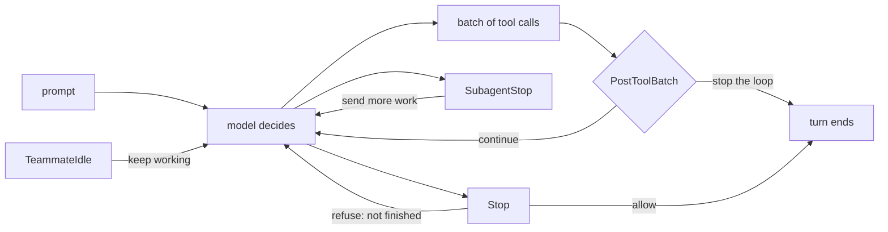
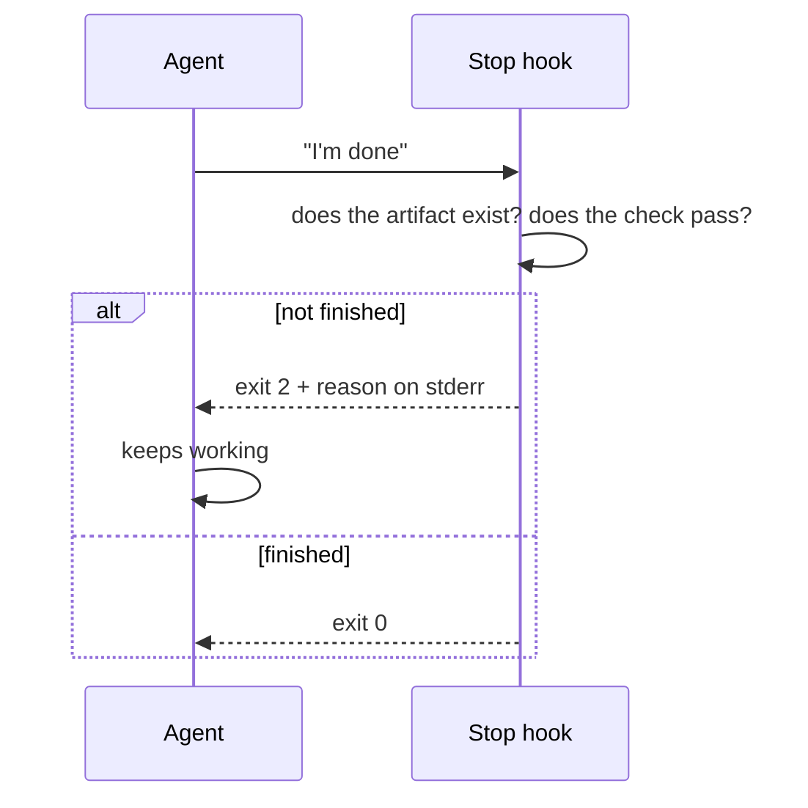

# Hooks-Driven Automation — Events as Control Flow

> The same exit-code contract that fences a tool call can push work back into the
> loop. Point it there and an event handler becomes the thing that decides a step
> is finished.

**Type:** Build
**Prerequisites:** Phase 08 (Lessons 55–60), Lesson 82 (Loops)
**Time:** ~45 minutes

---

## Learning Objectives

- Attach a hook to an event that *pushes the loop forward*, not just one that refuses a tool
- Make "done" a checkable fact with a `Stop` hook instead of a sentence an agent wrote
- Use `SubagentStop`, `PostToolBatch`, and `TeammateIdle` to keep orchestration moving
- Post a message into your own session from a hook or Bash command, using the socket the session exports
- Decide when a handler must be a `command` and when spending a model call is justified

---

## The Problem

A loop was babysitting a release branch, once every twenty minutes. On the fourth
iteration it reported that everything was green and quiet.

CI had been red for twenty minutes.

Nobody lied. The agent ran the check, read a truncated log, and summarised what
it saw. The claim "everything is green" was the agent's sentence, not the check's
output — and a sentence is not a fact you can enforce.

That is the gap this lesson closes, and it is not closed by a better prompt. It is
closed by moving the decision somewhere that produces an exit code.

A hook is the only part of Claude Code that runs *because an event happened*
rather than *because the model chose to*. Phase 08 taught it as a fence: this tool
call is refused, this write is impossible. The same mechanism points the other
way. The loop is a sequence of events — a turn is about to end, a subagent just
stopped, a batch of tool calls just completed, a teammate just went idle — and
your code gets to speak at every one of them.

---

## The Concept

The loop is a machine with seams in it. A hook attaches to a seam.



### The events that push, not just block

Phase 08's event table has a "can block?" column. Read it again with the
orchestration question in mind: *what would blocking here push forward?*

| Event | Blocking means | What it is for |
|---|---|---|
| `Stop` | Refuse to end the turn | The turn is not finished, whatever the model said |
| `SubagentStop` | Send the subagent more work | A worker stopped early; the review says so |
| `PostToolBatch` | Stop the loop before the next model turn | A batch of results changed the plan; stop and look |
| `TeammateIdle` | Keep the teammate working | An agent-team peer went idle with the shared task list unfinished |
| `TaskCreated` / `TaskCompleted` | Refuse creation / reject completion | A task does not meet the bar to exist, or to be called done |
| `SessionStart` | Refuse startup | Load-time policy, not orchestration |
| `PreCompact` | Block the compaction | Rarely right. It is a seam, not a tool |

`WorktreeCreate` and `WorktreeRemove` are not blocking, and they are the other
half of orchestration: they fire on the lifecycle of a worker's checkout, which
is where logging and cleanup belong.

And there is `MessageDisplay`, which carries a message's id, its delta, and
whether it is final. It cannot block. It observes what a session shows.

### "Done" is an event, and you get to define it

The single most useful hook in this phase is a `Stop` hook. The agent says it has
finished; `Stop` fires; your script looks at the world and either allows the turn
to end or refuses with a reason.



That is the release-branch incident fixed. Not "remember to check CI" — a script
that checks, and a turn that cannot end until it agrees.

One guard you must have: `Stop` carries `stop_hook_active`, which tells you a stop
hook has already fired. Without it, a hook that refuses for the wrong reason
refuses forever. Phase 08's exit-2-versus-exit-1 distinction applies here exactly
as it does to a fence — Lesson 58 if you need the reminder.

### Where this meets workflows and loops

Two limits from the last four lessons point at hooks.

**A workflow run takes no input mid-flight.** It pauses only for agent permission
prompts and a usage-limit wait. The seams that *are* available to you are the
agent-lifecycle events: `SubagentStart`, `SubagentStop`, and the task events. A
`SubagentStop` hook is how a stopping subagent gets handed one more sentence of
work inside a run, without editing the script.

**A loop cannot be trusted to report its own state.** Lesson 82's loop fires
between turns and summarises. A `Stop` hook is what converts that summary into a
verifiable claim, and it fires whether the loop was Claude's idea or yours.

### The other exit: post into your own session

Phase 08 taught the return path as exit code plus stdout JSON. There is a second
one, and it is the one that makes hooks a *channel* rather than a decision.

Every session with messaging available binds a socket and exports its path and a
per-session token to hooks and Bash commands as `CLAUDE_CODE_MESSAGING_SOCKET` and
`CLAUDE_CODE_MESSAGING_TOKEN`. A hook or a command can open that socket and post a
line back into its own session:

```sh
#!/bin/sh
# Emit a line into this session's own conversation.
{
  printf '%s\n' "{\"type\":\"auth\",\"token\":\"$CLAUDE_CODE_MESSAGING_TOKEN\"}"
  printf '%s\n' "build finished: 3 failures, see /tmp/build.log"
} > "$CLAUDE_CODE_MESSAGING_SOCKET"
```

One connection carrying both lines, because the auth line has to be the first
line of *its* connection.

This is the same wire Lesson 77 described, addressed to yourself. Two traps carry
over: on native Windows the auth line is **required**, and a connection that has
not sent a complete line within 30 seconds is dropped — so capture slow output
before you open it.

### Cost decides the handler type

Phase 08's five handler types are not interchangeable, and orchestration is where
the bill shows up. A `command` handler is milliseconds. An `agent` handler is a
full subagent: slow, and a model call.

A hook on `Stop` fires once per turn. A hook on `PreToolUse` fires on every tool
call. Put a model call on the second one and you have doubled the cost of your
session to enforce a rule a `grep` could have enforced.

The rule: **`command` until a script has demonstrably failed you.** Then `agent`,
on the narrowest event you can find.

> **The reframe:** a hook is not only a fence around a tool call — the same
> exit-code contract can push work back into the loop, so an event handler is
> where "this step is finished" gets decided instead of described.

---

## Build It

### 1. Turn a claim into a check

Pick a turn that has a checkable finish line. This repo works well: the lesson
body is finished when the validator passes.

Write `.claude/hooks/stop-requires-validator.sh`:

```sh
#!/bin/sh
input=$(cat)
active=$(printf '%s' "$input" | jq -r '.stop_hook_active // false')

# Never refuse twice in a row; that is how a hook traps a session.
[ "$active" = "true" ] && exit 0

if [ -f package.json ] && ! node scripts/validate-lessons.mjs 12-parallelism-ii >/tmp/validate.log 2>&1; then
  head -20 /tmp/validate.log >&2
  exit 2
fi

exit 0
```

Wire it to `Stop` in `.claude/settings.json`, then ask the agent to finish
something it has not actually finished.

✅ You pass when the turn refuses to end, the reason on your screen is the
validator's first lines, and a second attempt can still end normally.

### 2. Prove the guard is load-bearing

Remove the `stop_hook_active` check and repeat. Make the validator fail in a way
the agent cannot fix — a malformed `quiz.json`, say.

✅ You pass when you can describe what happens instead of a clean stop, and you
can say which field would have prevented it.

### 3. Push work to a subagent at the moment it stops

`SubagentStop` fires when a subagent finishes, and blocking there sends it more
work. Use the incident from Phase 06: a subagent that triages a report file. Have
it stop after writing the line, with its `SubagentStop` hook asking a follow-up
question the first pass did not answer.

✅ You pass when the same subagent does more work after its first stop, and you
can point at the field that told your hook it was safe to block.

### 4. Stop the loop between batches

`PostToolBatch` fires after a batch of tool calls, with the calls in
`tool_calls[]`, and blocking there stops the loop before the next model turn.
Write a hook that refuses the batch when a single batch wrote more than twenty
files.

✅ You pass when the loop stops before the next model turn, and you can say which
event you *would* have used if the rule were about one tool rather than a batch.

### 5. Keep a teammate from going idle

If you have agent teams enabled (Phase 11, Lesson 73), this is the orchestration
event with no substitute. `TeammateIdle` carries `teammate_name`; blocking keeps
the teammate working. Give a teammate a task and have the hook check the shared
task list before letting it idle.

✅ You pass when the teammate keeps working with tasks outstanding, and you can
say what the hook reads to decide.

### 6. Post instead of return

Rewrite the hook in step 1 so that, instead of refusing, it *reports* — into the
session's own conversation, over the socket.

✅ You pass when the line appears in your session without a tool call producing
it, and you can say which of the two return paths is a decision and which is a
message.

### 7. Watch the cost

Run `/hooks` and count how many handler groups are attached to tool events versus
turn events. If any tool-event handler uses an `agent` handler, replace it with a
`command` handler and see whether the behaviour survived.

✅ You pass when the rule still holds and you can state, in milliseconds versus
model calls, what you saved per session.

> Event names, which events can block, and the socket's contract are all the kind
> of thing that changes. Verified against
> [the hooks page](https://code.claude.com/docs/en/hooks) and
> [the cross-session messaging page](https://code.claude.com/docs/en/cross-session-messaging)
> on 2026-10-15. Phase 08's table, and this one, both inherit their age from
> `https://code.claude.com/docs/llms.txt`.

---

## Use It

| You want to… | Event | Blocking does |
|---|---|---|
| Refuse to call the work finished | `Stop` | Sends the agent back to work. Guard with `stop_hook_active` |
| Give a subagent one more task | `SubagentStop` | Sends the subagent more work |
| Stop before the next model turn | `PostToolBatch` | Ends the loop at a batch boundary |
| Keep a team peer busy | `TeammateIdle` | Keeps the teammate working |
| Reject a task's completion | `TaskCompleted` | Refuses to accept it as done |
| Log a worker's checkout lifetime | `WorktreeCreate` / `WorktreeRemove` | Not blocking. Cleanup and logging live here |
| Put a line in your own conversation | Socket + token | Not a decision — a message |
| Watch what a session shows | `MessageDisplay` | Not blocking. `displayContent` only |
| Enforce a rule on every tool call | `PreToolUse` | Cheap and frequent. Keep it a `command` handler |

---

## Exercises

1. Take a rule you currently enforce with prose — in a skill, a `CLAUDE.md`, or a
   prompt — and re-express it as a `Stop` hook. Run it for an afternoon.
   ✅ You pass when you can name a case where the prose version passed and the
   hook version refused, and a case where both passed.

2. Write a hook that posts a line into your own session from a background Bash
   command, not from a hook event. Compare it with returning JSON from a hook.
   ✅ You pass when the line arrives both ways and you can say which path the
   model sees as a tool result and which it sees as a message.

3. A hook that fires on `PostToolUse` and classifies each result with an `agent`
   handler costs one model call per tool call. Compute what that does to a
   200-tool-call session.
   ✅ You pass when your number is derived from a run you measured, not from an
   estimate you wrote down.

4. Explain why a `WorktreeCreate` hook cannot stop a worktree from being created,
   and what you would use instead.
   ✅ You pass when your answer names a different event and says what it does
   *before* the worktree exists.

---

## Key Terms

| Term | What people say | What it actually means |
|---|---|---|
| `Stop` | "the end-of-turn hook" | Fires as a turn is ending. Blocking refuses the end and sends the agent back |
| `stop_hook_active` | "a flag" | Whether a stop hook has already fired. You need it, or a bad hook never lets a turn end |
| `SubagentStop` | "the worker's done" | Fires when a subagent stops. Blocking hands it more work |
| `PostToolBatch` | "after the tools" | Fires between batches. Blocking stops the loop before the next model turn |
| `TeammateIdle` | "the peer is waiting" | Fires when a team peer goes idle. Blocking keeps it working |
| handler type | "how the hook runs" | `command` (milliseconds), `agent` (a model call), `http`, `mcp_tool`, `prompt` (legacy) |
| control flow | "an if statement" | The decision about what runs next, moved out of the model and into a script that returns an exit code |
| own-child message | "talking to myself" | A hook or Bash command posting into its own session's socket. Needs the token where process evidence is missing |
| `MessageDisplay` | "the output hook" | Observes what a session shows. Cannot block, and only `displayContent` returns |

---

## What this lesson skipped

**The hook contract itself.** Exit codes, stdin JSON, `hookSpecificOutput` shapes,
matchers, and the `if` field are Phase 08, Lessons 55–60. This lesson builds on
them and does not restate them.

**The full JSON shape for each of these events.** Each event's decision object has
its own fields and its own nesting. Copy from the hooks page for the event you are
writing — Lesson 57 says the same thing for the three you write by hand.

**Channels.** Pushing an event in from outside — CI, chat, monitoring — is an MCP
server with a channel contract, and it is Phase 17. The distinction that matters
here is direction: a hook reacts to something that happened *inside* a session; a
channel injects something from *outside*.

**Guardrails versus instructions as a design stance.** This lesson is about where
a decision lives. Lesson 96 is about what that decision can and cannot buy you,
and which of the two an unattended run depends on.

**Async hooks and timeouts.** A background hook cannot block — the harness stops
waiting — and a timeout on `PreToolUse` normally lets the call through. Both are
Lesson 60, and both are silently wrong the first time you hit them.
