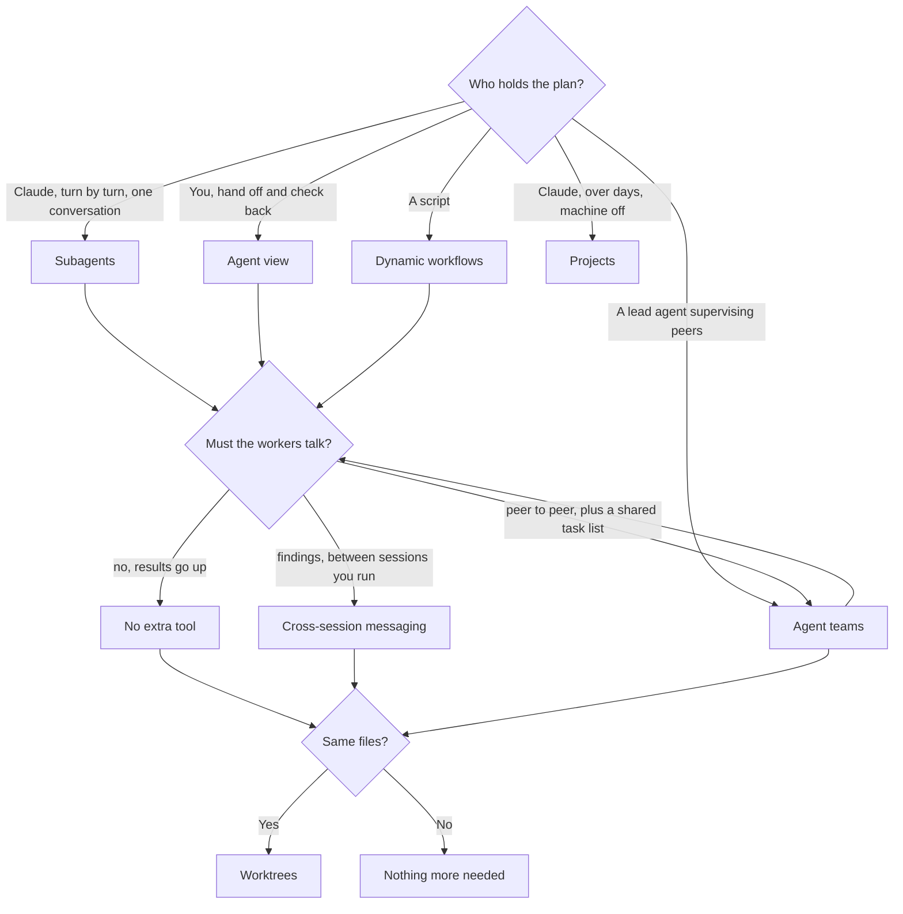

# The Decision Framework — Which Mechanism, When

> The mechanisms are not ranked. They answer different questions, and the first
> question rules out most of the list.

**Type:** Learn
**Prerequisites:** Phase 11 (Lessons 71–76), Lessons 77–83
**Time:** ~40 minutes

---

## Learning Objectives

- Eliminate mechanisms with one question instead of comparing feature lists
- Say which mechanisms cannot isolate workers in worktrees, and what to do instead
- Separate "run agents" from "schedule" and "react", and stop reaching for the wrong family
- Defend a choice by naming what would have to change for a different one to be right

---

## The Problem

This course's own mission statement opens with how the learner got here: they knew
Claude Code had several ways to run agents at once, could not say which one
applied to the task in front of them, and guessed. Guessing cost a restart and a
manual workaround.

Two guesses in particular are worth naming, because they are the two the names
invite.

The first is reaching for **agent teams** because the task sounds like teamwork —
several independent changes, and a word in the feature that matches a word in the
problem. Agent teams are experimental and disabled by default, and they do not
isolate teammates in worktrees, so five teammates editing one repository collide
exactly the way five people would. That is the manual workaround.

The second is reaching for **subagents** because they are the mechanism you
already know, on a task with 400 items. Delegation works; the hundredth summary
does not. The window fills mid-run, compaction arrives, and the plan is now a
summary of the plan.

Neither was a competence failure. Both were a *question* failure. Something like
"who holds the plan here?" would have ruled out one candidate each.

This repo has the same scar at scale: two different renderers were wired into the
same build step, each writing its own half-site into one directory. Two mechanisms
doing one job, and the output looked plausible enough that it took a second look
to notice.

---

## The Concept

There are **five ways to run agents**, three **support tools** that are not
mechanisms, and three **adjacent families** that solve different problems
entirely. Almost every bad choice is a confusion between those three groups.

### Question 1: who holds the plan?

Ask this first, because the answer is one word and it eliminates four options.

| The plan lives in… | Mechanism | What it gives you |
|---|---|---|
| Claude's turn-by-turn judgement, inside one conversation | **Subagents** | A worker that returns a summary. Results land in your window |
| Your judgement, dispatching and checking back | **Agent view** | One screen of background sessions, each with its own state |
| A lead agent's judgement, supervising peers | **Agent teams** | Shared task list and inter-agent messaging, led by one of the agents |
| A script | **Dynamic workflows** | Dozens to hundreds of agents, intermediates in script variables |
| Claude's judgement, across days | **Projects** | Parallel cloud threads that share the project's instructions |

Read the first row against the last two. Subagents and workflows can run the same
job; the difference is *who decides what runs next*. Turn-by-turn judgement is
flexible and does not scale; a script scales and cannot improvise. Nothing here
is better.

### Question 2: must the workers talk?

| Answer | What it means |
|---|---|
| Peer to peer, with a shared task list | **Agent teams.** Teammates message each other directly |
| Findings only, between sessions you run yourself | **Cross-session messaging** (Lesson 77) |
| No — each worker reports *up* | Nothing extra. Subagents already do the only communication you need |
| Only a summary at the end | Nothing extra. A workflow returns one result |

The trap here is wanting "communication" when what you want is a *result*. A
report going up to the conversation that spawned it is not collaboration, and it
does not need a mechanism.

### Question 3: do they touch the same files?

Worktrees are the answer, with one exception that matters.

- A session you run yourself can use a worktree
- A **subagent** can be given one
- A session you dispatch from **agent view** moves into a worktree of its own before it edits files
- **Agent teams do not isolate teammates in worktrees**

That last line is the one to memorise. For a team, isolation is your job: partition
the work so each teammate owns a different set of files. Which is to say — if the
task cannot be partitioned that way, the task is not a good fit for a team.

### Three support tools, not mechanisms

| Tool | What it is | What it is not |
|---|---|---|
| **Worktrees** | A separate checkout per session or worker | A coordination style. It answers *where files land* |
| **Cross-session messaging** | Text between sessions you run | A task assignment system. It carries findings |
| **`/batch`** | A skill that splits one large change into 5–30 worktree-isolated subagents | A mechanism of its own. It is subagents *plus* worktrees, packaged |

### Three adjacent families that are not parallelism at all

| Family | The problem it solves | Lesson |
|---|---|---|
| **Loops** | Run a prompt again later, on an interval | 82 |
| **Hooks** | React to an event, and decide what happens next | 83 |
| **Channels and routines** | Push something in from outside; run without your machine | Phase 17 |

If your question is "when does this run", you are in the loop family. If it is
"what should happen when X does", you are in the hook family. Neither is a way to
split work across workers, and reaching for one to do the other's job is how a
loop becomes a bad scheduler and a hook becomes a bad queue.

### Availability is part of the decision

Two of the five carry a maturity label, and pretending otherwise wastes an
afternoon:

| Mechanism | Status | Consequence |
|---|---|---|
| Subagents | Stable | Nothing to think about |
| Worktrees | Stable | Nothing to think about |
| Dynamic workflows | Paid plans, plus API and the major cloud providers | Check before you plan a session around it |
| Agent view | Research preview | Fine locally; do not build a team process on it yet |
| Agent teams | Experimental, disabled by default | Straightforward to enable, but assume it changes |

> **The reframe:** ask who holds the plan first, because that one answer rules out
> most of the list — and then ask about sharing, because "the workers need to
> talk" and "the workers touch the same files" are different questions with
> different answers.

---

## Build It

### 1. Collect six real tasks

Not hypotheticals. Six things you actually did in the last two weeks that took
more than an hour, or that you abandoned.

✅ You pass when every task has a one-line description of what the *output* was,
not what you did.

### 2. Answer question 1 for each, in one word

Write the holder of the plan next to each task: `Claude`, `me`, `lead`, `script`,
or `nobody`. `nobody` is a real answer, and it often means the task is not ready
to parallelise at all.

✅ You pass when two or more tasks have different answers, and you can say what
in the task decided it.

### 3. Apply questions 2 and 3 only where they apply

If question 1 gave you subagents or a workflow, question 2 is usually "no". Do not
answer it anyway. If it gave you a team, question 3 decides whether the task is
feasible — because a team will not isolate for you.

✅ You pass when at least one task is *rejected* by question 3, and you can say
what you would change about the task to make it pass.

### 4. Name the runner-up

For each of your six choices, write the mechanism you did not pick and one
sentence on what would have to change for it to be correct.

✅ You pass when your runner-up is a *different* answer to question 1, rather than
a different opinion about the same answer.

### 5. Reproduce one wrong guess on purpose

Take a task where you were once wrong. Do it the wrong way, on something small
enough to throw away.

✅ You pass when the failure is observable — colliding edits, a filled window, a
summary where a plan used to be — and you can name the question you did not ask.

### 6. Read the failure out of the artifact

This build step has a real artifact behind it, and it is in this repo. Two
renderers were wired into one build step and each wrote a half-site into the same
directory. Read `scripts/dynamic-workflow.mjs` and find the comment block that
explains the removal.

✅ You pass when you can say which *two mechanisms* were doing one job, and which
question would have caught it.

> The comparison this lesson uses is the docs' own, checked on 2026-10-15 against
> [Run agents in parallel](https://code.claude.com/docs/en/agents) and
> [the workflows page](https://code.claude.com/docs/en/workflows). Maturity labels
> change faster than anything else in this course. Check
> `https://code.claude.com/docs/llms.txt` before you rely on a status.

---

## Use It

| Your situation | Reach for | Because |
|---|---|---|
| A side task would flood your window | Subagents | Results summarise back; the mess stays out |
| Five independent tasks, you want to step away | Agent view | It is built for handing off and checking state |
| A project to split, assign, and keep in sync | Agent teams | Shared task list and peer messaging |
| The same step across hundreds of items | Dynamic workflows | A script holds the plan and the results |
| Work spanning days, machine off | Projects | Cloud threads that share instructions |
| Workers on the same repo, independently | Worktrees | Where the files land |
| One large mechanical change, split wide | `/batch` | Packaged subagents + worktrees |
| One session needs a finding from another | Cross-session messaging | Text between sessions you run |
| Nothing should run until tomorrow | A loop or a routine | Different family — timing, not splitting |
| Something must be impossible | A hook | Different family — enforcement, not splitting |

---

## Exercises

1. Write the three questions on a card and use them on your next three tasks
   before you open a terminal.
   ✅ You pass when at least one decision is different from what you would have
   guessed, and you can say which question changed it.

2. A colleague proposes agent teams for five fixes spread across one repository.
   Write the two-sentence reply.
   ✅ You pass when the reply names the missing isolation and proposes either
   partitioning or a different mechanism — not both vaguely.

3. Take the task from your list with the most items. Answer question 1 twice: once
   as `Claude` and once as `script`. Write what each version would look like.
   ✅ You pass when each version has a concrete failure mode the other does not.

4. Name one task where the correct answer is *none of the five*.
   ✅ You pass when you can say why parallelism loses — and the reason is not "it
   felt like a lot of setup".

---

## Key Terms

| Term | What people say | What it actually means |
|---|---|---|
| the plan | "the approach" | The decision about what runs next. Question 1 asks where it lives |
| subagents | "parallel agents" | Workers in one session, reporting summaries into Claude's window |
| agent view | "the dashboard" | Dispatching and monitoring background sessions you run. Research preview |
| agent teams | "agents that talk" | A lead plus peers with a shared task list and peer messaging. Experimental, off by default |
| dynamic workflow | "the scripting one" | A script the runtime executes. The plan is code, not judgement |
| projects | "the cloud thing" | Parallel cloud threads sharing a project's instructions across days |
| support tool | "also a way to parallelise" | Worktrees, messaging, `/batch`. They answer *where* and *how findings travel* |
| partition | "split the work" | Assign each worker a different set of files, because a team will not isolate for you |
| maturity label | "fine print" | Research preview and experimental are scheduling information, not marketing |

---

## What this lesson skipped

**Whether you should parallelise at all.** This lesson assumes the task divides
and asks *how*. Lesson 85 asks whether it divides, and it is the more valuable
question of the two.

**Cost.** Every one of these multiplies token use. Phase 14 is where you measure
what a run actually spends; the size guideline in Lesson 78 is a crude brake.

**Configuration.** Enabling teams, dispatching from agent view, and the exact
worktree flags are Phase 11 and Phase 16. This lesson is the choice, not the
setup.

**Channels, routines, and the rest of the automation surface.** Named above so
you stop confusing the families. Phase 17 is where they are configured.
