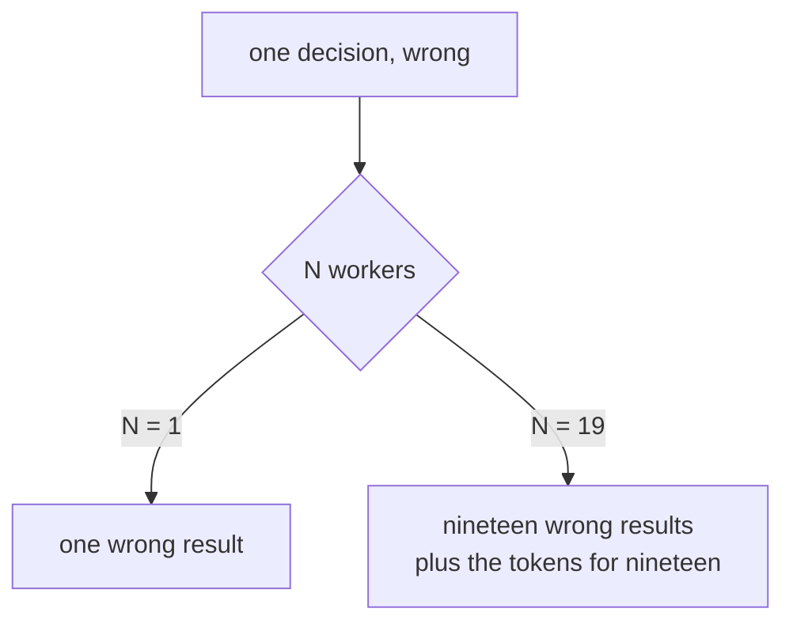

# When NOT to Parallelize

> Parallelise when the work divides at a boundary you can verify on its own.
> Otherwise the merge is the work, and you have just made the work bigger.

**Type:** Learn
**Prerequisites:** Lesson 84 (The Decision Framework)
**Time:** ~35 minutes

---

## Learning Objectives

- Run six tests on a task and reject it, with a reason, before writing any orchestration
- Estimate the coordination cost as a number you can compare to the work
- Name a merge step before the work starts, or say why there isn't one
- Explain why a parallel run multiplies a bug rather than averaging it out

---

## The Problem

Two incidents from this repo, and both are the same mistake in different clothes.

The first: a workflow script grew a `--phases` flag to narrow a run to one phase.
It accepted the flag, filtered a list with it, and then passed every phase to the
authoring step anyway. The flag was decoration. The run fanned out over all
nineteen phases when the user had asked for one.

The cost of that bug was not the bug. It was nineteen times whatever the bug
would have cost sequentially.

The second: three agents were dispatched, each into its own worktree, each asked
for a piece of finished work. All three produced exactly what they were asked for.
None of them ran `git commit`. All three branches pointed at the same commit as
`main`. There was nothing to merge. Perfect work, isolated properly, gone.

And a third, from the same afternoon, which is the one that teaches attribution:
after a parallel authoring run the test suite came back red. The obvious reading
was that the agents had broken something. The actual cause was a wrong glob in
`package.json` — the runner, not the work. Many workers, one red result, and the
evidence pointed the wrong way.

None of these is an argument against parallelism. All three are arguments against
starting it before you have answered a short list of questions.

---

## The Concept

Parallelism is an amplifier. It multiplies throughput **and** it multiplies
whatever the loop was already doing — including its bugs, its ambiguity, and its
unfinished decisions.



So the first question is never "how many workers". It is "is the thing they will
each execute correct?"

### Six tests, in order

Run them in this order. The first two reject most tasks.

**1. Is the single-threaded version correct?**

Run it once, serially, and look at the output. If it is wrong, the parallel run
is wrong N times, faster, and more expensive. This is the `--phases` incident:
the fan-out was fine and the thing it fanned out was not.

**2. Does the work divide at a boundary you can verify on its own?**

Take one piece, in isolation, and ask whether you can say it is right without the
other pieces. If you cannot, you do not have pieces — you have a task you have
sliced into un-checkable fragments, and you will be checking the whole thing at
the end anyway.

This is the real discriminator. It rules out "have five agents each improve this
module" and it permits "have five agents each rewrite one file to a stated
format".

**3. Is anything load-bearing sequential?**

If step B needs step A's output, they are one worker's job. You can still run
*two* independent chains in parallel; you cannot parallelise a chain.

The test is concrete: write down what each worker's input is. If any input is
"the result of another worker", that pair is sequential.

**4. Is there a shared mutable resource?**

Worktrees give each worker its own copy of the **files**. They do not give each
worker its own database, its own deployment target, its own message queue, or its
own row in a table. Two workers writing to one of those collide exactly as two
people would, and a worktree will not help.

Count the shared things before you dispatch: one file, one branch, one service,
one account. Each one is either partitioned or serialised.

**5. Can you attribute a failure to a worker?**

If the aggregate result is wrong, can you say which worker did it? For the
red-suite incident the answer was "no", and the wrong party got the blame. If a
result is a single artifact assembled from N contributions with no per-contribution
evidence, you have traded one slow debug for N fast mismatches.

**6. Is the task bigger than the coordination?**

The coordination cost is real and it is countable:

```
N workers × (setup + briefing + isolation)
+ N commits
+ N−1 merges
+ the review you now owe each piece
+ the re-run when one fails
```

If that number is larger than the task, do it yourself. It often is. A four-line
change does not need five worktrees, and the merge conflict between two workers
who both touched the same helper will take longer than the change.

### The commit rule

If your parallel plan does not end in a commit per worker and a stated merge, it
does not end. **Isolation without a commit is not a backup.** That is the second
incident above, and it is the most expensive failure in this repo's history
because it *looked* finished.

So the merge step is not step seven. It is part of the plan, decided before the
first worker starts:

- Which branch does each worker commit to?
- Who merges, in what order, and what does "merged" mean?
- What if two workers changed the same file?

If you cannot answer the third question, test 4 already failed.

### The honest summary

| Parallelism buys | Parallelism costs |
|---|---|
| Wall clock, when the boundary is clean | Coordination: setup, briefs, isolation, merges |
| Scale, when the step is uniform | Tokens: N times the work, plus each worker's context |
| Independence, when workers cannot collide | Attribution: harder to say who broke what |
| Throughput on I/O-heavy work | Compounding: a wrong instruction, N times |

None of these is a reason to avoid it. They are the reasons it is a *decision*.

> **The reframe:** parallelise when the work divides at a boundary you can verify
> on its own — because if you cannot check a piece by itself, the merge is the
> work, and you have made the work bigger rather than faster.

---

## Build It

### 1. Take a task you were about to parallelise

Pick one you have already thought about — ideally something you were confident
about when you opened this lesson.

✅ You pass when you can write the task in one sentence and name the output in
another.

### 2. Run the six tests and write a verdict per test

Pass, fail, or "not sure". `not sure` is a fail for the purposes of this exercise;
it usually means test 2.

✅ You pass when every test has a written verdict and at least one is not "pass".

### 3. Compute the coordination cost

Fill in the formula above with real numbers: minutes per setup, minutes per merge,
minutes for the review. Then write down what the task would take you alone.

✅ You pass when the two numbers are comparable — same units, same level of
optimism — and you can say which is larger.

### 4. Write the merge step, or write why there isn't one

Branch names, commit rule, merge order, and what happens if two workers touched
one file.

✅ You pass when the third clause has a real answer, and it is not "they won't".

### 5. Reproduce incident one at the smallest scale

Take a decision that is not pinned down — an ambiguous instruction you have not
finished specifying — and fan it out over three workers. Deliberately.

✅ You pass when all three outputs are wrong in *different* ways, and you can say
what the single-threaded run would have told you for a third of the cost.

### 6. Now serialise the same task and measure both

Run it once, yourself, start to finish, and time it. Then run the parallel version
and time that, including the merges and the review.

✅ You pass when you can state the crossover: at what N would the parallel version
have been worth it.

### 7. Find the verification boundary

For a task that failed test 2, try again to find a boundary where each piece is
independently checkable — even if that means the pieces are smaller than you first
imagined.

✅ You pass when you can name a boundary, or explain why none exists for this
task.

### 8. Read the failure mode in this repo's own script

`scripts/lib/workflow-lib.mjs` opens by explaining what the *old* done-check got
wrong: a single `git grep` for one scaffold marker, which was wrong in both
directions. That is a verification boundary problem, written down by someone who
hit it.

✅ You pass when you can state the two directions it was wrong in, and connect
each to a test above.

> Nothing here is version-gated — this is arithmetic and judgement. The repo scars
> are dated in the commit log. If you want the mechanism details behind any test,
> the pages linked in Lessons 77–84 are the sources.

---

## Use It

| You are about to… | Stop if… | Instead |
|---|---|---|
| Fan out a change you have not run once | Test 1 | Run it serially. Look at the output |
| Split a module into five improvements | Test 2 | State each piece's check, or don't split |
| Parallelise a chain | Test 3 | One worker. Or find a second chain to run alongside |
| Have two workers write the same file | Test 4 | Partition by ownership, or serialise |
| Ship an aggregate you can't decompose | Test 5 | Keep per-contribution evidence, or don't split |
| Split a four-line change | Test 6 | Do it yourself |
| Skip the commit in a worktree | The commit rule | Commit. A branch that looks like `main` is not a backup |
| Blame the workers for an aggregate failure | — | Check the runner first. Ours was a wrong glob |

---

## Exercises

1. Write the one-line rejection you would give for each of these: a 40-line bug
   fix across five worktrees; five agents improving one module; three agents
   processing a queue that writes to one table.
   ✅ You pass when each rejection names a *test* rather than a preference, and at
   least one offers the narrower task that would pass.

2. Time a serial run of a task you would normally parallelise. Then parallelise it
   and time the whole thing, merges included.
   ✅ You pass when you have both numbers and a stated N at which the parallel
   version wins.

3. Design a parallel plan for a task where two workers must touch the same file.
   Do not say "they won't".
   ✅ You pass when the plan names the conflict-handling step and says who
   resolves it.

4. A red test suite after a parallel run is evidence of what, exactly? Answer
   before checking.
   ✅ You pass when your answer names the possibility that the runner is at fault,
   not only the workers.

---

## Key Terms

| Term | What people say | What it actually means |
|---|---|---|
| amplifier | "more agents, more work done" | Parallelism multiplies throughput *and* whatever the loop was already doing, bugs included |
| verification boundary | "where I split it" | A place where one piece can be judged correct without the others. If none exists, don't split |
| load-bearing sequential | "it's mostly independent" | B needs A's output, so A and B are one worker's job |
| shared mutable resource | "a conflict" | Anything only one worker can own at a time. Worktrees fix files, not databases |
| coordination cost | "some overhead" | Setup + briefs + isolation + merges + review + re-runs, in the same units as the task |
| merge step | "we'll sort it out" | Branch, commit rule, merge order, conflict handling. Decided before work starts |
| attribution | "which agent broke it" | Whether a failure can be traced to one contribution. If not, more workers make debugging worse |
| isolation without a commit | "it's done" | A worktree whose branch points at `main`. It is not a backup and there is nothing to merge |

---

## What this lesson skipped

**Dependency structure as a formal thing.** "Which steps need which" as a graph,
and the notion of a critical path, is Phase 15. This lesson uses the plain version
of the same idea: if B needs A's output, that pair is sequential.

**Measuring an agent's real cost.** Attribution and cost both get instruments in
Phase 14. Test 5 here is the design question; Phase 14 is the measurement.

**Merge strategy in depth.** Branch naming, ordering, and conflict resolution for
agent branches is Phase 16, Lesson 109.

**Failure propagation across a graph.** What happens when one of N workers dies,
and how the rest of the plan should react, is Phase 15, Lesson 104. This lesson
only insists that you be able to *tell* which one died.

**The case for parallelism.** This is the counterweight lesson, and it is easy to
read as a prohibition. It is not. Every test above has a version that passes, and
when the boundary is clean and the merge is cheap, doing it serially is the
mistake.

**The one scar deliberately left out.** The startup-cache trap — where a session
started before `git init` cannot use worktree tools even though `git rev-parse`
says otherwise — is real, and it is Phase 16, Lesson 108, because it is a bug you
reproduce rather than a judgement you make.
