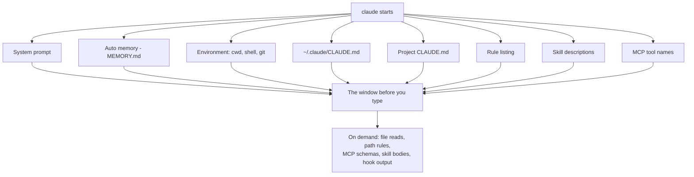

# What Loads, What Costs

> After this lesson you can open `/context` and point at the blocks that loaded
> before you typed a word — and say which one is costing the most.

**Type:** Learn
**Prerequisites:** Lesson 32 (What Loads Into the Window), Lesson 44 (Author a Skill), Lesson 65 (CLAUDE.md)
**Time:** ~30 minutes

---

## Learning Objectives

- Run `/context` and separate the auto-loaded blocks from the on-demand ones
- Name what loads before your first message: system prompt, memory, project
  instructions, the rule listing, skill descriptions, and MCP tool names
- Say which startup blocks you can shrink and which you cannot touch
- Move one always-loaded block to on-demand and watch the startup number change
- Predict, before a task starts, which file reads will dominate the rest of it

---

## The Problem

One more checklist. One more skill. One more MCP server. Each felt free when you
added it.

Six weeks later every session opens slow, and Claude starts ignoring a rule that
sits in the middle of `CLAUDE.md`. Nothing errored. Nothing is broken. Your
window filled up before you typed, and you never saw the bill.

That is the whole trap: the expensive content is the content you stopped
noticing. You watch the tokens you spend on a task. You do not watch the tokens
you spend *before* the task, every time, whether you need them or not.

---

## The Concept

The context window fills in two waves.

The first wave loads before your first message. You do not ask for it, and most
of it you never see.

The second wave loads only when something needs it — a file read, a rule that
matches, a skill you invoke.



### What loads at startup

| Block | What it is | Can you shrink it? |
|---|---|---|
| System prompt | Core instructions and tool definitions. Not yours. | No — it is fixed and you never see it. |
| Auto memory (`MEMORY.md`) | Claude's notes to itself from past sessions. The first 200 lines or 25 KB, whichever comes first. | Yes — keep only what Claude cannot re-derive. |
| Environment block | Working directory, platform, shell, OS, whether this is a git repo. Branch, status, and recent commits load as a separate block. | Barely — moving directory changes it. |
| `~/.claude/CLAUDE.md` | Your global preferences. Applies to every project. | Yes — trim it globally, or move detail into skills. |
| Project `CLAUDE.md` | Project conventions and build commands. Read once at session start. | Yes — this is the file to keep under 200 lines. |
| Rule listing | The names of unscoped rules. Path-scoped rules wait. | Yes — give rules `paths:` so they load on file match, not at startup. |
| Skill descriptions | One line per skill, so Claude knows what exists. Full bodies do not load here. | Yes — fewer skills, shorter descriptions, or `disable-model-invocation: true`. |
| MCP tool names | Names only. Full schemas are deferred and fetched on demand by tool search. | Partly — names are cheap; schemas are not. |

### What loads on demand

| Block | Trigger | Why it is the big one |
|---|---|---|
| File reads | Claude reads a file. | Thousands of tokens each, and the read stays in the window for the rest of the session. |
| Path-scoped rules | Claude reads a file matching the rule's `paths:` pattern. | You only pay for rules in the directories you actually touch. |
| MCP schemas | Tool search decides a tool is needed. | A schema is far larger than the tool's name. |
| Skill bodies | You or Claude invoke the skill. | The whole `SKILL.md`, kept across turns. |
| Hook output | A hook returns `additionalContext`. | Only JSON `additionalContext` enters the window; plain stdout on exit 0 goes to the debug log only. |

The counts `/context` prints are illustrative of *shape*, not of your exact
numbers — they move with your files, your skill count, and your servers. What
does not move is the split: a standing charge you pay every session, and a cost
you pay when you use something.

> **The reframe:** everything at startup is a standing charge you pay every
> session before you type — so the only question worth asking about any of it is
> whether it needs to be there at all, or can load when it is actually used.

Verified against the [context window page](https://code.claude.com/docs/en/context-window)
and the [skills page](https://code.claude.com/docs/en/skills) on 2026-10-15.
Actual token counts, the 200-line / 25 KB auto-memory cap, and the deferred-schema
default all drift with releases; the two-wave shape does not.

---

## Build It

You need one real project where you have actually worked. Do not use a scratch
repo — the point is to see *your* standing charges.

1. Start a session in the project and run `/context`. Copy the block names and
   their token counts into a table.

   ✅ You pass when you can name the largest startup block without scrolling.

2. Find the biggest block you control. It is usually the project `CLAUDE.md`.
   Count its lines:

   ```bash
   wc -l CLAUDE.md
   ```

3. Move one section out of it. Pick by shape, not by size:
   - A procedure — a sequence of steps — becomes a **skill** (Lesson 87).
   - Something true only under one directory becomes a **path-scoped rule**
     with a `paths:` pattern.
   - Something the code already says becomes **nothing** — delete it.

4. Start a fresh session and run `/context` again. The startup number should be
   smaller by roughly the size of what you moved.

5. For one real task you run often, count the file reads it always does. That is
   your per-turn cost, and it is the number that matters more than startup.

---

## Use It

| Command / concept | When you reach for it |
|---|---|
| `/context` | First command in any session where you suspect the window is crowded. |
| `wc -l CLAUDE.md` | Before you decide a memory file is "basically small". |
| `paths:` on a rule | When a rule only matters in one kind of directory. |
| A skill instead of a memory line | When the content is a procedure, not a fact. |
| A subagent for a research read | When a task would read many files you will not reuse (Lesson 72). |
| `/compact` at a task break | When the work is done and the reads behind it are dead weight (Lesson 30). |

---

## Exercises

1. **Inventory your startup.**
   In a project you have used for weeks, run `/context` and write down every
   auto-loaded block with its cost. Mark each one *removable*, *shrinkable*, or
   *fixed*.
   ✅ You pass when your table has at least six rows and exactly one block marked
   *fixed* (the system prompt).

2. **Move a block and measure.**
   Take the largest shrinkable block, relocate it (skill, path rule, or delete),
   restart, and capture `/context` again.
   ✅ You pass when the second capture shows a smaller startup total and you can
   name the block that shrank.

3. **Predict, then verify, the dominant read.**
   Before running a task you know well, write down which file reads you expect
   Claude to make. Run it. Compare.
   ✅ You pass when you correctly named the single most expensive read, or can
   explain precisely which extra read you missed and why the task caused it.

---

## Key Terms

| Term | What people say | What it actually means |
|---|---|---|
| `/context` | "the token counter" | The view of what actually loaded and what it cost — the only honest answer to "why is my window full". |
| startup context | "the preamble" | Everything auto-loaded before your first message. You pay it every session whether you use it or not. |
| deferred MCP schemas | "MCP servers cost a fortune" | The *names* load at startup; full schemas load on demand via tool search. The names are cheap. The schemas are not. |
| skill listing | "the skill" | Only the skill's name and description load at startup. The body loads when the skill is invoked. |
| auto memory | "it remembers everything" | The first 200 lines or 25 KB of `MEMORY.md` load at startup. Past that, it does not. |
| standing charge | "it's just one line" | A cost paid every session. Lines add up across files, skills, and servers faster than anyone expects. |

---

## What this lesson skipped

**The exact sizes.** Model windows, the 200-line / 25 KB memory cap, and
deferred-schema defaults are version-gated and change. Read them from `/context`
on your machine, not from a blog post.

**Compaction mechanics.** What survives when the window fills is Lesson 30.

**Cutting without losing capability.** This lesson is the diagnosis. The
treatment is Lesson 90.

**Cache-aware ordering.** Context is also a cache. What you put first changes
what stays cheap — Lesson 89.
