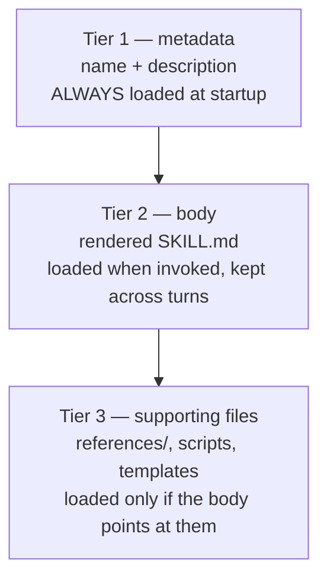

# Progressive Disclosure — Skills as a Loading Strategy

> You can split a wall of reference text into metadata you always pay, a body
> you pay on use, and files you pay only when something asks for them.

**Type:** Learn
**Prerequisites:** Lesson 86 (What Loads, What Costs), Lesson 44 (Author a Skill)
**Time:** ~30 minutes

---

## Learning Objectives

- Name the three tiers a skill loads in, and when each one is paid
- Read a skill's startup cost from `/context` and separate it from its body cost
- Move a long checklist into `references/` and show it does not load until asked
- Use `disable-model-invocation: true` to keep a side-effecting skill at zero
  cost until you invoke it
- Put the rule that must survive compaction at the top of the body, on purpose

---

## The Problem

Your review skill works. It is 600 lines: an intro, a long security checklist, a
house-style guide, and — near the bottom — the three rules that actually catch
bugs.

It fires. It reviews. Everything is in the window, and it stays there for the
rest of the session. Then the conversation compacts to free space, and only the
first 5,000 tokens of the skill come back. The part that returns is your intro.
The three rules that matter are gone, silently, and Claude keeps reviewing
without them.

You wrote a document. You needed a loading strategy.

---

## The Concept

A skill loads in three tiers, and each tier has a different price and a
different time. This is what *progressive disclosure* means: show a little,
load more only when it is needed.



### Tier 1 — metadata, always paid

The skill's `description` (plus `when_to_use`) is the only part that sits in the
window from startup. It is one line, so Claude knows the skill exists. The
combined `description` + `when_to_use` text is truncated at 1,536 characters in
the listing.

There is a switch that removes even this. A skill with `disable-model-invocation: true`
is **not** in the startup listing at all. It costs nothing until you type its
name. Put it on anything with side effects — committing, deploying, sending.

| Frontmatter | You can invoke | Claude can invoke | Loaded at startup |
|---|---|---|---|
| (default) | Yes | Yes | Description only |
| `disable-model-invocation: true` | Yes | Not on its own | Nothing |
| `user-invocable: false` | No | Yes | Description only |

### Tier 2 — the body, paid on use

When the skill is invoked, the rendered body enters the conversation as one
message and stays across later turns. The file is **not re-read** on later turns,
which is why instructions must be written as standing rules, not one-time steps.

After auto-compaction, Claude Code re-attaches the most recent invocation of each
skill, keeping the **first 5,000 tokens** of each, with a **25,000-token** budget
shared across skills and filled most-recent-first. Consequence: an old skill can
be dropped entirely, and within a skill only the top survives.

### Tier 3 — supporting files, paid on demand

Anything else in the folder ships alongside the skill but costs nothing until the
body points at it and something reads it. A 400-line checklist in
`references/security.md` is free until the run that needs it.

```text
.claude/skills/review/
├── SKILL.md              tier 1 + tier 2
└── references/
    ├── security.md       tier 3, free until read
    └── house-style.md    tier 3, free until read
```

> **The reframe:** a skill is a loading strategy you design, not a document you
> write — every line belongs to one of three tiers, and the tier decides when you
> pay for it.

Verified against the [skills page](https://code.claude.com/docs/en/skills) and the
[context window page](https://code.claude.com/docs/en/context-window) on
2026-10-15. The 1,536-character cap, the 5,000-token re-attach, and the
25,000-token budget are version-gated and will move; the three tiers will not.

---

## Build It

Use a skill you already own that has grown past ~150 lines. If you do not have
one, take the longest reference section of your `CLAUDE.md` and make it a skill
first.

1. Run `/context` in a fresh session. Find the **Skill descriptions** block.
   Note its total.

   ✅ You pass when you can name the startup cost of your skill listing.

2. Open the skill. Find its longest block — the checklist or style guide. Create
   a `references/` directory beside `SKILL.md` and move that block into a file
   there.

3. Replace the moved block with one line that says when to read it:

   ```markdown
   For the full security checklist, read `references/security.md`.
   ```

4. Invoke the skill on a task that does *not* need the checklist. Confirm the
   reference file was not read and cost nothing.

   ✅ You pass when you can show both states: a run where `security.md` never
   loaded, and a run where it did.

5. Put the three rules that must catch bugs at the **top** of the body. Move them
   to the bottom, compact the session, and compare what came back.

   ✅ You pass when you can say which position survived and tie it to the
   5,000-token cap rather than to intuition.

6. Add `disable-model-invocation: true` to a skill with side effects. Restart and
   run `/context`.

   ✅ You pass when the skill no longer appears in the startup listing, yet still
   runs when you type its name.

---

## Use It

| Thing | When you reach for it |
|---|---|
| Three tiers | Every time a skill passes ~150 lines |
| `references/` + a pointer line | Long checklists and style guides |
| `disable-model-invocation: true` | Anything that commits, deploys, or sends |
| `user-invocable: false` | Background knowledge Claude should apply, you should not trigger |
| Strongest rule at the top | Any skill you expect to survive compaction |
| `!`command`` dynamic context | A skill that asserts the *current* state of something (`git status`, a branch) |
| A shorter `description` | The listing is a standing charge; every skill's line adds up |

---

## Exercises

1. **Measure a listing.**
   In a project with several skills, capture the Skill descriptions cost from
   `/context`, then add one new skill with a 20-word description. Capture again.
   ✅ You pass when you can state the per-skill startup cost you measured, not
   estimated.

2. **Relocate a checklist.**
   Take a skill over 150 lines and move its longest section to `references/`.
   Keep a one-line pointer.
   ✅ You pass when a run that does not need the section never reads the file, and
   a run that does read it — both observed, not assumed.

3. **Design for compaction.**
   Choose the single rule your skill must never lose. Put it first, then compact
   the session and confirm it came back. Move a second, less important rule below
   the 5,000-token line and observe it drop.
   ✅ You pass when you can point at which rule survived and which was cut, and
   say how many tokens the attached copy held.

---

## Key Terms

| Term | What people say | What it actually means |
|---|---|---|
| progressive disclosure | "lazy loading for prompts" | Metadata always, body on invoke, supporting files on demand. Three tiers, three times. |
| the listing | "the skills" | Only name + description load at startup. The body is not loaded until the skill is used. |
| `disable-model-invocation` | "make it manual" | The skill leaves the startup listing entirely and costs zero until you type its name. |
| `references/` | "extra files" | Shipped with the skill, read only when the body points at them. Free until then. |
| 5,000-token re-attach | "it got truncated" | After compaction, only the first 5,000 tokens of each invoked skill return. Top matters. |
| standing instruction | "a step" | Wording that applies for the whole task. The body is not re-read, so a step reads as done. |

---

## What this lesson skipped

**Skills inside subagents.** `context: fork`, `agent`, and what changes when the
skill runs in its own window — Phase 06, lessons 45–48.

**Enforcement.** If a rule must hold every single time, a skill is a request. A
hook is the enforcement — Phase 08.

**Packaging.** A skill plus hooks plus subagents as one installable unit is a
plugin — Phase 09.

**Listing-budget tuning.** The knobs that cap or hide skill listings
(`skillListingBudgetFraction`, `skillOverrides`, `name-only`) are a settings
topic. Come back when the listing itself is one of your larger blocks.
