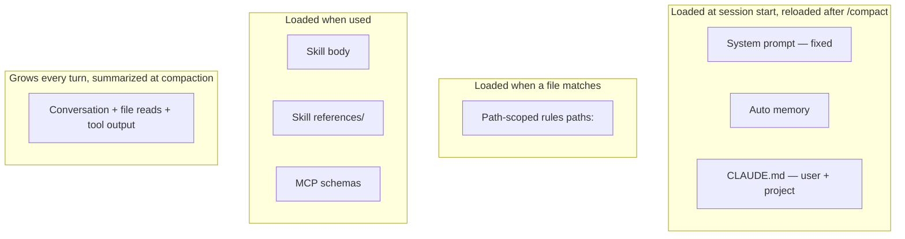

# Context as Architecture, Not a Dump

> You can decide where a fact lives — which layer, loaded when, by whom — instead
> of pasting it into one file and paying for all of it forever.

**Type:** Learn
**Prerequisites:** Lesson 87 (Progressive Disclosure), Lesson 65 (CLAUDE.md), Lesson 67 (Rules)
**Time:** ~35 minutes

---

## Learning Objectives

- Ask four questions of any piece of context: home, lifetime, trigger, eviction
- Sort a bloated `CLAUDE.md` line by line into keep / delete / rule / skill
- Name which layer each fact belongs in, and defend the choice
- Read the reload behavior of each layer after `/compact` and after a restart
- Spot a dump: everything in one layer, in one file, at one priority

---

## The Problem

Your `CLAUDE.md` grew to 900 lines. Someone added the deploy steps. Someone else
added the whole API style guide. A third person pasted the test matrix. All of it
is the same file, the same priority, loaded at the same moment, for every task.

Now Claude follows the wrong third of it at random. A rule that applies only to
`src/api/` fires while it edits a test file in `src/lib/`. You cannot tell which
lines are load-bearing, because nothing about the file says. It is one flat pile
where a design should be.

That is a dump. A dump has no place, no lifetime, and no owner. It just has
volume.

---

## The Concept

Every piece of context has three properties, whether you chose them or not:

- **Home** — which layer it lives in.
- **Lifetime** — when it loads, and when it goes away.
- **Owner** — what loads it: the session start, a file match, an invocation.

A dump gives everything the same three answers: one layer, always, loaded by
nothing in particular. An architecture gives each fact the answers that fit it.



### The four questions

Ask these of any line before you decide where it goes:

1. **Does Claude need this before it acts, or only when it does a specific thing?**
   If only for a specific thing, it belongs behind a trigger, not at startup.
2. **When should it load?** Session start, a matching file, or an invocation.
3. **What loads it?** If nothing loads it, it is a dump line.
4. **What removes it?** `/clear`, `/compact`, a restart, or the end of the
   session. If the answer is "nothing, ever", you are paying for it every turn.

### Where each layer reloads

| Layer | Loaded | After `/compact` | After restart |
|---|---|---|---|
| System prompt | Session start | Reloaded | Reloaded |
| Auto memory | Session start | Reloaded | Reloaded |
| `CLAUDE.md` | Session start | Reloaded from disk | Reloaded from disk |
| Rule listing | Session start | The listing does not re-inject; invoked skills do | Reloaded |
| Path-scoped rule | When a matching file is read | Stays if already read | Not until re-matched |
| Skill description | Session start | Not re-injected | Reloaded |
| Skill body | On invoke | Re-attached, first 5,000 tokens | Not until re-invoked |
| File read | When read | Recent files re-read; older content summarized | Gone |
| MCP tool names | Session start | Reloaded | Reloaded |

The point of the table is not memorization. It is that a fact has a *lifetime*,
and the lifetime decides whether you are paying for it every turn or only on the
turn you use it.

> **The reframe:** context is architecture, not a dump — every fact needs a home,
> a lifetime, and an owner, and if you cannot name all three for a line, it does
> not belong in the window yet.

Verified against the [context window page](https://code.claude.com/docs/en/context-window)
and the [memory page](https://code.claude.com/docs/en/memory) on 2026-10-15.
Compaction details and reload behavior are version-gated; the four questions are
not.

---

## Build It

Take a real `CLAUDE.md` — ideally one that is over 200 lines, or any memory file
you suspect is a dump.

1. Print it with line numbers so you can point at decisions:

   ```bash
   cat -n CLAUDE.md
   ```

2. Make a four-column table and process **every line**: `line`, `decision`,
   `new home`, `why`. The decisions are the only four allowed:

   | Decision | New home | When it loads |
   |---|---|---|
   | Keep | `CLAUDE.md`, under 200 lines | Session start |
   | Rule | `.claude/rules/<name>.md` with `paths:` | When a matching file is read |
   | Skill | `.claude/skills/<name>/SKILL.md` | On invoke |
   | Delete | nowhere | never — it is derivable from the code |

3. Do the sort. Do not skip lines. The uncomfortable ones — the 900-line file's
   deploy steps, its style guide — are the whole exercise.

   ✅ You pass when your table has a row for every line and no row says "keep,
   because it's important".

4. Move one line of each non-Keep kind into its real home. Restart and run
   `/context`.

   ✅ You pass when the startup total drops and you can say which line moved
   where, and why that home and no other.

5. Break it on purpose: put a path-scoped rule where an always-loaded one was and
   confirm it does *not* fire outside its `paths:`.

   ✅ You pass when you can show the rule loading for a matching file and staying
   out of the window for a non-matching one.

---

## Use It

| Situation | Where it belongs |
|---|---|
| "Always run the formatter before you finish." | `CLAUDE.md` — true for every task |
| "Endpoints under `src/api/` return this error shape." | Path-scoped rule with `paths: src/api/**` |
| "How to cut a release: 8 numbered steps." | A skill — a procedure, invoked when needed |
| "The deploy checklist is 200 lines." | A skill plus a `references/` file |
| "Read the spec before changing this module." | A line in `CLAUDE.md`, or a rule, pointing at the spec |
| "The build command is `pnpm build`." | `CLAUDE.md`, one line — or delete it if `package.json` says so |
| "Research how auth works across 12 files." | A subagent — its reads never touch your window |

---

## Exercises

1. **Sort a dump.**
   Take a memory file over 200 lines and produce the `line / decision / new home
   / why` table for all of it.
   ✅ You pass when no row is blank and at least three rows are Delete with a
   stated reason the code already implies them.

2. **Architect one fact end to end.**
   Pick a single fact currently at startup. Move it to a path-scoped rule, a
   skill, or a subagent. Then show it loading in the right situation and absent
   in the wrong one.
   ✅ You pass when you can demonstrate both the load and the non-load from
   `/context` or a transcript.

3. **Defend a home.**
   Ask a peer (or your past self) where one fact should live. If the answer is
   "just put it in `CLAUDE.md`", get all three properties — home, lifetime,
   owner — for that choice.
   ✅ You pass when you can name a fact whose correct home is *not* `CLAUDE.md`
   and say which of the four questions rules it out.

---

## Key Terms

| Term | What people say | What it actually means |
|---|---|---|
| context dump | "a thorough CLAUDE.md" | Everything in one layer, at one priority, loaded always. Volume instead of design. |
| home / lifetime / owner | "where does this go" | The three properties every fact needs. No answer to all three means it is a dump line. |
| path-scoped rule | "a rule" | A rule with `paths:` — it loads when a matching file is read, not at startup. |
| reload behavior | "it comes back" | What a layer does after `/compact` or a restart. Skill descriptions do not re-inject; bodies re-attach capped; reads go stale. |
| derivable | "worth documenting" | Content the code or config already states. Keeping it in the window is a standing charge with no return. |

---

## What this lesson skipped

**Auto memory internals.** How `MEMORY.md` is written and trimmed is Lesson 68.

**Output styles and imports.** Other context layers, in Lessons 69–70.

**Reducing a live context.** The mechanics of cutting a specific window in half
are Lesson 90.

**Harness design.** Designing the layers of a harness rather than a project is
Phase 14.
