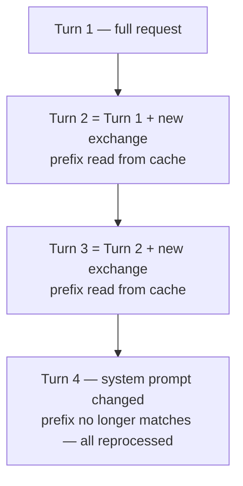

# Prompt Caching as a Design Constraint

> You can name what invalidates the cache and stop paying a full re-read in the
> middle of a task.

**Type:** Learn
**Prerequisites:** Lesson 88 (Context as Architecture), Lesson 22 (Prompt Caching)
**Time:** ~30 minutes

---

## Learning Objectives

- Explain prefix matching: why a change at the front of a request rebuilds
  everything behind it
- Name the actions that invalidate the cache mid-session and the common ones that
  do not
- Order context so what changes rarely sits first and what changes every turn
  sits last
- Read cache reads versus cache writes from `/usage` or a statusline
- Plan a session so model and effort are chosen once, at the top

---

## The Problem

Halfway through a long task, you switch models to save tokens. The next turn is
slow and expensive — slower than the first turn of the session was.

You changed one thing at the very start of the request. The API had processed
your entire history under the old model, and a change at the front means none of
that work is reusable. It reprocessed everything. You meant to spend less and
spent more, and nothing in the UI told you why.

---

## The Concept

The model does not remember anything between turns. Every time you send a
message, Claude Code re-sends the whole context: system prompt, project context,
every prior message and tool result, and your new message. The new part is
appended at the end, so most of each request is identical to the one before it.

Prompt caching is how the API avoids reprocessing that identical part. It caches
by matching the **start** of the request — the *prefix* — against content it
recently processed. On a normal turn, the prefix is the entire previous request
and only the latest exchange is new.

The match is **exact**. There is no per-file or per-region caching. A change
anywhere in the prefix recomputes everything after it.

To get the most out of prefix matching, Claude Code orders each request so
content that rarely changes comes first:

| Layer | Content | Changes when |
|---|---|---|
| System prompt | Core instructions, tool definitions | The set of loaded tool definitions changes |
| Project context | `CLAUDE.md`, auto memory, unscoped rules | Session starts, or after `/clear` or `/compact` |
| Conversation | Your messages, Claude's responses, tool results | Every turn |

The ordering is the design constraint. You do not control the layers' order, but
you control what you put inside them and how stable it is.

### What invalidates the cache

| Action | Why it costs a rebuild |
|---|---|
| Switching models | Each model has its own cache. `/model` re-reads the whole history. |
| Changing effort level | On most models, each effort level has its own cache. |
| Turning on fast mode | Adds a request header that is part of the cache key. |
| `/compact` | Replaces the conversation with a summary — a new, shorter prefix. |
| Connecting/removing an MCP server | If tool schemas are loaded upfront, the tool definitions change. |
| Enabling/disabling a plugin that supplies MCP servers | Same as above. |
| Denying a whole tool | Removes a tool definition when tool search is off. |
| Upgrading Claude Code | Usually changes the system prompt or tools; applies on restart. |

### What keeps the cache

| Action | Why it is safe |
|---|---|
| Editing files in the repo | Reads append to the conversation; history is not rewritten. |
| Editing `CLAUDE.md` mid-session | Keeps the cache — but the edit also does not *apply* until `/clear`, `/compact`, or a restart. |
| Changing permission mode | Does not change system prompt or tools. |
| Invoking a skill or command | Injects as a message at the end. |
| Spawning a subagent | Its request and result append after the parent's prefix. |
| `/rewind` | Truncates back to a prefix that was already cached. |
| `/recap` | Appends a summary; does not replace history. |

The two rows that surprise people: switching models feels free and is not;
editing `CLAUDE.md` feels like it should take effect and does not.

> **The reframe:** caching turns the order of your context into a design
> decision — put what changes rarely first and what changes every turn last,
> because one change at the front rebuilds everything behind it.

Verified against the [prompt caching page](https://code.claude.com/docs/en/prompt-caching)
on 2026-10-15. Which actions are cache-safe, the TTL, and per-model behavior are
version-gated and change with releases; the prefix-match rule is the stable part.

---

## Build It

You need a session with at least a few turns behind it, so there is a prefix
worth caching.

1. Check cache performance. Use `/usage` and look for the **Prompt cache (main)**
   line, or a statusline that reads the `current_usage` object. Two numbers
   matter:

   | Field | Meaning |
   |---|---|
   | `cache_read_input_tokens` | Tokens served from cache this turn |
   | `cache_creation_input_tokens` | Tokens written to the cache this turn |

   ✅ You pass when you can name your session's read-to-creation ratio.

2. Send a trivial follow-up. The read count should be high and the creation count
   low — most of the prefix matched.

3. Now invalidate deliberately: run `/model` and switch. Send the same trivial
   follow-up.

   ✅ You pass when you can point at the turn where reads collapsed and creation
   jumped, and say it was the model switch and not the message.

4. Design around it. Write down the one action in your normal workflow that
   invalidates the cache mid-task — usually a model switch or a stray `/compact`.
   Decide where it moves to: the top of the session, or a task boundary.

   ✅ You pass when you can name the action and the new place it goes.

5. Prove the `CLAUDE.md` surprise: edit a memory file mid-session, ask Claude to
   use the new line, and observe that it does not. Then `/clear` and ask again.

   ✅ You pass when you can show the edit not applying, then applying after a
   reload — and state which one kept the cache.

---

## Use It

| Command / concept | When you reach for it |
|---|---|
| `/model` at the top | Pick the model once, before the long task, not during it. |
| Effort level at the top | Same reason — most models cache per effort. |
| `/compact` at task boundaries | Between tasks, never mid-task. |
| `/rewind` instead of abandoning | To drop a wrong path back to an already-cached prefix. |
| `/usage` → Prompt cache (main) | When a turn felt slower and you want the cause. |
| Statusline `current_usage` | To watch reads versus writes live. |
| Keep `CLAUDE.md` stable | Edits do not apply mid-session; batch them for a reload point. |

---

## Exercises

1. **Catch a rebuild.**
   In a session with real history, record `cache_read` and `cache_creation` on a
   normal turn. Then switch models and record them again.
   ✅ You pass when the second turn shows creation up and reads down, and you can
   explain it in one sentence about prefixes.

2. **Order a workflow.**
   Take a multi-step task you run often. List each step that would change the
   request's front — model switch, effort change, an MCP toggle. Rearrange the
   workflow so every such change happens once, at the start.
   ✅ You pass when no step in the middle of the task changes the front, and you
   can name the one step you moved.

3. **Test the memory-edit myth.**
   Edit `CLAUDE.md` mid-session and try to make Claude follow the new line.
   Then reload and try again.
   ✅ You pass when you can state both facts — the edit kept the cache, and it
   did not take effect until `/clear` or `/compact` or a restart.

---

## Key Terms

| Term | What people say | What it actually means |
|---|---|---|
| prefix | "the cached part" | The start of each request that the API matches. A change anywhere in it recomputes everything after. |
| cache read | "a cache hit" | Tokens served from the cache this turn. Billed cheaper than fresh input. |
| cache creation | "a cache write" | Tokens written to the cache this turn. What goes up when something at the front changed. |
| model switch | "just trying another model" | A full cache miss. The new model has its own cache and reprocesses the whole history. |
| cache-safe edit | "changing CLAUDE.md" | It keeps the cache but does not apply until `/clear`, `/compact`, or a restart. Two separate facts people merge into one. |
| TTL | "how long it lasts" | Cache entries expire after inactivity. Keeping the session warm keeps the cache warm. |

---

## What this lesson skipped

**TTLs and pricing.** Five-minute versus one-hour caches, and the write-rate
increase, are settings and billing topics. See the
[prompt caching page](https://code.claude.com/docs/en/prompt-caching) when you
need to choose one.

**Gateways.** What survives caching through a proxy, a custom base URL, or a
cloud provider depends on how the gateway forwards the cache markers.

**Reducing context without losing capability.** Caching lowers the cost of a
stable prefix; it does not shrink it. That is Lesson 90.
