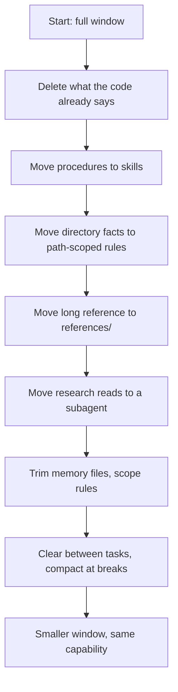

# Reducing Context Without Losing Capability

> You can halve the standing cost of a setup and still do the task the removed
> content was there for.

**Type:** Learn
**Prerequisites:** Lesson 89 (Prompt Caching as a Design Constraint), Lesson 72 (Subagents as Isolation)
**Time:** ~35 minutes

---

## Learning Objectives

- Reduce startup and per-turn cost with levers, not with deletions
- Move a fact to a home that loads it back when it is needed
- Pair every cut with a capability test that would fail if the fact were simply
  gone
- Explain the difference between reducing context and losing capability
- Pick the cheapest lever that preserves the capability

---

## The Problem

You read that a full window causes forgetting. So you delete half of
`CLAUDE.md`.

The window drops. It feels great for a week. Then Claude stops following a rule
you deleted — a rule you had forgotten existed, because the file no longer
reminds you. A release goes out without the check, and you find out from the
incident.

That is not reduction. That is amnesia with better numbers. The size went down
and so did the capability, and you cannot tell the difference until something
breaks.

---

## The Concept

Reduction is relocation, not deletion. Every fact you remove gets a place to load
**from** when it is actually needed. The window stays small because the fact is
not standing there; the capability stays because the fact is still reachable.

The levers, roughly cheapest and safest first:

| Lever | What moves | Loads back when |
|---|---|---|
| Delete derivable content | Details the code/config already states | Never — it is re-derivable |
| Procedure → skill | Step-by-step instructions | The skill is invoked |
| Fact → path-scoped rule | Directory-specific conventions | A matching file is read |
| Reference → `references/` | Long checklists and guides | The skill body points at it |
| Research → subagent | Many-file reads you will not reuse | Its summary returns; reads never touch your window |
| `disable-model-invocation` | Side-effect skills | You type the skill name |
| Defer MCP schemas | Tool definitions | Tool search fetches one on demand |
| `/clear` between tasks | The whole prior conversation | Never — it is a new task |
| `/compact` at a break | Verbatim history | A structured summary returns |

### The capability test

A cut is safe when you can name a task that **fails if the fact is deleted** and
**passes if the fact is relocated**. Without that task, you are guessing.

| You cut | Bad proof | Real proof |
|---|---|---|
| The release checklist moved to a skill | "The window is smaller." | "In a fresh session, run a release; the checklist loads and the check runs." |
| A path rule for `src/api/**` | "It is still in the repo." | "Edit a file in `src/api/`; the rule loads. Edit a file in `src/lib/`; it does not." |
| A research read moved to a subagent | "The read is gone." | "The task completes and only the summary appears in the main window." |

> **The reframe:** the goal is not a smaller context but the same capability at a
> lower standing cost — so every cut must come with a place to load the thing
> back, and a task that proves it still works.

Verified against the [skills page](https://code.claude.com/docs/en/skills),
[memory page](https://code.claude.com/docs/en/memory), and
[context window page](https://code.claude.com/docs/en/context-window) on
2026-10-15. Which levers exist and their exact budgets are version-gated; the
principle — relocate, then prove — is not.

---

## Build It

Use the project from Lesson 88, or any project where `/context` starts above
half the window.

1. Baseline. Run `/context` in a fresh session and record the startup total and
   the total after one representative task.

2. Apply **two** levers, no more:
   - a procedure out of memory into a skill, and
   - one long file read delegated to a subagent.

   Do not delete anything yet.

   ✅ You pass when you can name the two levers and the fact each one moved.

3. Re-`/clear`, run `/context` again, and run the same representative task.
   Record both totals.

   ✅ You pass when the startup total is lower and the task still completes.

4. Write the capability test. Name a task that requires the moved facts and
   would fail if they were deleted. Run it in a fresh session.

   ✅ You pass when the task succeeds using the relocated content, and you have
   the transcript as evidence — not just "it looked fine".

5. Only now consider deleting the derivable lines. For each, state where Claude
   would get the fact instead.

   ✅ You pass when every deletion has a stated re-derivation path and a task
   that still passes without it.

---

## Use It

| Symptom | Lever to reach for |
|---|---|
| `CLAUDE.md` over 200 lines | Move procedures to skills; path-scope directory facts |
| A skill over ~150 lines | Split into `SKILL.md` + `references/` |
| Every session reads the same 12 files | A subagent for that research |
| A side-effect skill in the listing | `disable-model-invocation: true` |
| A huge MCP tool list | Leave schemas deferred (the default) |
| New task, old history | `/clear` |
| Finished a task, starting another | `/compact` at the break |
| The window is full mid-task | Do not `/compact` blindly — see Lesson 89 first |

---

## Exercises

1. **Cut and prove.**
   Pick one fact at startup. Move it to a home that loads it back. Write the
   capability test and run it.
   ✅ You pass when the window is smaller, the test task passes, and the evidence
   shows the fact was loaded on demand rather than deleted.

2. **Distinguish reduction from deletion.**
   Take a fact and produce two versions of the setup: one where it is deleted,
   one where it is relocated. Run the capability test against both.
   ✅ You pass when the deleted version fails the test and the relocated version
   passes — this is the whole lesson in one experiment.

3. **Find the cheapest lever.**
   For a bloated section of memory, list every lever that could handle it and
   pick the one that loads it back latest (cheapest standing cost) without
   breaking the capability test.
   ✅ You pass when you can name a cheaper lever you rejected and why it was
   cheaper but wrong.

---

## Key Terms

| Term | What people say | What it actually means |
|---|---|---|
| reduction | "make it smaller" | Relocating facts to homes that load on demand. Deleting instead is a different, usually wrong, move. |
| relocation | "I moved it" | The fact still loads — just later and only when needed. The evidence is a run where it loaded. |
| capability test | "it still works" | A named task that fails if the fact is gone. The only honest proof a cut was safe. |
| standing cost | "the startup number" | What you pay every session regardless of the task. The target of reduction. |
| on-demand load | "lazy loading" | A skill body, a `references/` file, a path rule, a subagent read — each loads only when triggered. |
| subagent delegation | "run it in a worker" | The reads happen in a separate window; only the summary returns to yours (Lesson 72). |

---

## What this lesson skipped

**The cache cost of your cuts.** Moving content changes the prefix and may
invalidate the cache. Re-read Lesson 89 before a large reshuffle.

**Automating the audit.** `/doctor` and `/doctor prompt-audit` can flag unused
extensions and redundant instructions. Worth revisiting once your manual pass
feels repetitive.

**Harness-level budgeting.** Deciding the cost envelope for an entire harness —
rather than one project — is Phase 14.

**The graded version.** This is the lesson. The module
`practice/13-cut-context-in-half` is where you do it to a real repo and submit
the before/after and the proof.
