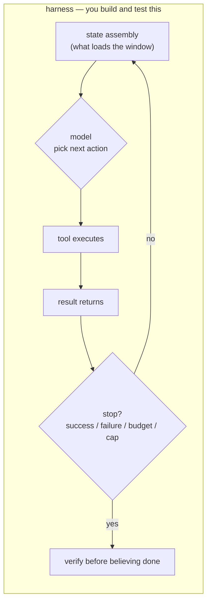

# What a Harness Is

> After this lesson you can point at any agent run and say which parts were the
> model and which parts were the machine around it.

**Type:** Learn
**Prerequisites:** Phase 04, Lesson 31 (The Agentic Loop); Phase 13
**Time:** ~30 minutes

---

## Learning Objectives

- Break an agent run into the parts a model owns and the parts the harness owns
- Name the five responsibilities a harness carries
- Read a real transcript and mark each turn model-owned or harness-owned
- Explain why "the model is bad at this" is usually a harness diagnosis

---

## The Problem

Three parallel agents were told to do work in isolated worktrees and commit when
done. The model did its job — the code was good. But the loop that spawned them
had no check that a commit existed. The agents exited. Their branches still
pointed at `main`. The work was gone.

The model wasn't wrong. The harness around it had no stop condition that said
"a worker with no commit is not finished." Two hours of parallel work lost to a
missing check.

That is the pain. When all you can see is "the agent," you blame the model for
failures that live in the machinery around it.

---

## The Concept

Ground first. From Lesson 31, the **agentic loop** is: the model decides → a
tool executes → the result returns → repeat. Every lesson since has treated that
loop as one thing.

A **harness** is the loop minus the intelligence. It is the code and
configuration around the model that decides:

- **What goes into the context window** before each turn (Lesson 32, and all of Phase 13)
- **Which tools** the model may call (Lesson 33 permissions; Phases 07 and 08)
- **How a tool's result is fed back** into the next turn
- **When the loop stops** — success, failure, budget, or a hard cap
- **What gets verified** before "done" is believed

The model owns exactly one box: *given this state, pick the next action.*
Everything else is harness.

The boundary between the two is testable, and that is the whole trick of this
lesson.

> **The reframe:** The harness is every part of the loop you could test without
> calling a model.

If a behaviour can be checked with a stub in place of the model — "does a
failed tool call retry at most N times?", "does the window drop old turns?" —
it is harness. If the behaviour changes when you swap `sonnet` for `opus`, it
is model. That test tells you where to look when something breaks.

The five responsibilities, as a checklist:

| Responsibility | The question it answers | Where it lives |
|---|---|---|
| State assembly | What does the model see this turn? | the code that builds the prompt |
| Tool exposure | What is the model allowed to do? | tool set + permissions |
| Result handling | How does a tool's output return? | the loop body |
| Stop condition | When does the loop end? | success check, budget, cap |
| Verification | How do we know it's actually done? | a check the worker doesn't own |

---

## Build It

You will annotate a real run and find the missing responsibility.

1. Run a small Claude Code task, or open a recent session transcript. Save it.
2. Make a table with one row per turn.
3. For each turn, label it **MODEL** (the choice of what to do next) or
   **HARNESS** (window assembly, tool dispatch, stop check, error handling).
4. Find the turn where the loop decided to stop. Was that the model's choice or
   a rule you wrote?
5. Circle one of the five responsibilities that has **no implementation** in
   this run — no verification, no cap, nothing. Write down what a missing
   implementation would cost you.

Step 5 is the point. Most runs have four of the five responsibilities and one
hole.

---

## Use It

| Command / concept | When you reach for it |
|---|---|
| The agentic loop (Lesson 31) | When you need to know what happens between your prompt and the result |
| The boundary test | When a run misbehaves and you are about to blame the model |
| State assembly | When the model seems to "forget" — check what actually loaded |
| Stop condition | Before any unattended run: the harness, not the model, ends the loop |
| Verification | Before you trust "done" from anything you didn't watch |

---

## Exercises

1. Classify three behaviours from a recent run as model-owned or harness-owned.
   ✅ You pass when each classification cites either "testable without a model"
   or "changes when the model changes."

2. Open `scripts/dynamic-workflow.mjs`. Name its five harness responsibilities
   and mark which are present and which are absent.
   ✅ You pass when you can point at a file and line for each present one, or
   write "absent" for each missing one.

3. Write the failure the missing responsibility allows, in one sentence.
   ✅ You pass when the sentence names an observable outcome — "work is lost
   because nothing checks the branch" — not a feeling.

---

## Key Terms

| Term | What people say | What it actually means |
|---|---|---|
| harness | "the agent's helper" | everything around the model that assembles state, exposes tools, ends the loop, and verifies |
| model | "the agent" | the component that picks the next action given the current state |
| agentic loop | "the agent thinking" | model decides → tool executes → result returns → repeat |
| stop condition | "when it's done" | the harness rule that ends the loop: success, failure, budget, or cap |
| boundary test | "is this the model's fault?" | if you can test it without a model, it is harness |

---

## What this lesson skipped

How to build each responsibility. Lessons 92–97 fill them in: decisions (92),
decision models in the loop (93), gating (94), verification (95), and
enforcement (96). The specific Claude Code settings for window assembly and
permissions are in Phases 04 and 10. Cost instrumentation is the module.

Version-gated details about Claude Code's own loop live at
https://code.claude.com/docs/llms.txt — check there before quoting behaviour as
permanent.
