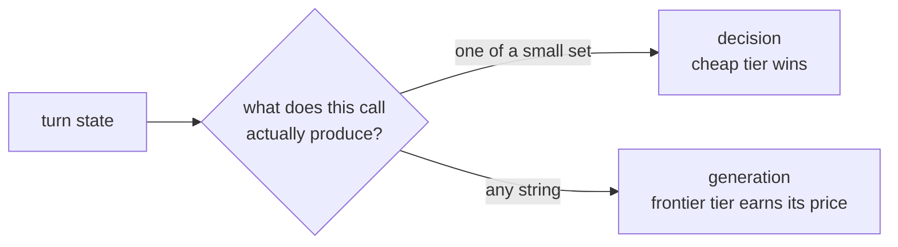

# Most Agent Calls Are Decisions, Not Generation

> After this lesson you can count the calls in your loop that never needed a
> paragraph.

**Type:** Learn
**Prerequisites:** Phase 03, Lesson 25 (Decision Models Beat Generation on Cost); Phase 04, Lesson 31
**Time:** ~30 minutes

---

## Learning Objectives

- Classify each model call in a loop as a **decision** or a **generation**
- Count how many of a real run's calls are decisions
- Name the closed set of options a decision call chooses from
- Estimate what share of spend is decision-shaped

---

## The Problem

A triage workflow sent every input to a frontier model with this prompt: *"Decide
which of these five pipelines this belongs to. Answer with the number only."*

Each call generated one token and stopped. Each call also paid frontier
generation prices to pick a number from 1 to 5. Over a week, 80% of the bill was
those one-token answers. The work that actually changed the data — the
transformation at the end — was the other 20%.

The pain is this: most of a loop's calls are questions with a handful of legal
answers, paid for as if each one needed an essay.

---

## The Concept

Ground first. From Lesson 25, a **decision model** answers a closed question —
pick from a small set, yes/no, a short label — cheaply and fast. A large language
model **generates**: the output can be any string of any length.

Every call in a loop is one or the other. Sort them:

| Call | Kind | Why |
|---|---|---|
| "Summarize this issue" | Generation | Output length and content vary |
| "Which of these 6 tools applies?" | Decision | Output is one of 6 |
| "Classify: bug / feature / question" | Decision | Output is one of 3 |
| "Write the fix" | Generation | Open-ended |
| "Is this test passing? yes/no" | Decision | Output is one of 2 |
| "Extract the version number" | Decision | Output is from a narrow shape |

The test is mechanical. Ask: **can I write the legal answers as a list?**

> **The reframe:** If you can write the legal answers as a list, the call is a
> decision, and generation prices are the wrong meter.

Yes → decision. "Any string" → generation. There is no third category worth
carrying.

A useful consequence: decision counts are usually much higher than generation
counts. A loop generates a handful of times and decides dozens of times. That
ratio is where the money hides.

---

## Build It

1. Pick a real run with at least ten model calls — a workflow from Phase 12, a
   Claude Code session, or the annotated run from Lesson 91.
2. For each call, write the question the model was actually asked and the set of
   legal outputs you would accept.
3. Label it **D** (decision) or **G** (generation).
4. Tally the two counts and, if you have token numbers, the share of cost each
   side represents.
5. Highlight every **D** call that ran on your most expensive model.

Step 5 is the finding. It names the mismatch you can fix.

---

## Use It

| Command / concept | When you reach for it |
|---|---|
| The "list the answers" test | When you're unsure whether a call is a decision |
| Decision vs generation | When you're choosing a model tier for a call |
| Closed set | When you write the prompt for a decision — name the legal outputs |
| Decision share of spend | When you want to know where the bill actually goes |
| The D-on-frontier flag | When you're about to optimize: it is almost always the first fix |

---

## Exercises

1. Take a prompt of your own and reduce it to its legal outputs. If you can't,
   it is a generation call.
   ✅ You pass when you either list the outputs or write "any string — this is
   generation."

2. Re-run your tally and report the decision share as a fraction of calls and,
   separately, as a fraction of cost.
   ✅ You pass when the two fractions are both stated, even if you have to
   estimate tokens.

3. Find one decision call whose answer is a single token and whose model is the
   priciest tier.
   ✅ You pass when you can name the call and the tier, or state that none exists
   in your run.

---

## Key Terms

| Term | What people say | What it actually means |
|---|---|---|
| decision call | "a small model call" | a call whose output is one of a small, known set |
| generation call | "the real work" | a call whose output can be any string of any length |
| closed set | "the options" | the finite list of legal answers a decision may return |
| triage | "sorting the input" | a decision call that routes work to the right path |
| one-token essay | "cheap prompt" | a decision paid for at generation prices because it ran on the wrong tier |

---

## What this lesson skipped

Which decision model to use and how to place it (Lesson 93), how to gate on
confidence (Lesson 94), and the full cost math (the module). Model aliases and
tiers come from Phase 03; teach `sonnet` and `opus`, never hardcoded versions.
Pricing drifts — check current numbers before quoting them.
