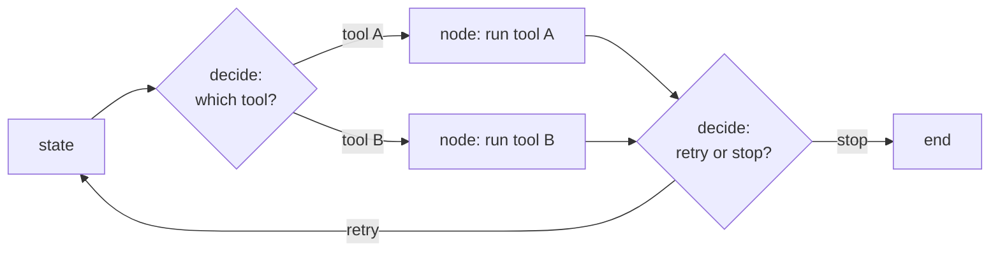

# Decision Models Inside a Loop

> After this lesson you can put the cheap decider exactly where the loop
> branches, and leave the expensive model on the work.

**Type:** Learn
**Prerequisites:** Phase 03, Lesson 25; Lesson 92 (decisions not generation)
**Time:** ~30 minutes

---

## Learning Objectives

- Find the branch points in a loop where a small decision replaces prose
- Insert a decision model at one branch and keep the frontier model on node work
- Constrain a decision model's output to a closed set
- Measure the cost change at that branch

---

## The Problem

A loop routed every turn through the frontier model to answer one question:
*which of six tools should run next?* A six-way pick, answered at frontier
prices, every turn, hundreds of turns per run.

The model was fine. But it was being used as a switchboard — the most expensive
component in the system doing the cheapest job in the system, over and over.

---

## The Concept

Ground first. A loop is a graph. **Nodes** do work — call a tool, generate a
summary, transform data. **Edges** choose the next node. Node work is usually
generation. Edge choice is almost always a decision (Lesson 92).

Two rules follow:

1. **Put the decider on the edge.** The cheap model answers *which*; the frontier
   model does *what*.
2. **Fence the output.** A decision is only useful if it returns a legal answer.
   Name the closed set in the prompt, and reject anything off-list — retry once,
   then fall back to the expensive path. Call that rejection the **fence**.

> **The reframe:** The frontier model is expensive because it *can* say anything;
> a branch only ever needs one of a few things.

The fence is what makes a small model safe at an edge. Without it, a small model
might answer "category 2, maybe 3" and the loop has no edge to follow.

---

## Build It

1. Take the loop you analyzed in Lesson 92. Write down its branch points.
2. For each branch, write the legal outputs as a list.
3. Pick the branch that runs most often — the switchboard.
4. Replace that one call with a decision model, fenced to the list.
5. Log tokens and estimated cost at that branch before and after.
6. Re-run a fixed input and check the loop reaches the same terminal node.
7. If the fence rejects an off-list answer, count how often.

Step 6 is the honesty check: cheaper is worthless if the path changed.

---

## Use It

| Command / concept | When you reach for it |
|---|---|
| Branch point | When you're deciding where to insert a cheap decider |
| Node work vs edge decision | When you split a loop into "what" and "which" |
| Closed set | When you write a decision prompt — list the legal outputs |
| The fence | When a small model must never return something unparseable |
| Terminal-node check | When you verify a cheaper loop still does the same job |

---

## Exercises

1. List every branch point in a loop you own, with its legal outputs.
   ✅ You pass when each branch has a written list, not a description.

2. Swap one branch to a decision model and record the before/after cost at that
   branch.
   ✅ You pass when both numbers are present and the branch's legal outputs are
   unchanged.

3. Fence one decision prompt and force a failure to prove the fence fires.
   ✅ You pass when an off-list answer is rejected and the loop retries or falls
   back instead of crashing.

---

## Key Terms

| Term | What people say | What it actually means |
|---|---|---|
| branch point | "the decision" | a place in the loop where the next node is chosen |
| node work | "the actual task" | the generation step a loop runs once it knows which path to take |
| edge decision | "the routing" | a closed-set choice of which node comes next |
| closed set | "the options" | the finite list of answers a decision model may return |
| the fence | "validation" | the check that rejects an off-list decision and falls back |

---

## What this lesson skipped

How to serve a decision model (Phase 03, and hosting is out of scope), how to
gate on confidence when the decision is uncertain (Lesson 94), and how to verify
the node's output (Lesson 95). Cost instrumentation is the module.
