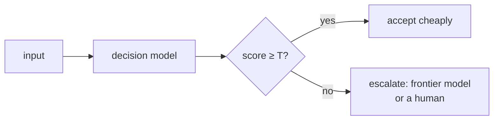

# Confidence Gating — Escalate Only When Unsure

> After this lesson you can route the easy calls to a cheap path and the hard
> ones to a strong path, using a threshold you have actually checked.

**Type:** Learn
**Prerequisites:** Lesson 93 (decision models in a loop); Phase 03, Lesson 25
**Time:** ~30 minutes

---

## Learning Objectives

- Explain why a model's self-reported confidence is not trustworthy on its own
- Build a threshold that routes low-confidence decisions to a stronger path
- Calibrate that threshold against known answers
- Name the cost of a wrong gate in both directions

---

## The Problem

A routed decision model was told to also output a confidence score from 0 to
100. It output 95 for nearly everything — including the cases it got wrong. The
gate that was supposed to escalate the hard 10% never fired. Errors shipped
silently.

The score was a mood, not a measurement. Nobody had checked it against outcomes,
so the threshold was a number with no meaning.

---

## The Concept

A **confidence gate** is a rule with three parts:

1. Make the decision.
2. Produce a score.
3. If the score is below a threshold `T`, escalate to a stronger path; else
   accept.

The catch is step 2. A raw self-score from a model is **uncalibrated** — the
number doesn't correspond to a real chance of being right. Calibration is the
work of checking scores against ground truth: bucket the inputs by score, then
measure accuracy in each bucket. A threshold is only meaningful once you have
seen that curve.

> **The reframe:** A confidence score is worthless until you have checked it
> against outcomes — gate on the mistake you can afford, not on the model's mood.

Two ways a gate can be wrong, and they are not symmetric:

| Error | What happens | Cost |
|---|---|---|
| False accept | a wrong decision passes the gate | an error ships and nothing catches it |
| False escalate | a right decision still escalates | you paid the strong path for nothing |

Which one you can afford depends on the task. A payments loop biases toward
escalating; a summary generator might accept the cheap path more often.

---

## Build It

1. Build a labelled set: at least twenty inputs with the correct decision known.
2. Run the decision model on each one. Record its answer and its score.
3. Bucket by score (for example 0–50, 51–80, 81–100) and compute accuracy per
   bucket.
4. Pick `T` so that everything above it is accurate enough for your use case.
5. Route scores below `T` to the stronger path.
6. Re-measure on a **held-out** slice you did not use to pick `T`.

Step 6 catches the mistake of tuning the threshold to the examples you stared at.

---

## Use It

| Command / concept | When you reach for it |
|---|---|
| Confidence gate | When cheap decisions are usually right but sometimes wrong |
| Calibration | Before you trust any score — check it against known answers |
| Threshold `T` | When you set the line between accept and escalate |
| Held-out slice | When you want to know whether `T` generalizes |
| False accept vs false escalate | When you decide which error to bias against |

---

## Exercises

1. Bucket a scored run by score and report accuracy per bucket.
   ✅ You pass when the table shows a rising accuracy trend, or you explain why
   it doesn't rise (in which case the score is unusable as-is).

2. Choose a threshold and justify it in one sentence by naming the error you are
   biasing against.
   ✅ You pass when the sentence names either false accept or false escalate.

3. Re-measure on inputs you did not use to choose `T`.
   ✅ You pass when you report the held-out accuracy and it is within a stated
   margin of the tuned number, or you say honestly that it dropped.

---

## Key Terms

| Term | What people say | What it actually means |
|---|---|---|
| confidence gate | "the filter" | a rule that escalates decisions whose score is below a threshold |
| calibration | "the score is accurate" | evidence that score buckets line up with real accuracy |
| false accept | "it slipped through" | a wrong decision that passed the gate and shipped |
| false escalate | "it was too cautious" | a right decision that was sent up the strong path anyway |
| held-out slice | "a second test" | inputs kept back so a threshold isn't overfit to the tuning set |

---

## What this lesson skipped

Production-grade calibration math (things like Platt scaling) — look it up when
you need routing that is statistically defensible, and come back after the
module. Also skipped: how to verify the escalated answer (Lesson 95) and how to
enforce a hard rule when the gate itself must never be wrong (Lesson 96).
