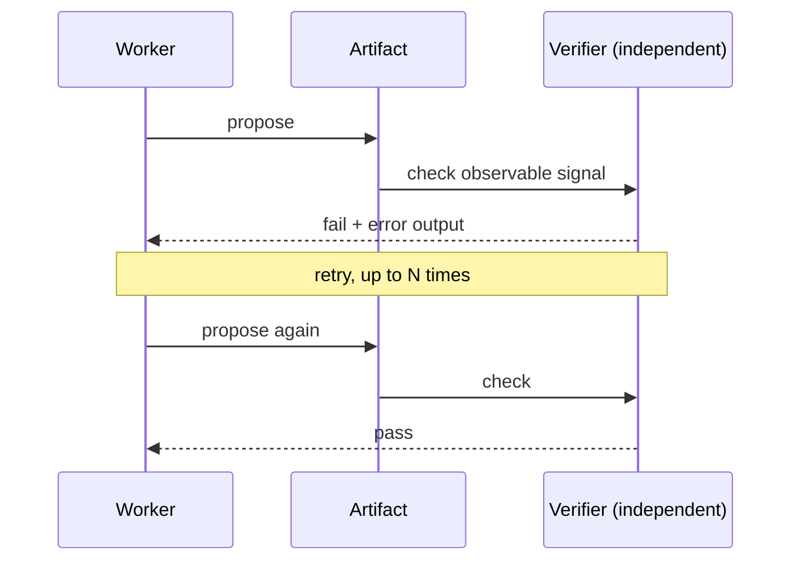

# Verification Loops — the Prerequisite for Unattended Runs

> After this lesson you can make a loop check its own work with something the
> worker does not control.

**Type:** Learn
**Prerequisites:** Phase 12, Lesson 80 (the completion-order gotcha); Phase 11, Lesson 72 (isolation); Phase 08
**Time:** ~30 minutes

---

## Learning Objectives

- Separate **propose** from **verify** with an independent check
- Verify an observable signal, not the proposal's own claim
- Bound the loop with a retry cap and a budget
- Explain why a verifier sharing the worker's context is not independent

---

## The Problem

A workflow's workers reported "done," and the loop believed them. The test suite
was red — the cause was a wrong glob in `package.json`, not the work. Nothing had
checked. The loop passed a broken build to the next stage and printed success.

The agents hadn't lied on purpose. "Done" was their opinion, and no one had
checked the opinion. The same trap appears with parallel work: three workers
finish at different times, and a naive loop treats the first result to arrive as
the answer — the **completion-order trap** from Lesson 80.

---

## The Concept

A **verification loop** has three parts:

1. A worker **proposes** an artifact.
2. An independent verifier runs an observable check.
3. On failure, feed the failure back and retry — up to a cap.

Two requirements make this real:

- **Independence.** The verifier runs in a different context than the worker
  (isolation, Lesson 72). If it shares the worker's window, it inherits the
  worker's belief that it already succeeded and rubber-stamps the result.
- **An observable signal.** The verifier checks something outside the worker's
  control: a test command's exit code, a schema, a diff against expected output.
  "The output says Success" is not evidence — the worker wrote that string.

> **The reframe:** If the thing that did the work also decides it is done, you
> have a proposal, not a result.

And a loop needs a floor: a **retry cap** and a **budget**. An unbounded verify
loop re-runs forever, burning the window and the wallet (the runtime caps from
Lesson 81 apply here).

---

## Build It

1. Pick a task that produces an artifact — a file, a build, a diagram.
2. Write the check as a **command that exits nonzero on failure**.
3. Wrap it: propose → run the check → on failure, feed the error output back →
   retry, maximum `N` times.
4. Log each attempt with its pass/fail and the error output.
5. Force one failure on purpose and confirm the loop retries and then stops at
   the cap instead of running forever.

Step 5 proves both halves: it retries, and it stops.

---

## Use It

| Command / concept | When you reach for it |
|---|---|
| Propose / verify | When a worker must not grade its own work |
| Verifier independence | When a check keeps passing things it shouldn't |
| Observable signal | When you turn "looks right" into a command that exits 0 or 1 |
| Retry cap | Before any unattended run — the loop must be able to give up |
| Completion-order trap | When parallel results arrive out of order (Lesson 80) |

---

## Exercises

1. Turn a fuzzy "is it correct?" into a command that exits nonzero on failure.
   ✅ You pass when the command can be run with no human and produces a clear
   exit code.

2. Add a verifier in a separate context from the worker and log each attempt.
   ✅ You pass when the log shows at least one failure followed by a retry, or
   you explain why every attempt passed.

3. Set a retry cap and show the loop stopping at it.
   ✅ You pass when a deliberately broken input ends with the loop reporting
   "gave up after N" rather than running forever.

---

## Key Terms

| Term | What people say | What it actually means |
|---|---|---|
| propose / verify | "the agent checks itself" | two roles: one produces, an independent one checks |
| verifier independence | "a second opinion" | the checker runs in its own context so it can't inherit the worker's assumptions |
| observable signal | "the test passed" | a check outside the worker's control: exit code, schema, diff |
| retry cap | "it keeps trying" | the maximum attempts before the loop gives up |
| completion-order trap | "first one wins" | mistaking arrival order for correctness when results are parallel (Lesson 80) |

---

## What this lesson skipped

Verifying fuzzy artifacts — prose, designs, "is this a good answer" — is only
partly solved and needs human or model grading; come back to this after the
module. The specific hook events that can run a check automatically are Phase 08.
Sandboxing the verifier is Phase 17.
