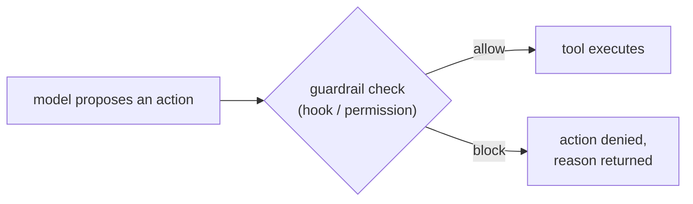

# Guardrails vs Instructions — Requests vs Enforcement

> After this lesson you can tell a request from a wall, and convert the rules
> that must never break into walls.

**Type:** Learn
**Prerequisites:** Phase 08, Lesson 55 (what a hook is) and 58 (exit-1-vs-2); Phase 04, Lesson 33 (permissions)
**Time:** ~30 minutes

---

## Learning Objectives

- Tell a **request** (context) from an **enforcement** (mechanism)
- Convert a must-never rule into a hook or a permission rule
- Explain why instructions can be overridden and guardrails cannot
- Place each guardrail where it actually fires

---

## The Problem

This repo's own brief says: one agent, one branch; never force-push; commit
before you exit. An agent that had read the file still force-pushed. The prose
was in its context window — it just weighed the instruction against a task that
said "clean up the branch" and lost.

The instruction had no wall behind it. The mechanism that would have blocked the
command — a hook — was never installed.

---

## The Concept

There are two layers, and they are not the same kind of thing.

**Instructions** are natural-language text in the context window: `CLAUDE.md`,
`AGENTS.md`, the system prompt, the task. They *steer* the model. They are cheap,
flexible, and carry no guarantee. The model may comply, and under a competing
instruction it may not.

**Guardrails** are mechanisms outside the model: a hook (Lesson 55), a permission
rule (Lesson 33), a sandbox, a git protection. The model can still *propose* the
action, but the mechanism decides whether it runs.

A hook's exit code carries the veto: from Lesson 58, one code blocks the call and
returns the reason, another only reports an error without blocking. That
distinction is what makes a hook a wall rather than a complaint.

> **The reframe:** You cannot instruct a wall into existence — enforcement is a
> mechanism the model cannot talk its way through.

The practical consequence: keep both. The instruction keeps the model from even
proposing the action, which is cheaper and clearer. The guardrail is the
guarantee for the day the instruction loses.

Which rules become walls? The ones where the cost of a single failure is
unacceptable: force-push, writing to `main`, deleting without a commit, sending
to production.

---

## Build It

1. List the "never" rules you currently rely on.
2. For each, ask: *if the model ignored this, what would stop it?* If the answer
   is "nothing," it is a request.
3. Pick the most dangerous one and convert it into enforcement — a `PreToolUse`
   hook that matches the command and exits with the blocking code from Lesson 58,
   or a permission deny rule.
4. Test it: ask the agent to do the forbidden thing. The guardrail must fire and
   the action must not happen.
5. Keep the instruction as well, and note in writing that the hook, not the
   sentence, is the guarantee.

Step 4 is the only proof that matters.

---

## Use It

| Command / concept | When you reach for it |
|---|---|
| Instruction / request | When you want to steer behaviour cheaply |
| Guardrail / enforcement | When a single failure is unacceptable |
| `PreToolUse` hook | When a specific action must be blocked before it runs |
| Permission deny rule | When a whole tool or path should never be reachable |
| Exit-code veto (Lesson 58) | When you need the hook to actually stop the call, not just warn |

---

## Exercises

1. Classify five of your rules as request or enforcement, with a reason.
   ✅ You pass when each rule is labelled and the enforcement ones name the
   mechanism that fires.

2. Convert one request into a guardrail and prove it blocks.
   ✅ You pass when the forbidden action is attempted and does not happen.

3. State, in one sentence each, what the instruction adds that the guardrail does
   not.
   ✅ You pass when the sentence names steering (the model avoids proposing the
   action) rather than enforcement.

---

## Key Terms

| Term | What people say | What it actually means |
|---|---|---|
| instruction | "a rule the agent follows" | natural-language text in the window that the model may or may not obey |
| guardrail | "a rule the agent follows" | a mechanism outside the model that allows or blocks the action |
| hook | "a script that watches the agent" | code that runs on a loop event and can veto a tool call (Phase 08) |
| deny rule | "a permission setting" | configuration that makes a tool or path unreachable |
| exit-code veto | "the hook returns an error" | the specific exit code that blocks the call rather than only reporting one (Lesson 58) |

---

## What this lesson skipped

The full hook event list is Phase 08, Lesson 56. Permission modes are Phase 04,
Lesson 33. Sandboxing is Phase 17, Lesson 114. Hook behaviour and exact exit-code
semantics are version-gated — verify them against
https://code.claude.com/docs/llms.txt and date any claim you repeat.
