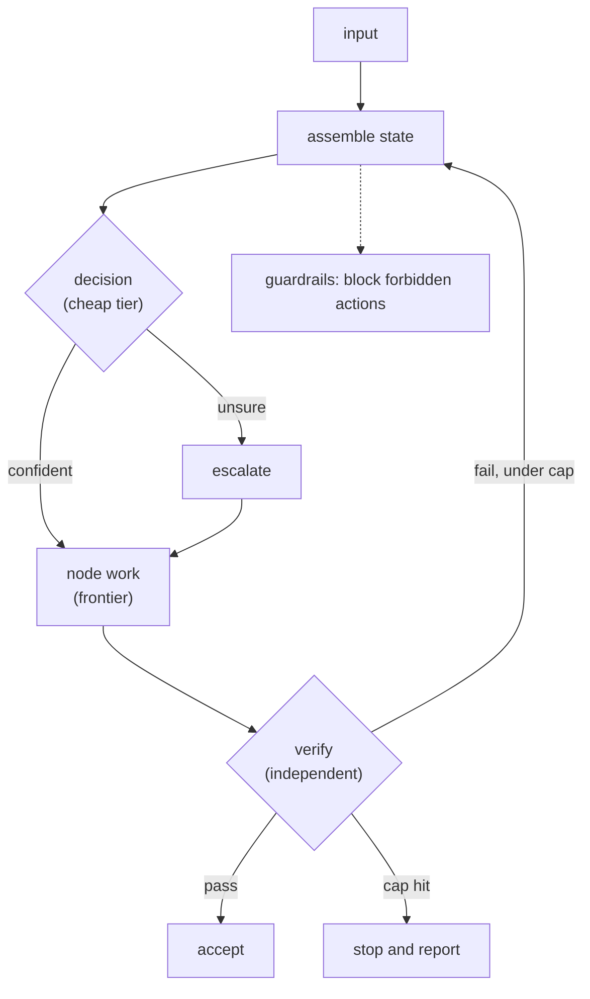

# Design Your Own Harness — and Defend the Trade-offs

> After this lesson you can assemble the loop on purpose — deciding where each
> check lives and stating why.

**Type:** Build
**Prerequisites:** Lessons 91–96
**Time:** ~45 minutes

---

## Learning Objectives

- Assemble the five harness responsibilities into a loop that runs with a stub model
- Choose where decisions, gates, verification, and caps live
- State the trade-off behind each choice
- Hand your spec to another person and have them predict the loop's behaviour

---

## The Problem

A loop nobody designed. A retry grew here, an escalation appeared there with no
threshold, verification was done by the worker. Nobody could say what it would do
on a bad input. The failure wasn't any single bug — it was that no one had made
the choices on purpose.

An accidental harness is one you can't reason about, can't test, and can't
improve. This lesson makes the choices explicit.

---

## The Concept

A harness is a set of decisions about where to spend intelligence and where to
put walls. Collect them into one checklist:

| # | Choice | The question |
|---|---|---|
| 1 | Goal + stop condition | When is the loop done, and what ends it if it isn't? |
| 2 | Branch points | Where does the loop choose the next node? |
| 3 | Decisions vs generation | Which calls have closed sets, and which generate? |
| 4 | Confidence gate | Where do uncertain decisions escalate, and at what threshold? |
| 5 | Verifier | What independent signal proves done? |
| 6 | Caps | What is the retry cap and the budget? |
| 7 | Enforcement | What must never happen, and what mechanism blocks it? |
| 8 | Isolation | Which parts run in their own context? |



> **The reframe:** A harness is a set of choices about where to spend
> intelligence — every choice is a trade-off you should be able to name.

A trade-off isn't a benefit. It names the cost you accepted and the alternative
you rejected. "Used a cheap decider so the switchboard is cheap; accepted that a
misroute is possible and covered it with a verifier." That sentence is the
design.

---

## Build It

The skeleton below is the loop minus the intelligence. Every part is testable
with a stub model — which is the point laid down in Lesson 91. Save it as
`harness.mjs` and run it.

```js
// harness.mjs — the loop minus the intelligence.
// Every part is testable with a stub model. Swap decide() for a real call.

const MAX_TURNS = 6;      // stop condition: hard cap
const MAX_ATTEMPTS = 3;   // stop condition: retry cap

const state = { turn: 0, attempts: 0, passed: false };
const trace = [];

// 1. The model. Stub now; replace with a decision call fenced to {work, stop}.
function decide(state) {
  return state.passed ? 'stop' : 'work';
}

// 2. Node work. Pure, so the harness is testable without a model.
function work(state) {
  state.attempts += 1;
  return { ok: state.attempts >= 2 };   // only the second attempt is good
}

// 3. Verifier. An observable signal the worker does not control.
function verify(artifact) {
  return artifact.ok === true;
}

// 4. The loop.
while (state.turn < MAX_TURNS) {
  state.turn += 1;
  const action = decide(state);
  trace.push(`turn ${state.turn}: decide → ${action}`);
  if (action === 'stop') break;

  const artifact = work(state);
  const ok = verify(artifact);
  trace.push(`turn ${state.turn}: verify → ${ok ? 'pass' : 'fail'}`);
  if (ok) { state.passed = true; break; }

  if (state.attempts >= MAX_ATTEMPTS) {
    trace.push(`stop: gave up after ${state.attempts} attempts`);
    break;
  }
}

console.log(trace.join('\n'));
console.log(`result: ${state.passed ? 'verified' : 'not verified'}`);
```

Then:

1. Run it with `node harness.mjs`. Read the trace: propose, verify, retry, pass.
2. Change `work` to always return `{ ok: false }` and run again. The loop must hit
   the retry cap and stop — never spin forever.
3. Replace the stub `decide()` with one real decision call, fenced to its closed
   set (Lesson 93).
4. Add one piece the skeleton lacks — a confidence gate, or a guardrail — and note
   what changed.
5. Write a one-page design doc: the eight checklist rows, your choice for each,
   and the trade-off in one sentence.

Step 5 is the artifact. The code proves the choices are real.

---

## Use It

| Command / concept | When you reach for it |
|---|---|
| Harness spec | Before you build a loop, so the choices are made on purpose |
| Stub model | When you want to test the machinery without paying for a model |
| Trade-off statement | When you defend a design decision to someone else |
| Retry cap | When a loop could otherwise run forever |
| Escalation path | When a cheap decision might be wrong and you need a court of appeal |

---

## Exercises

1. Run the skeleton and paste its trace.
   ✅ You pass when the trace shows a failed verification followed by a passing
   retry.

2. Force the cap and show the loop stopping.
   ✅ You pass when the trace ends with "gave up after N attempts" and the
   program exits.

3. Write the one-page design doc with all eight rows and a trade-off each.
   ✅ You pass when every row has a stated cost and a rejected alternative, not
   just a benefit.

4. Have someone read only the spec and predict the loop's behaviour on a bad
   input.
   ✅ You pass when their prediction matches what the code actually does.

---

## Key Terms

| Term | What people say | What it actually means |
|---|---|---|
| harness spec | "the architecture doc" | the eight deliberate choices, each with its trade-off |
| stub model | "a fake model" | a stand-in that lets you test the harness without an API call |
| trade-off | "the reason we chose it" | the cost you accepted plus the alternative you rejected |
| budget | "the cost limit" | the spend ceiling the harness enforces before it stops |
| escalation path | "the fallback" | where an unsure decision goes when the cheap path won't do |

---

## What this lesson skipped

Hosting and scaling the harness (Phase 17), graph-level design across many
loops (Phase 15), and the measurement module that follows this lesson
(`practice/14-find-the-expensive-20-percent`), where you instrument a real loop
and find the expensive 20% of calls.
