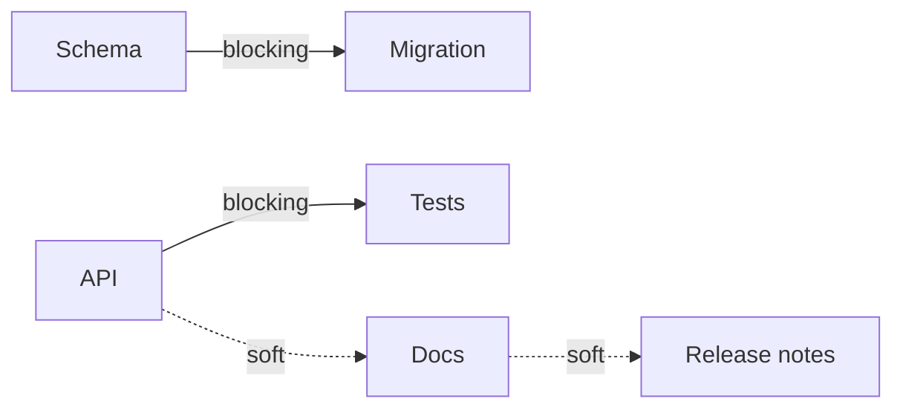
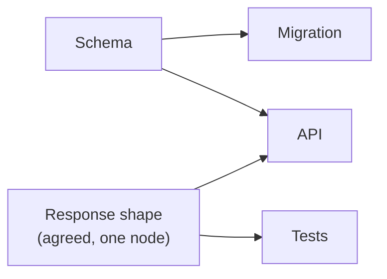

# Blocking Edges — What's Actually Parallelizable

> You can tell a hard dependency from a preference, and turn the hard ones into
> interfaces — which is the only way to buy real parallelism.

**Type:** Learn
**Prerequisites:** Lesson 99 (Task Graphs); Phase 12, Lesson 85 (When NOT to Parallelize)
**Time:** ~35 minutes

---

## Learning Objectives

- Sort every edge in a graph into blocking or soft
- Say why only blocking edges constrain what can run at once
- Convert a blocking edge into a soft one by naming an interface
- Say when *not* to convert — when the reconciliation costs more than the wait

---

## The Problem

A plan had eight agents and seven arrows between their tasks. The runner treated
every arrow as a hard wait. So eight agents ran, one at a time, four minutes each.

Six of the seven arrows meant "I would prefer this order." The frontend section
"should" land before the docs, said the plan. Nobody had a reason. The runner did
not ask; an arrow was an arrow. A job that could have finished in two waves took
eight sequential steps, and the parallelism the team paid eight agents for never
happened.

The opposite failure is worse. In the five-job feature from Lesson 98, one arrow
*was* real: the tests needed the schema. Marked soft, ignored, and the tests were
written against a schema that did not exist. The collision was cheap to prevent
and expensive to unwind.

Both failures come from the same gap: an edge is drawn as one thing but means two.

---

## The Concept

An edge is a claim that one node needs another. But "needs" hides a decision, and
it has two answers.

A **blocking edge** is a real dependency. B's correct output cannot exist until
A's output exists. The migration needs the schema, because the migration edits
the schema, so it literally cannot run before it. Marked blocking, B waits.

A **soft edge** is a preference. A first is nicer — tidier, more legible, lower
rework — but B *can* start without A. The docs "should" follow the API, but a
docs writer can begin against the agreed response shape. Marked soft, B runs when
it is ready.

Only **blocking** edges constrain the frontier. Soft edges reshape the graph's
*readability* and change the order you'd *prefer*, but they do not add waves. If
you mark every edge blocking, you have paid for eight agents and received one.
If you mark none, you get the tests-in-the-void collision.

### The move that buys parallelism: name an interface

The interesting part is that a blocking edge is not fixed. The reason B cannot
start is that A's output does not exist yet. So create a *stand-in* for that
output — an interface: a schema, a function signature, a response shape, a stub —
agree it, and now both sides can be built against it, in parallel.

The team spent one small node defining the interface. Before: API, then tests,
two waves. After: API and tests in the same wave. That single node bought a wave.

This is sometimes called **interface-first**: build the contract before either
implementation, so neither waits on the other. It is the same idea as the cycle
fix in Lesson 98 — a shared interface removes the dependency, it does not just
relabel it.

### When not to convert

An interface is a bet. You are agreeing a shape that neither side has validated,
and at the fan-in (Lesson 103) the two sides have to reconcile — and the stub
might have been wrong.

So the rule is not "convert every blocking edge". It is:

- Convert when the two sides are large, slow, or owned by different workers —
  the wait is expensive and the interface is cheap.
- Leave it blocking when the dependency is small and fast, or when the shape is
  genuinely unknowable until A exists, or when a wrong interface would send both
  sides down a long dead end.

The critical path is the longest chain of *blocking* edges. Every blocking edge
you keep is a sequential step you paid for. Every soft edge you left marked
blocking is a step you did not have to pay for. The design is choosing, per edge.

> **The reframe:** two tasks are parallel exactly when no blocking edge joins
> them — so every blocking edge you turn into an interface is parallelism you
> bought, and every soft edge you left marked blocking is parallelism you paid
> for and never used.

"Blocking" and "soft" are this course's words. The underlying distinction is
older than any tool; the mechanism pages move weekly, so confirm runner behaviour
against [Run agents in parallel](https://code.claude.com/docs/en/agents).

---

## Build It

Take the graph you built in Lesson 99, as `tasks.json`.

### 1. Label every edge

For each `needs` entry, answer one question in a table: *can B produce a correct
output if A never runs?*

| From | To | Blocking or soft | Why |
|---|---|---|---|
| schema | migration | blocking | the migration edits the schema |
| schema | api | blocking | the API reads the columns |
| api | tests | blocking | the tests call the real endpoint |

✅ You pass when every edge has a label and a reason, and the reason is about
B's output, not about tidiness.

### 2. Drop the soft edges and recount the waves

Remove every edge labelled soft and re-run `waves.mjs`.

✅ You pass when the critical path shortens, and you can name the exact edge that
did it.

### 3. Convert one blocking edge

Pick the blocking edge whose wait costs the most. Name the interface that could
stand in for the producer's output — a schema, a response shape, a signature, a
stub file. Make the interface its own node with edges to both sides.

✅ You pass when the two formerly serial nodes land in the same wave, and the
interface node is a real artifact (a file you could commit), not the word
"agreement".

### 4. Defend leaving one blocking

Pick one edge you are *not* converting and write one sentence for why the wait is
cheaper than the reconciliation.

✅ You pass when the sentence names a concrete cost — an hour of building on a
wrong stub, a two-sided rewrite — rather than "it felt safer".

---

## Use It

| Situation | Move |
|---|---|
| B's output is literally made of A's output | Blocking. Leave it, and put it on the critical path. |
| B "should" follow A, and nobody can say why | Soft. Remove the edge and run. |
| Two large nodes owned by different workers, one small interface between them | Convert: build the interface first. |
| The interface shape is unknowable until A exists | Leave blocking. A wrong stub is worse than a wait. |
| An edge you cannot classify | Find the artifact it carries. If no artifact moves across it, it is soft. |
| Everything looks blocking | You are describing a pipeline, not a graph. Check for preferences dressed as needs. |
| The critical path is too long | Find the blocking edge whose wait is longest and cheapest to convert. Not the longest node. |

---

## Exercises

1. Take a real plan of yours with at least six edges and label every one blocking
   or soft, with a reason.
   ✅ You pass when at least two edges are soft and you can defend each removal by
   naming what B does *without* A.

2. For the longest blocking chain, write out the interface that would split the
   worst edge — an actual file, schema, or signature.
   ✅ You pass when the interface exists as something you could hand two
   implementers, and both could start from it today.

3. Find a plan where someone converted an edge the wrong way — built on a stub
   that turned out wrong, or serialized work that never needed to wait.
   ✅ You pass when you can say which classification was wrong and what it cost.

---

## Key Terms

| Term | What people say | What it actually means |
|---|---|---|
| blocking edge | "a dependency" | B cannot produce correct output until A exists. It adds a wave. |
| soft edge | "also a dependency" | A preference for order. B can start without A. It adds no wave. |
| interface | "a stub" | An agreed stand-in for a producer's output, so consumers do not wait for it. |
| interface-first | "design first" | Build the contract before either implementation, so both sides run in parallel. |
| critical path | "the long pole" | The longest chain of *blocking* edges. Its length is your floor. |
| over-blocking | "being safe" | Marking preferences as hard waits. It costs parallelism and buys nothing. |
| reconciliation | "merging" | The fan-in cost of running two sides against an interface that may be wrong. |

---

## What this lesson skipped

**Claiming.** Even a graph full of soft edges can have two workers grab one node.
That is Lesson 101.

**The fan-in cost in detail.** How parallel children reconcile their outputs is
Lesson 103.

**Failure.** A blocking edge whose producer *fails* — as opposed to merely
running late — is Lesson 104.

**Runner configuration.** Whether a specific runner lets you declare an edge soft
is version-gated; check the docs linked above.
