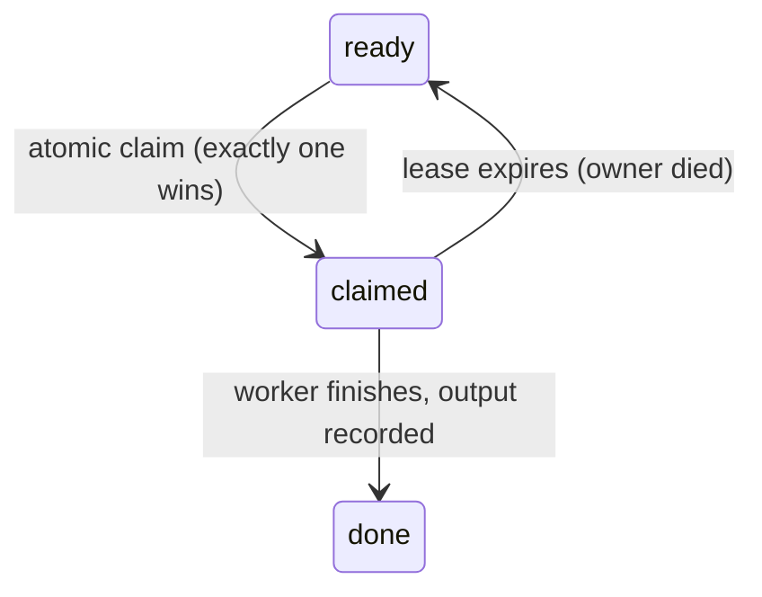

# Claiming — Stopping Two Agents Doing One Job

> You can make exactly one worker take a ready node, using an operation that
> cannot be raced — because "ready" is public and "mine" must not be.

**Type:** Learn
**Prerequisites:** Lesson 99 (Task Graphs), Lesson 100 (Blocking Edges); Phase 11, Lesson 73 (Agent Teams)
**Time:** ~35 minutes

---

## Learning Objectives

- Explain why "ready" and "claimed" are different states
- Name the window where two workers race, and the property that closes it
- Implement a claim with an atomic operation, not a read-then-write
- Add a lease so a dead owner does not strand a node forever

---

## The Problem

A workflow fanned eight workers over one task queue. When a node became ready,
every idle worker re-read the queue, saw the same ready node, and started it.

Two workers built the same parser. Both committed. The second commit overwrote
the first, and the first worker's passing tests were gone. Nobody noticed until a
reviewer asked why the parser had lost its error handling.

The run looked correct. Every node was marked done. The queue never lied — the
node really was ready, right up until the first worker finished it. The bug was
that "ready" was the only state the queue had. Between a worker reading "ready"
and a worker acting on it, another worker could do the same thing. That gap is
where two agents do one job.

---

## The Concept

The frontier from Lesson 99 is **public information**. Every worker can compute
it, and every worker will, and they will all agree. That is the problem: agreement
is not ownership.

A node needs a second state, and only one worker may make the transition:



The transition `ready → claimed` must be **atomic**: it either happens completely
for one worker or not at all for everyone else. There is no moment when two
workers both observe the node as theirs.

### Why read-then-write races

The naive claim is two steps:

```text
if (status === 'ready') { status = 'claimed by me' }
```

Two workers can both evaluate `status === 'ready'` as true before either writes.
Both then set the status, and the second write wins silently. The check and the
set must be one indivisible operation — a **compare-and-swap**: "set this to
claimed *only if* it is still ready, and tell me whether I won."

You get an atomic operation from a primitive that is already atomic:

| Primitive | The atomic act |
|---|---|
| Exclusive file create (`open(path, 'wx')`, `mkdir`) | The OS creates the file for exactly one caller; the rest get "exists". |
| A lock file / lock directory | Same idea, with a convention about who cleans up. |
| A database row with a conditional update | `UPDATE … SET owner=? WHERE status='ready'` returns how many rows changed. |
| A single-writer queue | One process hands out nodes; the hand-off is the claim. |

A claim is not a lock you hold while you work; it is a record. The record says:
node id, owner, when it was taken, and a **lease** — an expiry time. If the owner
dies mid-work, its lease expires and the node returns to `ready` (Lesson 104).
Without a lease, one crashed worker strands its node forever.

### Idempotency: the claim check happens before the side effect

A claim only helps if you *consult* it before doing anything destructive. A worker
that starts editing, then checks whether it holds the claim, has already lost the
race. And a node that runs twice — a retry, a resumed run — must be safe: the
second run sees the claim or the completion and does nothing. That property is
**idempotency**, and it is what makes retries and leases safe.

The atomicity guards *who takes* the node. Idempotency guards *what happens if it
runs twice anyway*. You need both; either alone leaves a hole.

> **The reframe:** the frontier says a job is *ready*; claiming is the atomic act
> by which exactly one worker says "*mine*" before it starts — and the gap between
> ready and claimed is where two agents do one job.

The need for atomic claims is version-independent. Which primitives a given runner
offers (a task list, a lock, a queue) changes weekly — check
[Run agents in parallel](https://code.claude.com/docs/en/agents) and the
[changelog](https://code.claude.com/docs/en/changelog).

---

## Build It

Build a claim primitive and prove it cannot be raced. Node's `open(..., 'wx')`
is atomic: exactly one caller creates the file, and every other caller gets
`EEXIST`.

### 1. Write the claimer

```js
// claim.mjs <node-id> <owner>
import { openSync, writeFileSync, closeSync, mkdirSync, readFileSync, statSync, unlinkSync } from 'node:fs';

mkdirSync('.claims', { recursive: true });
const [node, owner] = process.argv.slice(2);
const path = `.claims/${node}.claim`;
const LEASE_MS = 30_000;

// Reclaim an expired lease before trying to take it.
try {
  const held = JSON.parse(readFileSync(path, 'utf8'));
  if (Date.now() - held.at > LEASE_MS) {
    console.log(`reclaiming expired lease on ${node} (was ${held.owner})`);
    unlinkSync(path);
  }
} catch { /* no claim file — nothing to reclaim */ }

try {
  const fd = openSync(path, 'wx'); // atomic create: one winner, rest throw
  writeFileSync(fd, JSON.stringify({ owner, at: Date.now() }));
  closeSync(fd);
  console.log(`CLAIMED ${node} by ${owner}`);
} catch (err) {
  if (err.code === 'EEXIST') {
    console.log(`lost ${node} — already held`);
    process.exit(0);
  }
  throw err;
}
```

✅ You pass when `node claim.mjs parser alice` prints `CLAIMED`, and running it
again as `bob` prints `lost`.

### 2. Race it hard

Fire many claimers at the same node at the same time and count the winners.
Delete the claim file between rounds so each round starts clean.

```bash
rm -f .claims/parser.claim
for i in $(seq 1 20); do node claim.mjs parser "w$i" & done; wait
```

✅ You pass when exactly one line says `CLAIMED` and the other nineteen say
`lost`, on every round you run.

### 3. Prove idempotency

Have a "worker" that does a side effect, then run the same node twice.

```bash
node claim.mjs build-parser alice   # first run, does the work
node claim.mjs build-parser alice   # resume — must not redo it
```

✅ You pass when the second run refuses to proceed (the claim exists) and no
second artifact is produced.

### 4. Expire a lease

Wait out `LEASE_MS` (or lower it to 500ms) and claim again from a new owner.

✅ You pass when the expired lease is reclaimed and exactly one *new* owner wins.

---

## Use It

| Situation | Move |
|---|---|
| Two workers might grab one node | A claim before any side effect, not after. |
| Choosing a primitive | Whatever your platform makes atomic: exclusive create, lock file, conditional DB update. |
| A worker dies mid-node | A lease with an expiry, so the node returns to `ready`. |
| A retry or a resumed run | Idempotency: check the claim/completion first, then act. |
| Claiming "just in case" and holding it while you decide | Don't. Claim the moment you commit to the work, and keep the lease short. |
| A long node that outlives its lease | Renew the lease, or set it longer than the node's worst case. |
| A single worker, no fan-out | You may not need claims at all — there is no race. |

---

## Exercises

1. Implement the claim primitive above and run 20 concurrent claimers at one node.
   ✅ You pass when the winner count is exactly 1 on every run, across at least
   five runs.

2. Add a lease and force expiry by killing a claimant mid-work (or setting a tiny
   TTL). Show the node returning to `ready` and a new owner winning.
   ✅ You pass when a second owner ends up holding the node without a manual
   delete.

3. Make the node idempotent. Run it twice and show the side effect happening
   once.
   ✅ You pass when the second run produces no duplicate artifact and can say
   which state it read to decide.

---

## Key Terms

| Term | What people say | What it actually means |
|---|---|---|
| claim | "taking a task" | An atomic transition from `ready` to `claimed` by exactly one worker. |
| atomic | "it just works" | The operation completes for one caller or not at all; no in-between state is observable. |
| compare-and-swap | "a lock" | "Set only if still ready." A conditional write that reports whether you won. |
| lease | "a timeout" | An expiry on a claim. When it lapses, the node returns to `ready`. |
| idempotent | "safe to retry" | Running it twice has the same effect as running it once. |
| owner | "who's on it" | The worker named in the claim record. |
| ready vs claimed | "it's pending" | Publicly runnable versus privately taken. The gap between them is the race. |

---

## What this lesson skipped

**What to do when a lease expires and the node is half-done.** Re-running a
partially applied node is Lesson 104's problem, and it is why idempotency matters
more than locking.

**Joining claimed results.** Collecting several workers' outputs is Lesson 103.

**Distributed locks in depth.** Consensus, fencing tokens, and lock safety across
machines is out of scope for a local-first course; a single machine's exclusive
create is enough here.

**Agent-team task lists.** How a lead's shared task list claims work internally is
Phase 11, Lesson 73 — this lesson is the mechanism underneath it.
