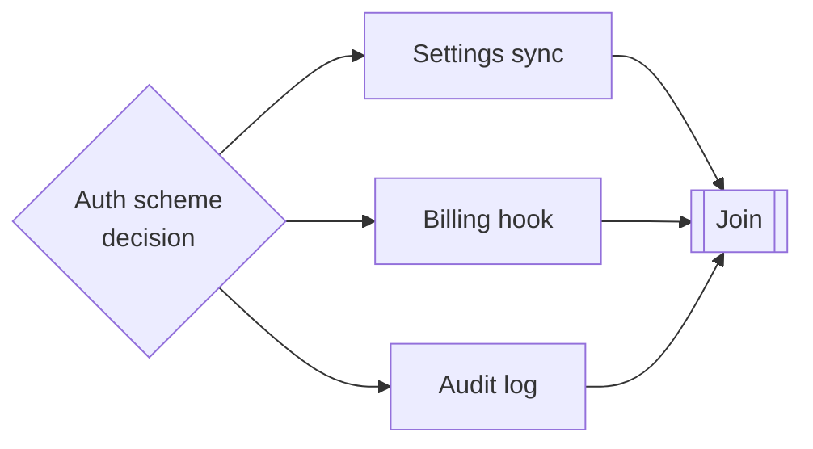

# Wayfinding — Producing Decisions, Not Deliverables

> You can put a decision on the graph as a node — with an owner, an output, and
> consumers — so it blocks what it must and stops blocking everything invisibly.

**Type:** Learn
**Prerequisites:** Lesson 99 (Task Graphs); Phase 14, Lesson 92 (Most Agent Calls Are Decisions)
**Time:** ~30 minutes

---

## Learning Objectives

- Tell a decision node from a deliverable node and from a spike
- Put a decision on the graph with an owner, an output, and its consumers
- Write a decision record downstream nodes can act on without re-asking
- Spot an invisible dependency — a decision nobody assigned

---

## The Problem

Three builders each had a node in the graph: build the settings sync, build the
billing hook, build the audit log. All three needed the same answer — *which auth
scheme does this product use?* — and that answer was not a node. It was a question
in a chat that nobody owned.

The three builders each made a reasonable guess. They chose three different
schemes. The fan-in produced three components that could not talk to each other,
and the fix was not a merge — it was a rewrite of two of the three.

The schedule had said the graph was three parallel nodes and a join. It was
actually three nodes joined by a decision that lived nowhere on the graph. That
is what an unowned decision does: it blocks every consumer at once, while looking
like nobody's task.

---

## The Concept

A node produces an output. Usually that output is an artifact — code, a file, a
passing test. But some nodes produce a **decision**: a choice, the options that
were weighed, and the reason. Call it a **wayfinding node**, from the navigation
term for the work that gets you oriented before you move.

A wayfinding node is not special machinery. It is a node like any other:

- It has an **output**: a decision record (the choice and its rationale).
- It has **consumers**: the nodes whose work depends on the choice.
- It has an **owner**: one person or agent who makes the call.
- It has a **position** on the graph, so it blocks its consumers and nothing else.



Once the decision is a node, the picture tells the truth: the three builders can
run in parallel, but *only after* the decision — and the decision can be made
once, by one owner, cheaply, instead of three times by guess.

### Decision, spike, deliverable

Three kinds of node are easy to confuse. The difference is what they produce:

| Node | Produces | Consumers do what with it |
|---|---|---|
| Deliverable | A shippable artifact | Depend on it existing and working |
| Spike / experiment | Knowledge: a number, a feasibility answer | Use it to *decide* something |
| Wayfinding / decision | A commitment: choice + rationale | Build against the choice, and stop re-asking |

A spike reduces uncertainty by *finding out*. A decision record reduces
uncertainty by *committing*. You often do a spike immediately before a decision
node, and the spike's output feeds the decision's input. The decision is the node
other things depend on; the spike is a helper that informs it.

### Make the decision its own node, not a side effect

The failure mode is a decision that never becomes a node. It hides in a chat
message, a comment, a verbal "let's just use X", or worse — it hides nowhere,
and each consumer invents its own.

Putting it on the graph does three things that are invisible when the decision
lives in prose:

1. It **blocks exactly its consumers**. A decision everyone needs is a fan-out
   bottleneck and the graph now shows it. A decision only one node needs does not
   hold up the rest.
2. It gets an **owner and a moment**. Unowned decisions drift; a node with an
   owner and a due position in the frontier gets made.
3. It **stops re-litigation**. The rationale is recorded, so a downstream node
   reads the decision instead of asking again — which is the same reason a
   decision record beats a decision made in conversation.

Sometimes the highest-leverage first node in a project is not code at all. It is
the decision that everything else was quietly waiting on. Wayfinding is choosing
to do that first, on the graph, on purpose.

> **The reframe:** some nodes produce code and some produce a decision — and a
> decision you did not put on the graph blocks every node downstream of it while
> looking like nobody's task.

The idea is version-independent; whether a given runner models a node as
"decision" or just as a task is cosmetic. What matters is that the output and its
consumers are on the graph. Mechanism pages:
[Run agents in parallel](https://code.claude.com/docs/en/agents).

---

## Build It

Take the graph you have been building (`tasks.json` from Lesson 99, edges labelled
in Lesson 100).

### 1. Walk the nodes and ask "what does this need to know?"

For each deliverable, list the facts it cannot proceed without. Anything that is
not already an artifact-producing node is a candidate decision.

```text
settings sync  needs: which auth scheme, where tokens live
billing hook   needs: which auth scheme
audit log      needs: which auth scheme, what retention period
```

✅ You pass when you have a list of questions, not of tasks.

### 2. Promote each shared question to a node

Any question needed by more than one consumer becomes a wayfinding node. Give it
id, owner, and **consumers** — the nodes that need it.

```json
{
  "tasks": [
    { "id": "decide-auth", "kind": "decision", "owner": "you", "needs": [],
      "consumers": ["settings", "billing", "audit"] },
    { "id": "settings", "kind": "deliverable", "needs": ["decide-auth"] },
    { "id": "billing",  "kind": "deliverable", "needs": ["decide-auth"] },
    { "id": "audit",    "kind": "deliverable", "needs": ["decide-auth", "decide-retention"] },
    { "id": "decide-retention", "kind": "decision", "owner": "you", "needs": [], "consumers": ["audit"] }
  ]
}
```

✅ You pass when every shared question exists as a node and both `waves.mjs` and
the graph agree that the builders wait on it.

### 3. Write one decision record

The output of a wayfinding node is a record, and it must be enough for a consumer
to act without asking. Four parts, short:

```markdown
# Decision: auth scheme
- Context: three components need to share a session; no SSO requirement yet.
- Options: (a) opaque session cookie, (b) signed JWT, (c) third-party IdP.
- Decision: (a) opaque cookie, server-side store. Revisit if SSO lands.
- Consequences: session store becomes a node we must deploy; tokens never
  leave the server.
```

✅ You pass when a reader who never saw the discussion can build against it and
know what would change the decision.

### 4. Find an invisible one

Look for a deliverable whose blocker is not any node in the graph — a question
someone answered in chat. That is an invisible dependency.

✅ You pass when you can name it and add it as a node, with a consumer list.

---

## Use It

| Situation | Move |
|---|---|
| Two or more nodes need the same unresolved answer | Promote it to a wayfinding node with those nodes as consumers. |
| One node needs an answer nobody has | Still a node — it just blocks only that one node. |
| The answer cannot be made without data | A spike feeds the decision; the decision is the node consumers wait on. |
| The decision is made but downstream nodes keep asking | Write the record. The record is the output. |
| A "decision" you cannot phrase as options and a choice | It is not ready to be a node. It is still a question. |
| A decision everyone needs, early | Expect a fan-out bottleneck; make it as early in the frontier as possible. |
| A decision only one node needs | Do not gate everyone on it — scope its consumers narrowly. |

---

## Exercises

1. Take a real project and list every answer a builder would need before starting.
   Mark which are shared.
   ✅ You pass when at least one shared answer is currently an *unowned question*
   in your notes rather than a task.

2. Promote the highest-fan-out decision to a node and write its record.
   ✅ You pass when the record names options, a choice, and the condition that
   would reverse it.

3. Take the graph from Lesson 99 and add a decision node. Recompute the waves.
   ✅ You pass when the graph shows three builders that previously looked
   independent now waiting on one shared node — and you can say which wave grew.

---

## Key Terms

| Term | What people say | What it actually means |
|---|---|---|
| wayfinding node | "just a task" | A node whose output is a decision: a choice plus its rationale. |
| decision record | "a note in chat" | The durable output of a wayfinding node: context, options, choice, consequences. |
| invisible dependency | "everyone knows that" | A blocker that exists in conversation but not on the graph. It blocks silently. |
| spike | "a research task" | A node that produces knowledge to inform a decision. Not the decision itself. |
| owner | "someone will figure it out" | The single person or agent accountable for making the call. |
| re-litigation | "we already decided" | Downstream nodes re-asking because the rationale was never recorded. |

---

## What this lesson skipped

**How agents make decisions cheaply.** Decision models and confidence gating are
Phase 14, Lessons 92–94.

**Joining consumers of a decision.** What the three builders do with the shared
answer at their join is Lesson 103.

**Failure of a decision node.** What happens when the owner never decides is
Lesson 104 — a decision node that never completes is a stranded parent.

**Decision-making frameworks** (pros/cons grids, weighted scoring). Useful, but
they are how you decide, not where the decision lives on the graph.
