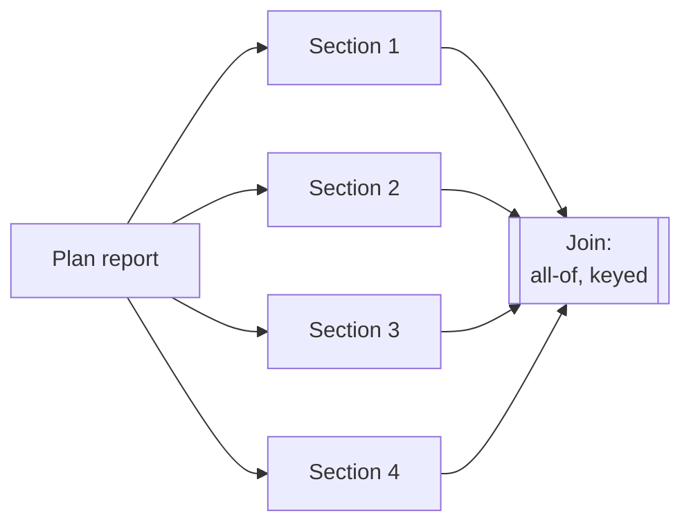

# Fan-Out / Fan-In Patterns

> You can design a join before you launch the fan-out — deciding what "done"
> means and what happens to the child that never came back.

**Type:** Learn
**Prerequisites:** Lesson 99 (Task Graphs); Phase 12, Lesson 79 (parallel() vs pipeline()), Lesson 80 (The Completion-Order Gotcha)
**Time:** ~35 minutes

---

## Learning Objectives

- Recognise fan-out and fan-in, and tell map from broadcast
- Choose join semantics: all-of, any-of, or quorum
- Collect parallel results by key, not by arrival order
- Decide, before the run, what a missing child does to the join

---

## The Problem

A report generator fanned out eight children, one per section. Eight agents
returned: seven as JSON, one as a friendly paragraph, and one returned nothing at
all because it hit a token limit and stopped.

The join node took "whatever came back" and assembled a report. It succeeded. The
report shipped with one section missing — and a reviewer found out a week later,
because the run reported success and the missing section looked like an editorial
choice.

Nothing about the fan-out was hard. Eight agents, eight sections. The bug was in
the **fan-in**: nobody had decided what each child must return, or what the join
should do when one of them returned nothing. The join was written to be
convenient, and convenient turned a failure into silence.

---

## The Concept

**Fan-out** is one node launching many children. **Fan-in** is one node consuming
them. Between them is the whole design problem.



Fan-out is the easy half and it is where the attention goes, because it is where
the agents are. The fan-in is where the design lives, because it is where you
decide what *done* means.

### Two contracts you must fix before launching

**1. The result shape.** Every child returns the same *kind* of thing, tagged
with which node produced it. A keyed record — `{ node: "section-3", ok: true,
output: "…" }` — beats "a string" or "a paragraph" or "whatever the agent felt
like". The join then works on a uniform shape and never has to guess.

**2. The join semantics.** "Wait for all of them" is only one choice:

| Join | Waits for | Use when |
|---|---|---|
| all-of (barrier) | Every child | The output is invalid without any of them — a report with all sections. |
| any-of | The first child to succeed | You want one answer from several routes — a race, a first-working mirror. |
| quorum (k of n) | Any k children | You can tolerate some loss — three-of-five reviewers. |

Each has a failure answer attached, and that answer is the design. For an all-of
join, a missing child can either **fail the join** or **produce a partial output
carrying an explicit gap marker**. Both are legitimate. The illegitimate one is
the default the bug above used: silently drop the missing child and report
success.

### Completion order is not node order

Children finish in whatever order they finish. The one that started first may
return last; the fastest may be the least important. So a join must **key its
results by node id**, never by arrival:

```js
// Wrong: positional — a fast child shifts every later result.
const report = results.map((r) => r.output).join('\n\n');

// Right: keyed — every child lands in its own slot, missing or not.
const byNode = new Map(results.map((r) => [r.node, r]));
const sections = expected.map((id) =>
  byNode.has(id) ? byNode.get(id).output : `[MISSING: ${id}]`,
);
```

This is the same trap the completion-order lesson names — a pipeline that assumes
results come back in the order you sent them. Keying by node id is the fix, and it
is the same fix at every join you build.

### Map versus broadcast

A fan-out is one of two shapes, and the difference matters for the result shape:

- **Map**: the same operation over different inputs. "Lint each of these 30
  files." Every child does the same thing; the results compare.
- **Broadcast**: the same input through different lenses. "Review this PR for
  security, performance, and tests." Every child does a different thing; the
  results complement.

A map's join can usually combine (concatenate, aggregate); a broadcast's join
must reconcile (the three lenses may disagree). Knowing which you have tells you
whether the fan-in is an assembly or an argument.

### Width is a cost

Every child is a window, a claim, and a slice of budget. A fan-out of two hundred
is rarely two hundred times the value. When the children are cheap and
independent, go wide; when they are expensive or must be reconciled, go narrow
and iterate. The join does not care how wide you went — but your budget does.

> **The reframe:** fan-out is the easy half; the design is the fan-in — the join
> is where you decide what "done" means and what happens to the child that never
> came back.

`parallel()` versus `pipeline()`, and the completion-order gotcha, are Phase 12,
Lessons 79 and 80. Which combinators a runner exposes is version-gated; check
[Run agents in parallel](https://code.claude.com/docs/en/agents).

---

## Build It

You will build an all-of fan-in that *reports* a missing child instead of hiding
it. Run this as a plain Node script; the shape maps directly onto a workflow's
fan-out.

### 1. Define the children and the expected set

```js
// fanin.mjs
const expected = ['intro', 'body', 'risks', 'outro'];
const work = {
  intro: async () => ({ node: 'intro', ok: true, output: 'Introduction…' }),
  body:  async () => ({ node: 'body',  ok: true, output: 'Body…' }),
  risks: async () => { throw new Error('token limit'); },
  outro: async () => ({ node: 'outro', ok: true, output: 'Outro…' }),
};
```

✅ You pass when every child returns the same keyed shape, or throws.

### 2. Fan out with allSettled, then join by key

```js
const settled = await Promise.allSettled(expected.map((id) => work[id]()));

const byNode = new Map();
for (const r of settled) {
  if (r.status === 'fulfilled') byNode.set(r.value.node, r.value);
}

const report = [];
for (const id of expected) {
  report.push(byNode.has(id) ? byNode.get(id).output : `[MISSING: ${id}]`);
}
console.log(report.join('\n'));
console.log(`complete: ${byNode.size}/${expected.length}`);
```

✅ You pass when the output contains `[MISSING: risks]` and the complete line
reads `3/4` — the hole is visible, not swallowed.

### 3. Deliberately reorder the results

Change `work` so `risks` resolves slowly and `outro` resolves first. Keep the same
join.

✅ You pass when the output is unchanged, because the join keyed by id and never
trusted arrival order.

### 4. Switch the join to quorum

Make the join succeed when at least three of the four children arrive.

✅ You pass when the run reports success *and still names* which child was
missing — a quorum join is allowed to proceed, not allowed to forget.

---

## Use It

| Situation | Move |
|---|---|
| Output is invalid without every child | All-of (barrier), and fail the join on a miss. |
| Need one good answer from several routes | Any-of: take the first success, cancel the rest. |
| Can tolerate some loss | Quorum: succeed at k of n, and log the misses. |
| Same operation over many inputs | Map. The join can usually combine. |
| One input through several lenses | Broadcast. The join must reconcile disagreement. |
| Results arrive out of order | Key by node id. Never join positionally. |
| A child returns a different shape | Fix the result contract at the fan-out, not in the join. |
| Hundreds of children | Check the budget. Fan-out width is a cost, not a target. |

---

## Exercises

1. Build the all-of join above and make it print `[MISSING: …]` for a dropped
   child rather than a silent gap.
   ✅ You pass when the completeness count is shown and never rounds a miss up to
   success.

2. Reorder your children's completion times and show the joined output is
   byte-for-byte identical.
   ✅ You pass when you can point at the keyed map as the reason order did not
   matter.

3. Take a real fan-out of yours and write, before running it, its result shape and
   its join semantics in one sentence each.
   ✅ You pass when the sentence names the shape, the join type, and what a
   missing child does.

---

## Key Terms

| Term | What people say | What it actually means |
|---|---|---|
| fan-out | "spawning agents" | One node launching N parallel children. |
| fan-in / join | "collecting results" | One node consuming N children. Where "done" is defined. |
| barrier (all-of) | "wait for everyone" | The join proceeds only when every child has returned. |
| any-of | "race them" | The join proceeds on the first success. |
| quorum (k of n) | "most of them" | The join proceeds when k children have returned. |
| keyed result | "the output" | A child's return tagged with its node id, so the join never trusts order. |
| map vs broadcast | "fan out" | Same operation over many inputs versus one input through many lenses. |
| completion order | "they come back in order" | False. Children finish by their own timing; key, do not index. |

---

## What this lesson skipped

**The runner's own combinators.** `parallel()` and `pipeline()`, and their caps,
are Phase 12, Lessons 79–81.

**What a failed child does to the *graph*.** Here a missing child affects one
join; how failure propagates to descendants is Lesson 104.

**Claiming inside a fan-out.** Who owns each child is Lesson 101; a fan-out
usually claims each child before running it.

**Streaming joins.** Consuming results as they arrive instead of at a barrier is
useful at scale and out of scope for a local-first course.
