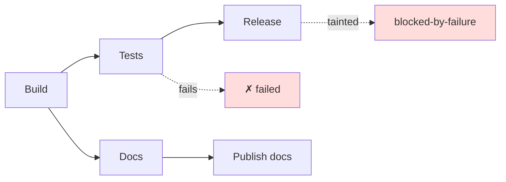

# Failure Propagation — What Happens When One Node Dies

> You can say, per node, what counts as failure and who is affected — so one dead
> node taints its descendants instead of the whole run, or silently poisons it.

**Type:** Learn
**Prerequisites:** Lesson 101 (Claiming); Phase 14, Lesson 95 (Verification Loops)
**Time:** ~35 minutes

---

## Learning Objectives

- Define failure for a node: exit, output, verification, or timeout
- Decide what a failure does downstream — propagate, skip, or compensate
- Bounds a retry and say why it must be idempotent
- Detect an orphaned node whose owner died

---

## The Problem

A deploy pipeline had a test node between build and release. The test node exited
non-zero. The runner logged the error and moved on.

The release node ran anyway. It built on an artifact whose tests had failed, and
the deploy went out. The error was sitting in the log the whole time — visible,
and ignored, because the runner treated "error" as a note rather than a state.

The inverse happens just as often. A runner treats a failed node as fatal for
*everything*: one docs typo kills the whole build, and three unrelated branches
that were fine never ship. Both are the same missing decision. The graph has no
answer to "what does a failure mean here", so the runner invents one — per node,
by accident.

---

## The Concept

Failure is not a property of an agent. It is a property of the graph, and it has
to be decided per node, before the run. Four questions:

**1. What counts as failure?** A node has failed when:

| Signal | Fail when… |
|---|---|
| Exit code | The process returned non-zero. |
| Empty output | It produced nothing, or less than the minimum it promised. |
| Verification | A checker — a test, a schema validation, a linter — rejected the output. |
| Timeout | It exceeded its allotted time and was stopped. |

A node with none of these is a node that cannot fail, which usually means it
cannot be verified either. "Exit 0" is the weakest signal; a verifier is the
strongest. (Turning a verifier into a structural check is Phase 14, Lesson 95.)

**2. What does it do to the graph?** A failure does not travel along every edge —
it travels along **dependency** edges, downstream. A failed node taints its
**descendants**: every node that needed its output is now blocked-by-failure, not
merely not-ready. But its **siblings** — nodes that share a parent but not this
node — are untouched. So is every subgraph the failure is not an ancestor of.



Build failed a test, so Release is tainted. Docs never depended on the tests, so
Publish docs runs. The failure pruned one branch of the graph and left the rest
alone. That is what "propagates" means — not "everything stops".

A node where propagation matters most is the **join** (Lesson 103). If an all-of
join is missing a child, it fails; if the join is a quorum, it may proceed — but
it must *know* one child failed, or it will report success over a hole.

**3. Retry, and idempotency.** A failure may be transient. Retry it — **bounded**.
An unbounded retry is a node that never completes and never fails, which strands
its descendants. A bound of two or three attempts is a decision, and it must be
written down.

A retry is only safe if the node is **idempotent** (Lesson 101): re-running must
not double-apply a side effect. A node that appends to a file, or charges a card,
must check what already happened before it acts. Retrying a non-idempotent node
compounds the failure instead of fixing it.

**4. Orphans.** A node whose claimant died mid-work is an **orphan**. Its claim's
lease expires (Lesson 101), the node returns to `ready`, and it is retried or
failed on purpose. Without orphan detection, that node is neither running nor
failed — it is lost, and its descendants wait forever.

### Fail-open versus fail-closed

The last decision is the one with the most consequence: when a node fails and
there is no retry left, does the graph proceed anyway or stop?

- **Fail-closed**: the failure blocks the run. Correct for irreversible or
  dangerous steps — a deploy, a migration, a payment.
- **Fail-open**: the run continues, marked, with the failure recorded. Correct for
  advisory steps — a lint, an optional enrichment, a nice-to-have summary.

Neither is "better". The failure comes from leaving the choice implicit, so the
default flips depending on which node happened to be written carelessly. Decide it
per node, and make the irreversible nodes fail closed by construction.

> **The reframe:** a failure does not kill the graph — it taints the failed node's
> descendants, while everything not downstream of it keeps running; the bug is a
> runner that treats "error" the same as "done".

The graph semantics are stable; retry defaults, timeouts, and capsule limits are
version-gated. Check the
[changelog](https://code.claude.com/docs/en/changelog) and
[Run agents in parallel](https://code.claude.com/docs/en/agents) before quoting a
number.

---

## Build It

Annotate the graph you have (`tasks.json`, plus decision nodes from Lesson 102).

### 1. Give every node a failure definition and a policy

Add three fields per node: what fails it, whether it retries, and whether the
graph fails closed.

```json
{
  "id": "tests",
  "needs": ["api"],
  "failsOn": ["nonzero-exit", "verifier"],
  "retry": { "attempts": 2, "idempotent": true },
  "onFinalFailure": "fail-closed"
}
```

✅ You pass when no node says `"onFinalFailure": "whatever"` and every
irreversible node (deploy, migrate, publish) says `fail-closed`.

### 2. Force a failure and watch what propagates

Use the join from Lesson 103. Make its upstream node throw.

✅ You pass when the failed node's **descendants** are marked
`blocked-by-failure`, its **siblings** still complete, and the run's summary names
the failed node rather than reporting blanket success.

### 3. Bound a retry and prove idempotency

Give the flaky node `attempts: 2`, make it fail once and succeed second time, and
log each attempt. Then make it succeed on the first try and re-run the whole node.

✅ You pass when the retry count stops at the bound and the re-run does not
double-apply any side effect.

### 4. Detect an orphan

Claim a node, then kill the claimant mid-work (Ctrl-C the process) with a short
lease. Re-run the runner.

✅ You pass when the expired claim is reclaimed and the orphaned node is retried
or failed — not left invisible.

---

## Use It

| Situation | Move |
|---|---|
| Deciding what "failed" means | A verifier beats an exit code. Exit 0 with no output is not success. |
| A node failed and something needs its output | Mark descendants blocked-by-failure. Do not run them on partial input. |
| A node failed with no dependents | Log it and let the rest of the graph finish. |
| A transient failure | Retry, bounded, and only if the node is idempotent. |
| An irreversible node (deploy, migrate, pay) | Fail-closed. Never proceed on error. |
| An advisory node (lint, optional summary) | Fail-open, recorded — the run continues and the gap is visible. |
| A claimed node whose owner died | Let the lease expire; retry or fail the orphan on purpose. |
| An all-of join missing a child | Fail the join, or emit a gap marker. Never report success. |

---

## Exercises

1. Add a failure policy to every node in a real graph, naming what fails it and
   whether it fails open or closed.
   ✅ You pass when every irreversible node is fail-closed and at least one
   advisory node is explicitly fail-open *with* a recorded marker.

2. Force a mid-graph node to fail and show the split: descendants tainted,
   siblings complete.
   ✅ You pass when the run output names the failed node, lists its blocked
   descendants, and lists at least one sibling that still finished.

3. Kill a claimant with a live lease and show the node recovered without a manual
   cleanup.
   ✅ You pass when a new attempt runs after the lease lapses and the node is
   neither lost nor double-applied.

---

## Key Terms

| Term | What people say | What it actually means |
|---|---|---|
| failure propagation | "it crashed the build" | A failure taints the failed node's descendants, not unrelated branches. |
| taint / blocked-by-failure | "skipped" | A downstream node whose ancestor failed. Distinct from "not ready yet". |
| verifier | "the tests" | A structural check that rejects bad output. A stronger failure signal than an exit code. |
| bounded retry | "just retry" | A fixed number of attempts. Unbounded retry strands descendants forever. |
| idempotent | "safe to re-run" | A retry does not double-apply its side effect. |
| orphan | "stuck" | A node whose claimant died; freed when its lease expires. |
| fail-open / fail-closed | "keep going" / "stop" | Proceed-with-a-marker versus block-the-run, chosen per node. |
| compensation | "undo" | A deliberate action that reverses a partial effect when a node cannot complete. |

---

## What this lesson skipped

**Verification design.** What a good verifier checks, and how to build one, is
Phase 14, Lesson 95.

**Compensation in depth.** Sagas and rollbacks across many nodes are beyond a
local-first course; this lesson names the concept and stops there.

**Runtime caps.** How a runner limits total agents, time, and fan-out is Phase 12,
Lesson 81.

**Error message catalogue.** Specific failure strings are version-gated; the four
failure signals above are not.
