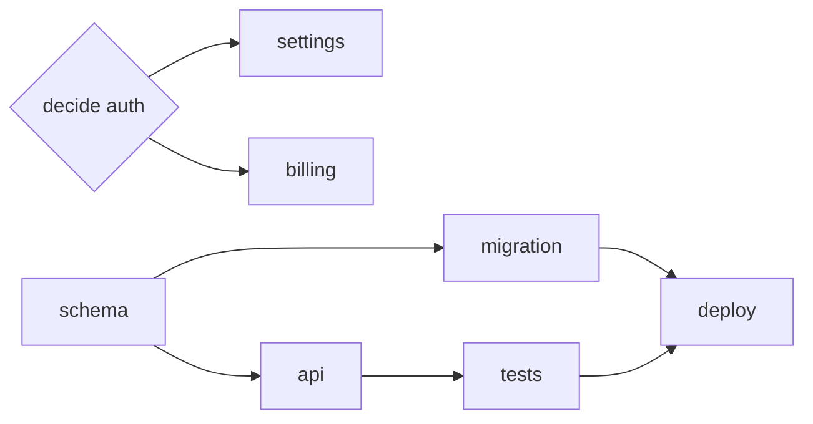

# Design a Graph for a Real Project

> You can take a real project, decompose it into a defended graph, and compute its
> critical path and widest wave — instead of asserting either.

**Type:** Build
**Prerequisites:** Lessons 98–104 (Nodes and Edges through Failure Propagation)
**Time:** ~45 minutes

---

## Learning Objectives

- Decompose a real project into nodes whose outputs something consumes
- Label every edge blocking or soft, and defend each blocking one
- Add decision nodes and design the joins before running anything
- Compute the critical path and the widest wave, and catch a wave that would collide

---

## The Problem

You can read graphs now. Designing one is the part that fails, and it fails in a
specific way: people draw an arrow between anything that *feels* ordered, call it a
graph, and it is a line with decoration. Ten nodes, nine arrows, zero parallelism —
and nobody notices, because an arrow was never questioned.

The other failure is quieter. A real graph gets run and two nodes in the same wave
both edit `config.json`. Nothing in the drawing warned them, because the drawing
never asked *what does each node write*. The graph was a diagram, not a plan.

A graph you cannot defend is decoration. This lesson is where you defend it.

---

## The Concept

Designing a graph is a sequence of commitments. Each one can be checked, and each
one can be wrong. The artifact — call it `GRAPH.md` — is the record of those
commitments: the nodes, the edges with their labels, the decision nodes, the joins,
the failure policy, and the computed critical path.

The two numbers the artifact must *compute*, not assert:

- **Critical path** — the number of waves in the longest blocking chain. The floor
  on wall-clock time with unlimited agents.
- **Widest wave** — the largest number of nodes that can run at once. The ceiling
  on useful parallelism, and the peak of your fan-out.



A third check falls out of the first two: the **busy-write check**. Two nodes in
the same wave that write the same file are a collision the graph created. Either
they need a blocking edge between them, or they need a claim (Lesson 101) — but
the graph must say which. A plan that cannot answer "what does each node write"
cannot pass this check, which is why the node list starts with outputs.

> **The reframe:** a graph is a claim about what can run at once — every edge you
> keep is parallelism you gave up, so you must be able to defend each one, or it is
> decoration.

The concepts are version-independent; the runner that executes the result is not.
Check [Run agents in parallel](https://code.claude.com/docs/en/agents) before
assuming a mechanism.

---

## Build It

Build `GRAPH.md` and one script. Use a real project you intend to do — not a toy.

### 1. Scope the project

Pick a project with **10 to 20 nodes**. Smaller and the structure is trivial;
larger and it is a spreadsheet, not a design.

✅ You pass when the project is one you would actually run, and you can name its
single deliverable at the end.

### 2. Write the nodes as outputs

One line per output. No verbs. Reuse the checks from Lesson 98.

```text
- auth scheme chosen            (decision)
- users schema has a token column
- GET /profile ships
- profile tests pass
- deploy artifact built
```

✅ You pass when every node names something checkable and none reads "work on…".

### 3. Draw edges and label every one

For each edge, answer "can B produce a correct output without A?" `no` is blocking;
`yes` is soft. For a soft edge, name what B does without A, or delete it.

✅ You pass when every edge carries a label and a one-line reason, and no soft edge
is really a blocking edge in disguise.

### 4. Add the decision nodes

Promote every shared unresolved question (Lesson 102) to a node with an owner and
a consumer list.

✅ You pass when at least one decision node exists and its consumers are the exact
nodes that would otherwise have guessed.

### 5. Design the joins

Where a node has several parents, name its join: all-of, any-of, or quorum, and
what a missing child does.

✅ You pass when every multi-parent node has a named join and an answer for a
missing input.

### 6. Give every node a failure policy

For each node: what fails it, whether it retries (and idempotency), and
fail-open or fail-closed.

✅ You pass when every irreversible node is fail-closed and at least one advisory
node is explicitly fail-open with a marker.

### 7. Compute the two numbers

Extend `waves.mjs` from Lesson 99 to also report the widest wave and the busy-write
list.

```js
// graph.mjs — waves, critical path, widest wave, and same-wave write collisions.
import { readFileSync } from 'node:fs';
const g = JSON.parse(readFileSync(process.argv[2], 'utf8'));
const byId = new Map(g.tasks.map((t) => [t.id, t]));
const memo = new Map();
function depth(id, stack = []) {
  if (memo.has(id)) return memo.get(id);
  if (stack.includes(id)) throw new Error(`cycle: ${[...stack, id].join(' -> ')}`);
  const needs = byId.get(id).needs ?? [];
  const d = needs.length ? 1 + Math.max(...needs.map((p) => depth(p, [...stack, id]))) : 1;
  memo.set(id, d); return d;
}
for (const t of g.tasks) depth(t.id);
const maxWave = Math.max(...memo.values());
const byWave = new Map();
for (const t of g.tasks) {
  const w = memo.get(t.id);
  if (!byWave.has(w)) byWave.set(w, []);
  byWave.get(w).push(t.id);
}
let widest = 0;
for (const [w, ids] of byWave) {
  widest = Math.max(widest, ids.length);
  const files = new Map();
  for (const id of ids) for (const f of byId.get(id).writes ?? []) {
    if (files.has(f)) console.log(`COLLISION wave ${w}: ${files.get(f)} and ${id} both write ${f}`);
    else files.set(f, id);
  }
}
console.log(`critical path: ${maxWave} waves`);
console.log(`widest wave: ${widest} node(s)`);
```

✅ You pass when the script prints a critical path, a widest wave, and no collision
— or names the collisions you then resolve with an edge or a claim.

### 8. Assemble `GRAPH.md`

One page: the mermaid diagram, the node table with `writes` and failure policy, the
edge table with labels, the two computed numbers, and one sentence naming the first
edge you would convert or delete to shorten the critical path.

✅ You pass when a reader who has never seen the project can trace the critical
path by hand and get the same number the script printed.

---

## Use It

| Step | The check that makes it real |
|---|---|
| Nodes as outputs | Every node names something you could show someone. |
| Edges labelled | No unlabelled arrow survives; no soft edge hides a real wait. |
| Decision nodes | Every shared question has an owner and a consumer list. |
| Joins | Every multi-parent node names all-of / any-of / quorum. |
| Failure policy | Irreversible nodes are fail-closed. |
| Critical path | Computed by the script, not asserted in prose. |
| Widest wave | The peak fan-out, compared against your budget. |
| Busy-write check | No two same-wave nodes write the same file without a rule. |

---

## Exercises

1. Build `GRAPH.md` for a real 10–20 node project, with the script's critical path
   and widest wave pasted in.
   ✅ You pass when a grader can trace the critical path on the diagram and reach
   the same number the script printed.

2. Resolve one busy-write collision: either add a blocking edge or state the claim
   the two nodes use.
   ✅ You pass when the script reports no collision and the fix is named in
   `GRAPH.md`.

3. Shorten the critical path by exactly one wave. Do it by converting or deleting
   one edge, and show the before/after numbers.
   ✅ You pass when the widest wave grows or stays the same, and you can say what
   the change cost (a new interface, a reconciliation, a claim).

---

## Key Terms

| Term | What people say | What it actually means |
|---|---|---|
| critical path | "the long pole" | The longest chain of blocking edges, in waves. Your wall-clock floor. |
| widest wave | "how parallel it is" | The most nodes that can run at once. Your fan-out ceiling. |
| busy-write check | "it should be fine" | Two same-wave nodes writing one file is a collision the graph must resolve. |
| defended edge | "an obvious dependency" | A blocking edge you can justify by naming the artifact it carries. |
| graph document | "a diagram" | The nodes, labelled edges, joins, failure policy, and computed numbers. |
| soft edge | "also needed" | A preference. It adds no wave; if deleting it changes nothing, delete it. |

---

## What this lesson skipped

**Executing the graph.** This lesson designs; running it uses the mechanisms from
Phase 11 and 12 (subagents, worktrees, workflows). The graph is the plan those
mechanisms consume.

**Cost modelling.** Widest wave is a proxy for peak spend; converting it to tokens
and dollars is Phase 03, Lesson 11.

**Tools that draw graphs for you.** A diagram generator can render your `GRAPH.md`;
it cannot decide your edges, which is the part that matters.

**The practice module.** Module 15.1 turns this into a graded deliverable with a
critical path you defend in writing. Do this lesson first; the module is stricter.
