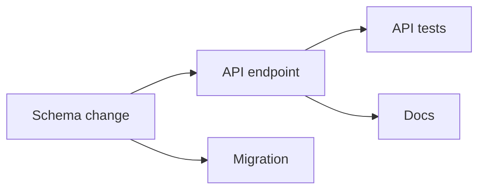
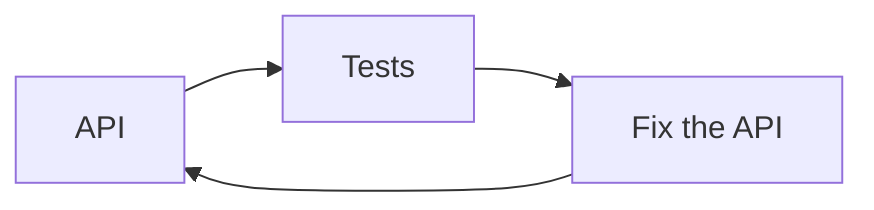
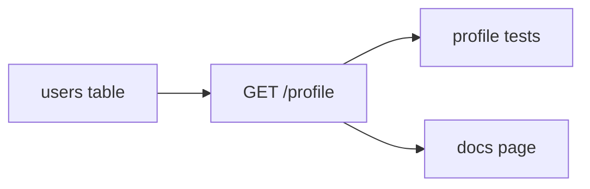

# Nodes and Edges

> You can turn a project into a graph — nodes that produce something, arrows that
> mean "needs" — and read the direction of every arrow out loud.

**Type:** Learn
**Prerequisites:** Phase 11, Lesson 71 (The Five Names); Phase 14, Lesson 91 (What a Harness Is)
**Time:** ~30 minutes

---

## Learning Objectives

- Draw a project as nodes and directed edges, and read every arrow as "B needs A"
- Separate a real dependency from a sequencing preference
- Spot a cycle on paper and say why no node in it can ever start
- List the nodes that could start right now — the ones with no unfinished arrow pointing at them

---

## The Problem

A team split a feature into five jobs and gave one to each agent: "Schema change."
"Write the API." "Write the API tests." "Update the docs." "Add the migration."

They designed it as a list — five rows, each looking independent. The run came
back and nothing fit together. The tests were written against a schema that did
not exist yet. The docs described an endpoint that changed while they were being
written. The migration and the schema change both edited the same file, and one
overwrote the other.

The agents were fine. The five jobs were fine. What was missing was the
**relationship between the jobs**. Nothing in the plan said the API tests need
the schema. Nobody wrote down that the migration must land before the API. A list
of five jobs says nothing about which four of them are safe to run at once.

That is the cost of a task list: it keeps the units and throws away the wiring —
and the wiring is the only thing that tells you what can actually run in parallel.

---

## The Concept

A **graph** is two things: **nodes** and **edges**.

- A **node** is a unit of work defined by its output — a file, a decision, a
  passing test.
- An **edge** is a statement that one node needs another's output. An arrow
  `A → B` reads "**B needs A**". B consumes what A produces.

The direction is the part people get backwards. The arrow points at the
*dependent* node, not the producer. `schema → api` means the API waits for the
schema.



Read the arrows out loud. "The API needs the schema." "The migration needs the
schema." "The tests need the API." Now the picture says something a list could
not: the schema unblocks three things, and the tests unblock nothing.

### Directed, and acyclic

Edges have a direction — you cannot swap the ends without changing the meaning.
And a work graph must have **no cycles**: no path that leads from a node back to
itself. A cycle is a node that waits on itself.



Nothing here can start. The API waits on the tests, the tests wait on the fix,
the fix waits on the API. A graph with a cycle has no valid starting point. When
a real project has a cycle, it is almost always two things that are genuinely
one thing, or two things that should share an interface instead of depending on
each other (Lesson 100).

A directed graph with no cycles has a name: a **DAG** (directed acyclic graph).
Every runnable task graph is a DAG.

### A node is an output, not an activity

The distinction is small and load-bearing: a node is defined by what it
*produces*, not by what someone *does*. "Work on the API" cannot be a node — you
cannot tell when it is done, so nothing can depend on it. "GET /profile returns
the signed-in user's row" is a node. If you cannot point at a node's output,
everything downstream of it is waiting on a feeling.

The **entry nodes** of a graph are the ones with no incoming edges — nothing
points at them. That set is the first thing that can run, and finding it is the
next lesson's whole job.

> **The reframe:** a task list keeps the work and throws away the wiring — and
> the wiring, every arrow that means "B needs A", is the only thing that tells
> you what is safe to run at once.

Graphs are version-independent. The mechanism names that run them move fast; the
comparison page is
[Run agents in parallel](https://code.claude.com/docs/en/agents). Check it before
trusting a specific name.

---

## Build It

Take a real project you know — a feature, a migration, a small app — and draw it.
Fifteen minutes, on paper or in the block below.

### 1. List the outputs, not the jobs

Write one line per thing the project must *produce*. If a line cannot be checked
off by looking at an artifact, rewrite it until it can.

```text
- users table has a profile column
- GET /profile returns the signed-in user's row
- profile tests pass
- docs page for GET /profile exists
```

✅ You pass when every line names something you could show someone, and none of
them is a bare verb.

### 2. Draw one arrow per real need

For each output, ask only: *is another output its input?* Draw the arrow from the
input to the consumer. Do not draw an arrow because one task "feels earlier".



✅ You pass when you can read every arrow as "…needs…" and it is true.

### 3. Hunt for cycles

Trace every path and see whether any can loop back. If one does, either merge the
two nodes into one, or split out an interface they can share (Lesson 100).

✅ You pass when no path leads from a node back to itself, and you can name the
pair you would merge first if one did.

### 4. Find the entry points

Circle every node with no arrow pointing at it. Those are the only things that
can start.

✅ You pass when you have circled the schema (or its equivalent) and can say why
the tests are not in that set.

---

## Use It

| Concept | When you reach for it |
|---|---|
| Node | Any unit whose output something else consumes. If nothing consumes it, ask whether it earns a node. |
| Directed edge `A → B` | B's input is A's output. The arrow points at the dependent. |
| Acyclic check | Before you run anything. A cycle means nothing in it can start. |
| Entry nodes (no incoming) | The first slice of work you can run in parallel. |
| Sink nodes (no outgoing) | The project's real finish line — the outputs everyone else feeds. |
| "Work on X" | A smell. Rewrite it as the output that proves X is done. |

---

## Exercises

1. Draw a five-node graph for a feature you shipped recently, arrows only where
   one node's output is another's input.
   ✅ You pass when every arrow survives "B literally cannot start without A," and
   at least one pair you first joined is *not* connected.

2. Redraw the five-job feature from The Problem as a DAG.
   ✅ You pass when the tests arrow into the API (not the schema), and you can
   name the node whose output was overwritten in the original run.

3. Find a cycle in something real — two documents that cite each other, two teams
   that keep handing work back.
   ✅ You pass when you can point at the two nodes and propose one concrete merge
   or interface that removes the loop.

---

## Key Terms

| Term | What people say | What it actually means |
|---|---|---|
| node | "a task" | A unit of work defined by its output. No output, no node. |
| edge | "the order" | A dependency: `A → B` means B needs A's output. Points at the dependent. |
| DAG | "a workflow" | A directed graph with no cycles. The only kind of task graph that can run. |
| cycle | "circular dependency" | A path from a node back to itself. Nothing in it can ever start. |
| entry node | "the first task" | A node with no incoming edges. An initial member of the parallel set. |
| sink node | "the last task" | A node with no outgoing edges. A final deliverable. |

---

## What this lesson skipped

**Scheduling.** Which nodes to run *next*, and how the set changes as nodes
finish, is Lesson 99.

**Edge strength.** That some arrows block and some only advise is Lesson 100 —
and it is where parallelism is actually won or lost.

**Claiming and locking.** Who owns a ready node is Lesson 101.

**Failure.** What a dead node does to the rest of the graph is Lesson 104.
