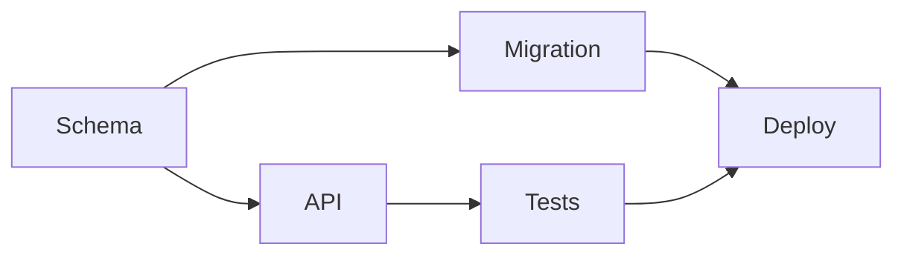
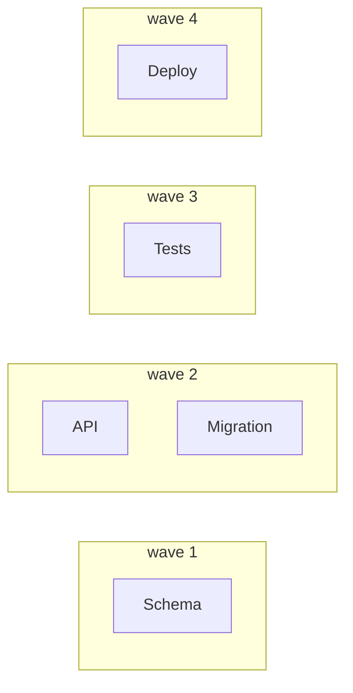

# Task Graphs — Dependencies and the Frontier

> You can compute what is runnable *right now* from the graph, instead of
> running the list in the order someone happened to write it.

**Type:** Learn
**Prerequisites:** Lesson 98 (Nodes and Edges); Phase 12, Lesson 78 (Dynamic Workflows)
**Time:** ~35 minutes

---

## Learning Objectives

- Name the frontier of a task graph at any moment
- Compute execution waves by taking nodes whose parents are all finished
- Tell the static layering (waves) apart from the live ready set (the frontier)
- Spot a node that will never enter the frontier

---

## The Problem

A planner wrote twelve tasks in a sensible reading order — context first, code in
the middle, cleanup last. The runner did the obvious thing and ran them top to
bottom, one at a time.

Six of those tasks had no dependency on each other at all. The whole thing took
four hours. The graph said it could take fifty minutes.

So on the next run, someone made it fire all twelve at once. That worked right up
until the deploy step ran while the migration was still half-applied, and the
service went down against a half-migrated database.

Both runs failed the same way. Neither one asked the graph a question — it just
read a list, forwards or all at once. A list has no concept of *ready*.

---

## The Concept

A node is **ready** when every node with an edge into it has finished. The set of
ready nodes is the **frontier**, sometimes called the ready set. A task-graph
runner is one loop:

```text
repeat:
    frontier = every unfinished node whose parents are all done
    run the frontier (in parallel)
    mark those done
until nothing is left
```

That is the whole engine. The runner never decides an order; the graph does.



Run the loop by hand. Ready at first: `Schema` alone, because it is the only node
with no parents. Finish Schema. Ready now: `API` and `Migration` — both, at once.
Finish both. Ready: `Tests` and `Deploy`'s parents are `Migration` (done) and
`Tests` (not), so ready is `Tests` alone. Then `Deploy`.

### Waves: the static picture

If you assume every node takes the same unit of time, the frontier splits into
**waves**. A node's wave is `1 + the deepest wave of its parents`; entry nodes are
wave 1. It is the longest chain of dependencies that ends at that node.



Waves are useful because the number of waves is the **critical path length**: the
minimum number of sequential steps, no matter how wide you fan out. Four waves
here means four steps of waiting even with infinite agents.

### Waves are not the frontier

This is the trap. A wave is a *static* layering that assumes every node costs the
same. The frontier is *live*: it is recomputed after every completion, and its
size depends on how long the nodes actually took.

If `Migration` finishes in one second and `API` takes an hour, then the moment
`Migration` is done, `Migration`'s child may become ready while `API` is still
running. A wave diagram would never show that. A runner that waits for the whole
of wave 2 before starting wave 3 has turned a dynamic graph back into a list of
batches — and left parallelism on the table.

The frontier answers "what can run right now". Waves answer "how deep is the
dependency chain". Do not confuse a scheduling convenience with the truth.

### A node that never arrives

A node with an unsatisfiable parent — one whose parent is in a cycle, or was
deleted, or forever fails — never enters the frontier. It just sits there and the
run "finishes" without it. Lesson 104 makes that visible and decides what to do.
For now, notice it: every graph has a set of nodes that *should* run, and a
runner that cannot say which ones did not is quietly losing work.

> **The reframe:** the frontier is not the list of jobs you have — it is the set
> of jobs whose parents have all finished, recomputed after every completion.

The loop above is version-independent. How a specific runner exposes it (a
workflow script, a scheduler) changes with each release; the
[changelog](https://code.claude.com/docs/en/changelog) and
[Run agents in parallel](https://code.claude.com/docs/en/agents) are the pages to
check.

---

## Build It

### 1. Write the graph as data

Make a `tasks.json`. Each task names its outputs and its parents.

```json
{
  "tasks": [
    { "id": "schema",    "needs": [] },
    { "id": "api",       "needs": ["schema"] },
    { "id": "migration", "needs": ["schema"] },
    { "id": "tests",     "needs": ["api"] },
    { "id": "deploy",    "needs": ["migration", "tests"] }
  ]
}
```

✅ You pass when every `needs` entry names a task that exists in the file.

### 2. Compute the waves

```js
// waves.mjs — read a task graph, print its waves and critical path.
import { readFileSync } from 'node:fs';

const graph = JSON.parse(readFileSync(process.argv[2], 'utf8'));
const byId = new Map(graph.tasks.map((t) => [t.id, t]));
const memo = new Map();

function depth(id, stack = []) {
  if (memo.has(id)) return memo.get(id);
  if (stack.includes(id)) throw new Error(`cycle: ${[...stack, id].join(' -> ')}`);
  const parents = byId.get(id).needs;
  const d = parents.length === 0
    ? 1
    : 1 + Math.max(...parents.map((p) => depth(p, [...stack, id])));
  memo.set(id, d);
  return d;
}

for (const t of graph.tasks) depth(t.id);
const maxWave = Math.max(...memo.values());
for (let w = 1; w <= maxWave; w++) {
  const ids = graph.tasks.filter((t) => memo.get(t.id) === w).map((t) => t.id);
  console.log(`wave ${w}: ${ids.join(', ')}`);
}
console.log(`critical path length: ${maxWave}`);
```

```bash
node waves.mjs tasks.json
```

```text
wave 1: schema
wave 2: api, migration
wave 3: tests
wave 4: deploy
critical path length: 4
```

✅ You pass when the output matches what you traced by hand, including that
`schema` is alone in wave 1.

### 3. Break it, and watch the depth change

Add an edge `tests → migration` (the migration needs the tests' fixture), making
`migration` depend on `tests`.

✅ You pass when `migration` moves from wave 2 to wave 4 and the critical path
grows from 4 to 5 — and you can say which single edge did it.

### 4. Create a cycle on purpose

Add `deploy → schema` and re-run.

✅ You pass when the script stops with a `cycle:` message instead of a wrong
answer, and you can name the path it printed.

---

## Use It

| Concept | When you reach for it |
|---|---|
| Frontier / ready set | Every scheduling decision. What can start now. |
| Wave | A static sense of depth. Planning, and estimating the critical path. |
| Critical path length | The floor on wall-clock time — how many sequential steps are unavoidable. |
| Topological order | Any linear order that respects every edge. A runner that uses positions instead of readiness is doing this wrong. |
| `needs: []` | The entry set. If nothing is empty, your graph has no start. |
| A ready node that never runs | A bug to surface, not to ignore. Lesson 104. |

---

## Exercises

1. Take the graph from Lesson 98 and write it as `tasks.json`, then run `waves.mjs`
   on it.
   ✅ You pass when the waves match your hand-trace and the critical path length
   is a number you can defend by pointing at the longest chain.

2. Add one extra dependency to your graph and re-run. Record the before and after
   critical path.
   ✅ You pass when you can name the edge that changed the length and state
   whether it was a real need or a preference (Lesson 100 decides).

3. Write down the frontier at three moments in a run where nodes take different
   amounts of time — right after the first entry node finishes, halfway, and near
   the end.
   ✅ You pass when at least one moment shows a node becoming ready *inside* a
   wave, which a pure wave diagram could not show.

---

## Key Terms

| Term | What people say | What it actually means |
|---|---|---|
| frontier / ready set | "the next tasks" | Unfinished nodes whose parents are all done. Recomputed after every completion. |
| wave | "a batch" | A static layer: 1 + the deepest wave of a node's parents. Assumes equal node cost. |
| critical path | "the long pole" | The longest chain of dependencies. Its length is the floor on wall-clock time. |
| topological order | "the order" | Any linear order that respects every edge. It is one valid order, not *the* order. |
| ready | "runnable" | Every parent finished. Not the same as "not started". |
| stranded node | "it'll run eventually" | A node whose parent can never complete, so it never enters the frontier. Lesson 104. |

---

## What this lesson skipped

**Which edges actually block.** You have treated every edge as a hard wait. Half
of them probably are not — that is Lesson 100, and it is where the real speedup
lives.

**Who runs a ready node.** The frontier is public; taking a node without two
workers colliding is Lesson 101.

**Joining parallel results.** What a node does with several parents' outputs at
once is Lesson 103.

**Failure.** What happens to a node in the frontier when a parent dies is Lesson
104.
