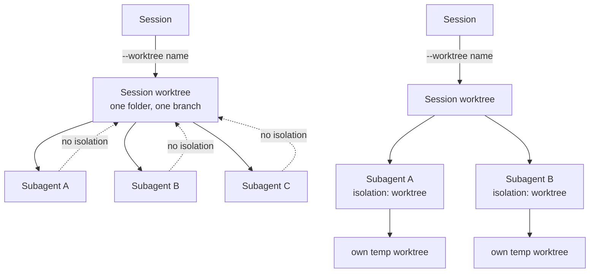

# Session vs Agent Scope

> You can say whether a worktree belongs to a whole session or to one agent —
> before two agents start editing the same file.

**Type:** Learn
**Prerequisites:** Phase 11 (Lesson 74, Worktrees, Deep), Phase 02
**Time:** ~30 minutes

---

## Learning Objectives

- Say whether a given worktree covers a session or a single agent
- Read a subagent file and predict, from its frontmatter, whether it gets its own checkout
- Start a session worktree and a per-agent worktree, and show the difference on disk
- Pick the scope that stops two parallel editors from touching the same file

---

## The Problem

You start a session with a worktree. You spawn three subagents to refactor three
parts of a module that all import the same helper. You assume `--worktree` means
"every agent gets its own checkout."

It does not. It gives the **session** one checkout. Ordinary subagents run in
that one folder.

Two of your subagents edit the same helper file. The second one writes over the
first. When the run ends there is no merge conflict waiting for you — and that
is the tell that something is wrong. There was only ever one copy. The work one
agent did is simply gone, and the file looks like the other agent wrote it.

Nobody lied, and no command failed. You picked the wrong scope.

---

## The Concept

A worktree is a second working folder for the same repository, on its own branch.
That much is Phase 11. The question this lesson answers is **who owns it**: the
session, or one agent inside it.

Two scopes, and they stack.



### Session scope

`claude --worktree <name>` (or `-w`) creates one worktree and starts the session
in it. Claude Code puts it under `.claude/worktrees/<name>/` at the repository
root and checks out a branch named `worktree-<name>`. You can also ask Claude to
"work in a worktree" mid-session; it enters one with the `EnterWorktree` tool.

This isolates the **session** from *other sessions*. Open a second terminal, run
`claude --worktree bugfix`, and the two sessions now have separate folders.

It does **not** isolate subagents from the session or from each other. Every
subagent that is not configured otherwise inherits the session's working folder.
That is usually what you want — an agent editing the session's files. It is a
problem when you launch several at once against overlapping files.

### Agent scope

A subagent can be given its own worktree by adding one line to its frontmatter:

```markdown
---
name: refactorer
description: Applies mechanical refactors across many files
isolation: worktree
---

Apply the requested refactor across every affected file, then run the tests
and report the results.
```

Now each time that subagent runs it gets a **temporary** worktree of its own.
Claude Code removes it automatically when the subagent finishes with no changes.
If the subagent leaves changes behind, the worktree stays on disk so nothing is
lost.

That is the difference in one line: **session scope isolates sessions; agent
scope isolates agents.**

### The base they branch from

Both kinds branch from your repository's default branch by default — the setting
`worktree.baseRef` is `"fresh"`, meaning a clean checkout of `main`. Set it to
`"head"` when the agent must start from your *current* work, including commits you
have not pushed:

```json
{
  "worktree": {
    "baseRef": "head"
  }
}
```

This matters because "fresh" means every agent starts from the same clean base.
If your session's work is uncommitted, an isolated subagent will not see it.

> **The reframe:** a session worktree isolates you from other sessions; a
> per-agent worktree isolates agents from each other — the same trick, aimed at
> two different collisions.

---

## Build It

You need a git repo with at least one commit. Phase 00's lab repo works.

### 1. Start a session worktree and find it on disk

```bash
cd ~/claude-course-lab
claude --worktree auth
```

Then, from another terminal or after the session ends:

```bash
git worktree list
```

✅ You pass when `git worktree list` shows a worktree under
`.claude/worktrees/auth` on a branch named `worktree-auth`.

### 2. Confirm subagents share it

Inside that session, with no subagent configured for isolation, ask Claude to
run any two subagents that touch files. While they run, watch the worktree list
from a second terminal.

```bash
git worktree list
```

✅ You pass when no *new* worktree appears — both subagents are working in the
one session folder.

### 3. Give one subagent its own scope

Create the file `.claude/agents/refactorer.md` with the frontmatter from above,
including `isolation: worktree`. Run it once from the session.

✅ You pass when a second worktree appears under `.claude/worktrees/` while the
subagent runs, and disappears afterwards if it made no changes.

### 4. Make the base explicit

Add the `worktree.baseRef` block to `.claude/settings.json` and set it to
`"head"`. Run the subagent again from a session that has an uncommitted commit.

✅ You pass when the subagent's worktree contains your unpushed commit, visible
with `git -C <that-worktree> log --oneline -1`.

### 5. Explain the failure from The Problem

Two subagents stampeded one helper file. Say, in one sentence, which scope was
missing.

✅ You pass when your answer is "agent scope — they shared the session
worktree," not "session scope — we needed a worktree."

---

## Use It

| Command / concept | When you reach for it |
|---|---|
| `claude --worktree <name>` / `-w` | Isolating a whole session from other sessions |
| `.claude/worktrees/<name>/` | Where Claude Code puts the worktrees it creates |
| `git worktree list` | Seeing every checkout of the repo, and which branch each is on |
| `isolation: worktree` (subagent frontmatter) | Isolating one agent from the session and from its siblings |
| `worktree.baseRef: "fresh"` | Every agent starts from the default branch (the default) |
| `worktree.baseRef: "head"` | Agents start from your current, possibly unpushed, work |
| `EnterWorktree` | Asking Claude to move a running session into a worktree |
| `.gitignore` | Add `.claude/worktrees/` so worktree contents don't show as untracked |

---

## Exercises

1. Run two sessions with `--worktree`, edit the same file in each, and commit in
   each. Merge them yourself.
   ✅ You pass when both commits exist in the repository history and you can name
   the branch each came from.

2. Take a subagent that edits several files, give it `isolation: worktree`, and
   run two copies of it at once.
   ✅ You pass when two separate worktrees appear in `git worktree list` and
   neither agent's edits show up in the other's folder.

3. For each of these, write down the scope you would choose and why: (a) three
   research subagents that only read code; (b) three subagents that each
   rewrite a different package's internals; (c) one subagent fixing a typo.
   ✅ You pass when (a) and (c) are agent-free — they cannot collide — and (b) is
   per-agent isolation, with your reason matching "they edit files in parallel."

---

## Key Terms

| Term | What people say | What it actually means |
|---|---|---|
| session worktree | "isolation for my agents" | One checkout for the whole session. It isolates the session from other sessions, not its subagents from each other. |
| agent worktree | "a worktree" | A checkout that belongs to one subagent, created because its frontmatter says `isolation: worktree`. |
| `isolation: worktree` | "agent isolation" | A subagent frontmatter field. One line; each run gets its own temporary checkout. |
| base ref | "where it branches from" | `worktree.baseRef`: `"fresh"` = the default branch, `"head"` = your current local work. |
| `EnterWorktree` | "opening a worktree" | Claude moving the running session into a worktree mid-session. |
| `.worktreeinclude` | "copying my env file in" | A list of gitignored files (`.env`, and so on) copied into every worktree Claude Code creates. |

---

## What this lesson skipped

**The desktop app's worktree option.** Select **worktree** when you start a
desktop session and you get the same thing without the flag. Same mechanism,
a different door.

**Non-git version control.** SVN, Perforce, and Mercurial need `WorktreeCreate`
and `WorktreeRemove` hooks. Come back when you are not on git.

**Sparse and partial worktrees.** Useful in monorepos to check out only the part
you need. Phase 17's scaling material, not this.

**Every cleanup rule.** Which worktrees Claude Code sweeps, locks, and keeps is
a page of its own. The short version: uncommitted work and unpushed commits keep
a worktree on disk, and that is exactly the safety net Lesson 110 is about.

Checked against the Claude Code worktrees documentation in October 2026:
<https://code.claude.com/docs/en/worktrees>. Version-gated details drift — verify
in your build.
