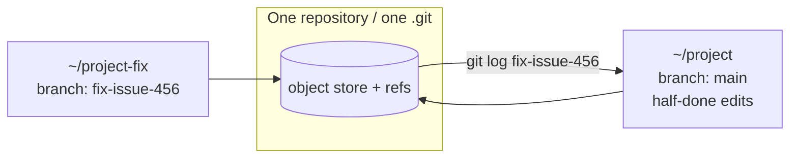

# Manual Worktrees — `git worktree add`

> You can put a second checkout of the same repository on any branch, anywhere on
> disk, without disturbing the folder you are already working in.

**Type:** Build
**Prerequisites:** Phase 02 (Lessons 13–15), Phase 11
**Time:** ~35 minutes

---

## Learning Objectives

- Create a worktree on a brand-new branch and on an existing one
- Commit inside a worktree and read that commit back from the main checkout
- Explain why one branch cannot be checked out in two worktrees at once
- Remove a worktree on purpose, and name what gets deleted with it

---

## The Problem

You are halfway through a refactor on `main`, with changes you are not ready to
commit. A bug report lands on `fix-issue-456`.

Every move you know is bad:

- `git stash` — and now your half-done work is in a place you have to remember to
  come back to. Ask any agent: stashes get lost.
- Commit the half-done work — and now `main` carries a commit labelled "wip" that
  someone will find in three months.
- `git switch fix-issue-456` — and git carries your uncommitted edits *into* the
  fix branch, where they will tangle with the actual fix.

There is a fourth move, and it is the whole reason `git worktree` exists: give
`fix-issue-456` a folder of its own, and leave `main` exactly as it is.

---

## The Concept

A worktree is a second working directory for the same repository. It has its own
files and its own checked-out branch, but it **shares the repository's object
store and refs** with every other worktree. A commit you make in one is a commit
in the repository, visible from all of them.



Two folders, one history. The branch you check out in a worktree stays there.

### The commands

```bash
# a worktree on a new branch
git worktree add ../project-fix -b fix-issue-456

# a worktree on a branch that already exists
git worktree add ../project-fix fix-issue-456

# list them
git worktree list

# remove one (add --force if it has uncommitted changes or untracked files)
git worktree remove ../project-fix
```

### One branch, one worktree

Git refuses to check out the same branch in two worktrees at once. Try it and you
get an error naming the other worktree. This is not a limitation to work around
— it is what stops two folders from rewriting the same branch and racing each
other. Every worktree gets a *different* branch, always.

### Claude's flag is sugar over this

`claude --worktree <name>` from Lesson 106 runs this machinery for you: it
creates the worktree under `.claude/worktrees/` and checks out `worktree-<name>`.
Use the manual form when you need something the flag does not do — an *existing*
branch, or a folder outside the repository.

One difference that bites later: Claude Code's cleanup sweep only manages
worktrees **it** created. A worktree you made with `git worktree add` is yours to
remove.

> **The reframe:** `git worktree add` gives the branch its own folder, so
> switching branches stops meaning "putting my uncommitted work at risk."

---

## Build It

### 1. Make a repo with work you are not ready to commit

```bash
mkdir -p ~/wt-drill && cd ~/wt-drill
git init
printf 'v1\n' > app.txt
git add app.txt && git commit -m "start app"
printf 'half-done\n' >> app.txt
git status
```

`app.txt` is modified but uncommitted. Leave it that way.

✅ You pass when `git status` shows `app.txt` modified and no worktree exists
yet (`git worktree list` shows only the main folder).

### 2. Add a worktree on a new branch

```bash
git worktree add ../wt-drill-fix -b fix-issue-456
git worktree list
```

✅ You pass when `git worktree list` shows **two** entries: the main folder on
`main`, and `../wt-drill-fix` on `fix-issue-456`.

### 3. Commit in the worktree, read it from main

```bash
cd ../wt-drill-fix
printf 'fixed\n' >> app.txt
git add app.txt && git commit -m "fix: handle empty input"
cd ~/wt-drill
git log --oneline fix-issue-456
git log --oneline main
```

The commit is now in the repository. `main` does not have it, and `main`'s
half-done edit is still sitting there untouched.

✅ You pass when `fix-issue-456` shows the fix commit, `main` does not, and the
main folder's `app.txt` still shows your uncommitted `half-done` line.

### 4. Try to check the branch out twice

```bash
git switch fix-issue-456
```

✅ You pass when git refuses, naming `../wt-drill-fix` as the worktree that
already has that branch checked out.

### 5. Remove the worktree and watch what goes with it

```bash
git worktree remove ../wt-drill-fix
git worktree list
git log --oneline fix-issue-456
```

✅ You pass when the worktree is gone but the commit is **still** in the log —
the folder went, the history stayed.

### 6. See the failure mode for yourself

Recreate the worktree, edit a file, and remove it **without committing**:

```bash
git worktree add ../wt-drill-fix fix-issue-456
cd ../wt-drill-fix && printf 'uncommitted\n' >> app.txt
cd ~/wt-drill
git worktree remove --force ../wt-drill-fix
```

✅ You pass when the edit is gone and you can say why: uncommitted work lives
only in that folder, and the folder was deleted.

---

## Use It

| Command / concept | When you reach for it |
|---|---|
| `git worktree add <path> -b <branch>` | A worktree on a new branch, started where you are |
| `git worktree add <path> <branch>` | A worktree on a branch that already exists |
| `git worktree list` | Seeing every checkout of the repo and its branch |
| `git worktree remove <path>` | Cleaning up when you own the worktree |
| `--force` | Removing one that has uncommitted changes or untracked files |
| Worktree shares `.git` | Why a commit in one folder is visible from all of them |
| One branch per worktree | Why git refuses the second checkout of the same branch |
| Manual vs `--worktree` | Manual when you need an existing branch or a path outside the repo |

---

## Exercises

1. Create one worktree on an existing branch and one on a new branch. Commit in
   each. From the main folder, show both commits in one `git log --all --oneline`.
   ✅ You pass when a single command lists commits from both worktrees, and you
   can say which object store they share.

2. Reproduce the "branch already checked out" error, read the full message, and
   then do the thing it suggests instead of forcing it.
   ✅ You pass when you can quote the worktree git names, and you resolved it
   without deleting anything.

3. Create a worktree, leave an uncommitted change in it, and try to remove it
   without `--force`.
   ✅ You pass when git warns you the worktree contains modifications — and you
   can say what `--force` would have destroyed.

---

## Key Terms

| Term | What people say | What it actually means |
|---|---|---|
| worktree | "a copy of the repo" | A second working folder for one repository, on its own branch, sharing the object store. |
| `git worktree add` | "checkout into a folder" | Creates that folder and checks out a branch in it. |
| shared object store | "they're synced" | Every worktree writes commits to the same `.git`. There is nothing to sync. |
| one branch per worktree | "git won't let me switch" | Git forbids the same branch in two worktrees. This prevents two folders racing one branch. |
| `git worktree remove` | "deleting the worktree" | Deletes the folder and its branch bookkeeping. Uncommitted work goes with it. |

---

## What this lesson skipped

**`git worktree lock` / `unlock`.** Protects a worktree from being pruned while
you might not be looking at it. Rarely needed by hand; Claude Code uses it
internally so its own cleanup cannot remove a running agent's worktree.

**Bare repositories and detached worktrees.** Real, and outside this course's
path.

**The `.worktreeinclude` file.** Copies gitignored files such as `.env` into
worktrees Claude Code creates. It only applies to `--worktree`, not to a worktree
you add by hand — copy those files yourself.

**Garbage collection of pruned worktrees.** `git worktree prune` cleans up
bookkeeping for worktrees whose folders are already gone. Come back if
`git worktree list` shows entries whose directories no longer exist.
