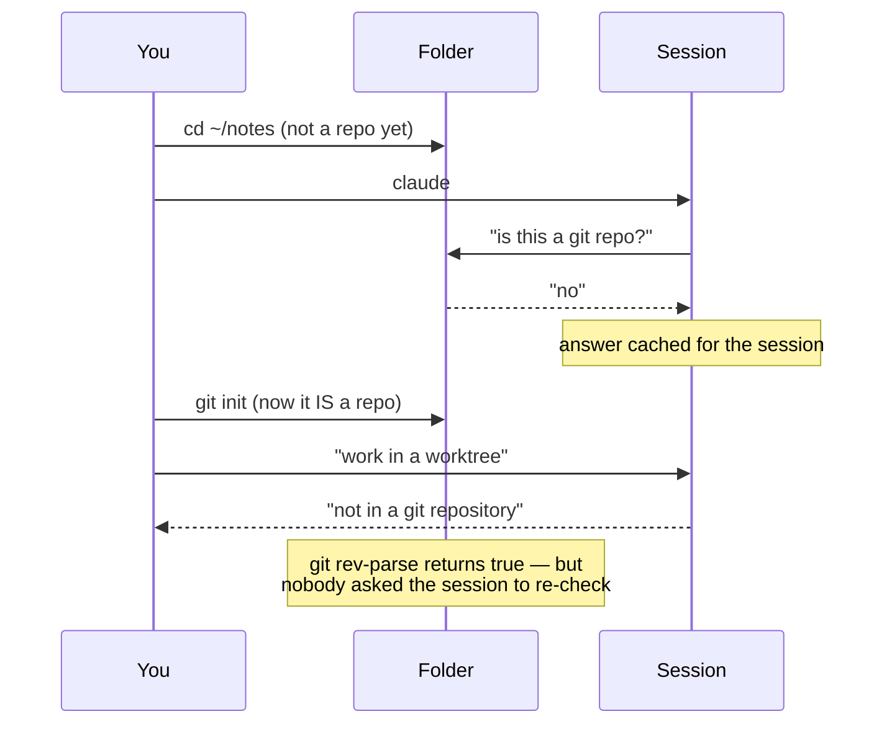

# The Startup-Cache Trap

> You can tell why a session says "not in a git repository" when `git rev-parse`
> — in the same folder — says otherwise, and you know the one fix.

**Type:** Learn
**Prerequisites:** Phase 00 (Lesson 1), Phase 11
**Time:** ~25 minutes

---

## Learning Objectives

- Explain why a session says "not in a git repository" when `git` thinks otherwise
- Reproduce the refusal in a folder that became a repository mid-session
- Fix it by restarting the session inside the repository
- State the ordering rule that avoids the trap entirely

---

## The Problem

A session started in `~/notes` — a plain folder, not a repository. Halfway
through, you decide you want a parallel agent, so you run `git init` right there
and make a first commit. In your terminal, everything checks out:

```bash
git rev-parse --show-toplevel
# /home/you/notes
```

Then you ask the agent to work in a worktree. It refuses:

```text
not in a git repository
```

You run `git rev-parse` again. Still fine. You try three more commands. Still
fine. The agent is not lying and git is not broken. The two of you are looking at
different answers to the same question, and the session will not re-ask it.

This is the trap that cost this course a session. It is worth ten minutes to
understand, because the fix has nothing to do with git.

---

## The Concept

When a session launches, it works out **once** whether it is inside a git
repository, and where that repository's root is. It caches that answer and uses
it for the rest of the session. This is the same "the working folder is decided
at launch" behaviour Lesson 1 warned you about, seen from the other side: it is
not just *where* the session is, it is *what the session believes the folder is*.



`git rev-parse --show-toplevel` reads the folder *right now*. The worktree tool
reads the cached answer from launch. Both are correct about different moments.

Why it is a trap and not just a quirk: the two checks disagree, so every instinct
you have says "the tool is wrong, retry." Retrying is the one thing that cannot
work. Nothing you type in that session changes a decision that was already made.

### The fix

Restart the session **in an existing repository**. Not "run `git init` earlier in
the same session" — the session has to *start* inside the repo:

```bash
cd ~/notes
# make it a repo first, in your own terminal, before you launch
git init && git add -A && git commit -m "chore: start"
claude
```

Then worktrees are available for the whole session.

### Why this is also a Phase 00 lesson

Lesson 1's closing warning is the short version of this: *run `git init` before
you start a session, not during one.* This lesson is that warning with the
mechanism exposed. The mechanism matters because it generalises: a session caches
several facts about where it started, and `git init` mid-session is the one that
produces a refusal with no matching symptom anywhere else.

> **The reframe:** a session answers "is this a git repo?" once, when it starts —
> so a repository created afterwards is invisible to it, and the fix is a
> restart, not a retry.

---

## Build It

You need a folder that is **not** a git repository. Do this in a scratch
directory, not in this repo.

### 1. Launch in a non-repo folder

```bash
mkdir -p ~/cache-trap && cd ~/cache-trap
claude
```

Ask the session to make a worktree — for example, "work in a worktree named
trap".

✅ You pass when the session reports it cannot, naming git or the repository.

### 2. Create the repo *while the session is running*

Leave the session open. In a second terminal:

```bash
cd ~/cache-trap
git init
printf 'hello\n' > file.txt
git add file.txt && git commit -m "first commit"
git rev-parse --show-toplevel      # prints ~/cache-trap
```

✅ You pass when `git rev-parse --show-toplevel` prints your folder — git itself
is convinced.

### 3. Ask the session again

Back in the running session, ask once more to make a worktree.

✅ You pass when it refuses **again**, or fails the same way — the repo you just
created did not change its answer.

> If your build *does* succeed here, the behaviour has changed. Record what
> happened and the version you ran. The lesson is still the mechanism: a cached
> launch-time answer is why a stale "no" survives.

### 4. Restart in the repo and try again

Exit the session, then:

```bash
cd ~/cache-trap
claude
```

Ask for the worktree again.

✅ You pass when it works now — a worktree appears under `.claude/worktrees/`
and `git worktree list` shows it.

### 5. Write the rule you will actually follow

In one line: when do you run `git init`?

✅ You pass when your rule says "before I start the session," and you can state
what goes wrong if it slips to "during."

---

## Use It

| Symptom / command | What it means |
|---|---|
| "not in a git repository" though `git rev-parse` disagrees | The session cached "not a repo" at launch. Restart inside a repo. |
| `git init` during a session | Makes the folder a repo; does not update the session's cached answer. |
| `git rev-parse --show-toplevel` | Reads the folder now. Reliable, and not what the session is using. |
| Worktrees require a repo | From session start, not from any point during it. |
| Restart in the repo | The only fix; a retry in the same session cannot help. |
| Trust dialog | First interactive run in a folder asks you to accept workspace trust before `--worktree` will work. |

---

## Exercises

1. Reproduce the trap end to end in a scratch folder, then fix it by restarting.
   ✅ You pass when you have the refusal from the same session and a working
   worktree from the restarted one, with the folder unchanged between them.

2. Reproduce the trap with `claude --worktree trap` instead of asking mid-session.
   ✅ You pass when you can say whether the flag changes the outcome, and why the
   cache is read before the flag can matter.

3. Explain to someone (or in writing) why "just retry" is the wrong instinct
   here, in two sentences.
   ✅ You pass when your explanation names a *cached, launch-time* decision — not
   a permissions problem or a slow filesystem.

---

## Key Terms

| Term | What people say | What it actually means |
|---|---|---|
| startup cache | "the tool is broken" | The repository check the session resolved at launch and keeps for the session. |
| "not in a git repository" | "but git says it is" | Both are true; git reads the folder now, the session reads its launch-time answer. |
| `git init` mid-session | "I made it a repo" | It did. The session did not notice, and will not re-check. |
| restart | "closing and reopening" | Launching a new session inside the repo so it caches the right answer. |
| workspace trust | "a permission prompt" | The first interactive run in a folder asks you to accept it; `--worktree` needs it. |

---

## What this lesson skipped

**Any other fact a session caches at launch.** This lesson names the one that
produces a misleading error. Treat the general claim — that a session's view of
its start state is fixed — as the takeaway, and verify others in your build
rather than assuming.

**Which versions behave this way.** Claude Code ships weekly and this is observed
behaviour, not a quoted guarantee. The exact message and whether the cache still
exists in your build can drift; the mechanism, and the restart-first fix, do not.

**Non-git version control.** Worktrees normally need git. SVN, Perforce, and
Mercurial can work through `WorktreeCreate` hooks, which sidesteps the git
check entirely.
