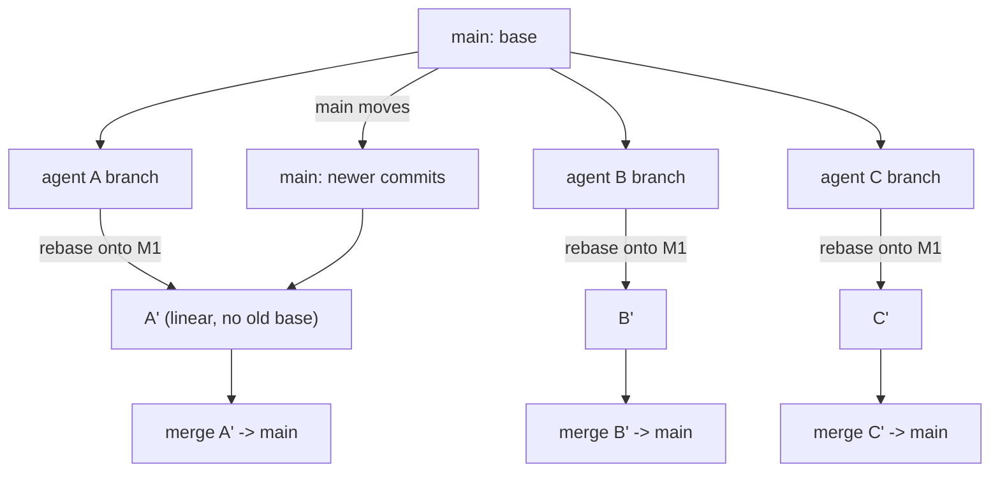

# Merge Strategy for Agent Branches

> You can merge a shelf of agent branches the hour they finish — instead of
> untangling conflicts between work that never actually disagreed.

**Type:** Learn
**Prerequisites:** Phase 02 (Lessons 14–15), Phase 11
**Time:** ~35 minutes

---

## Learning Objectives

- Rebase an agent branch onto today's `main`, and say why that removes stale-base conflicts
- Choose a merge order and defend it against "merge as they finish"
- Merge an agent branch with `--no-ff` and read the resulting graph
- State when an agent branch is safe to rebase versus merge

---

## The Problem

Five agents ran in five worktrees. Each produced good work. You decided to merge
"when I get to it," and two days passed.

`main` moved three times in those two days. When you finally merge the branches
in completion order, the third one conflicts with a change the first one made to
the same function — and neither agent ever saw the other's code. The changes are
each individually correct. The conflict exists only because both branches were
cut from a `main` that no longer exists.

You spend the afternoon resolving a conflict between two pieces of work that
were never in dispute. The lesson is not "read conflicts better." It is that the
longer an agent branch sits, the more it fails for reasons unrelated to the work
in it.

---

## The Concept

An agent branch is a **parcel**, not a feature branch you keep. It is:

- **short-lived** — its job ends when the agent reports done;
- **private** — nobody else has it, so rewriting it is safe;
- **cut from a base** — by default the repository's default branch, the same
  clean `main` every other agent started from.

Those three properties decide the strategy, and the strategy is the Phase 02 rule
applied to agent work:

> Rebase a branch you own. Merge a branch anyone else has.

An agent branch is yours until you merge it. So rebase it onto today's `main`
before it goes in.



### The order matters

Merge in the order the branches will read well in history — usually the order
you started the agents, or the catalog order if the work is a numbered sequence.
"Completion order" is the wrong key: agents finish out of order, and merging by
finish time puts a branch built on an older `main` under one built on a newer one
for no reason.

### Rebase, then merge

```bash
# in or targeting each agent's branch
git fetch origin                      # make sure main is current
git rebase origin/main                # replay the agent's commits on today's main

# back on main
git merge --no-ff worktree-refactor-a  # record the join explicitly
```

Rebasing each branch onto the *same* new `main` first means every branch is built
on the same base when it merges. That is what removes the "conflict between work
that never disagreed." If a genuine conflict survives the rebase, it is a real
one — two agents changed the same lines — and Lesson 15's reading of the markers
applies.

`--no-ff` forces a merge commit even when a fast-forward is possible. It costs
one commit and buys a visible record that this batch of agent work came in
together. Optional, but it is what makes `git log --graph` legible later.

### What "immediately" buys you

Merge the moment an agent finishes. Every hour a branch waits, `main` can move,
and the rebase gets bigger. The repo convention is blunt about it for the same
reason: **one agent, one branch. Merge immediately — branches drift.**

> **The reframe:** an agent branch is a parcel to be delivered the hour it is
> packed — rebase it onto today's `main` and merge it before `main` moves again.

---

## Build It

### 1. Set up a repo and two branches from the same base

```bash
mkdir -p ~/merge-drill && cd ~/merge-drill
git init
printf 'a\n' > a.txt && printf 'b\n' > b.txt
git add -A && git commit -m "base"
git branch agent-a
git branch agent-b
```

✅ You pass when `git branch` lists `agent-a` and `agent-b`, both at the same
commit as `main`.

### 2. Give each branch independent work

Use two worktrees so you can edit both at once (Lesson 107):

```bash
git worktree add ../merge-drill-a agent-a
git worktree add ../merge-drill-b agent-b
# in ../merge-drill-a: edit a.txt, commit "agent a: edit a"
# in ../merge-drill-b: edit b.txt, commit "agent b: edit b"
```

✅ You pass when each branch has exactly one commit the other does not.

### 3. Move `main` underneath them

```bash
cd ~/merge-drill
printf 'c\n' > c.txt && git add c.txt && git commit -m "main: unrelated"
```

✅ You pass when `main` has a commit neither agent branch has.

### 4. Rebase each onto the new `main`, then merge in order

```bash
git rebase main agent-a
git rebase main agent-b
git switch main
git merge --no-ff agent-a
git merge --no-ff agent-b
git log --oneline --graph
```

✅ You pass when both merges succeed with **no conflict**, and the graph shows
two merge commits in the order you chose.

### 5. Now do it the other way and feel the difference

Reset to before the merges, and instead merge the *stale* branches without
rebasing. Change the same line in both branch worktrees first.

```bash
# in both worktrees, edit the SAME line of a.txt and commit
git switch main
git merge agent-a
git merge agent-b        # conflict
```

✅ You pass when you get a conflict in `a.txt`, and you can say it appeared
because both branches changed the same region — not because the agents
disagreed about anything else.

---

## Use It

| Command / concept | When you reach for it |
|---|---|
| `git rebase origin/main` on an agent branch | Bringing a finished agent's work up to today's base |
| `git merge --no-ff <branch>` | Merging an agent branch and recording the batch explicitly |
| Merge order | Creation or catalog order, never completion order |
| One agent, one branch | Keeping the parcel small and attributable |
| Merge immediately | Before `main` moves and the rebase grows |
| `git log --oneline --graph` | Reading what arrived and in what order |
| Fast-forward | Fine when the branch is a straight extension of `main` |
| `git branch -d <branch>` | Deleting the branch once it is merged |

---

## Exercises

1. Run three agent branches from one base, move `main` twice, then rebase all
   three onto the new `main` and merge them in a chosen order.
   ✅ You pass when all three merge with no conflict and you can point at the
   shared base each was rebased onto.

2. Merge the same three branches **without** rebasing, in completion order.
   Record where conflicts appear and whether they correspond to real
   disagreements.
   ✅ You pass when you can name at least one conflict caused purely by a stale
   base, not by two agents editing the same lines.

3. Merge `agent-a` with a fast-forward and `agent-b` with `--no-ff`, then compare
   `git log --graph`.
   ✅ You pass when you can say which history is easier to explain to a reviewer
   and what the extra merge commit bought.

---

## Key Terms

| Term | What people say | What it actually means |
|---|---|---|
| agent branch | "the agent's work" | A private, short-lived branch created for one agent. Yours until merged. |
| merge order | "merge as they finish" | Creation or catalog order. Completion order merges stale bases under fresh ones. |
| rebase before merge | "cleaning up" | Replaying the branch on today's `main` so it merges from the same base as its siblings. |
| `--no-ff` | "a real merge" | Forces a merge commit, recording the batch instead of sliding the label. |
| branch drift | "it got stale" | The time a branch waits while `main` moves. The cost is rebase size, not the agent's work. |
| stale-base conflict | "the agents disagreed" | A conflict from two branches cut from an old `main`. Not a real disagreement. |

---

## What this lesson skipped

**`/batch` and PR-based fan-out.** Claude Code can run many subagents and have
each publish a change, often as a pull request. That is the same merge problem at
a larger scale, and it is Phase 11 Lesson 75's territory.

**Stacked branches and merge trains.** When agent B depends on agent A's branch.
Real, and a different shape from the flat fan-out here.

**Squashing an agent branch to one commit.** `git merge --squash` collapses the
parcel into a single change. Useful when the agent's intermediate commits are
noise — and it is `git rebase -i` territory, deliberately left to when you are
cleaning up your own unpushed work.
