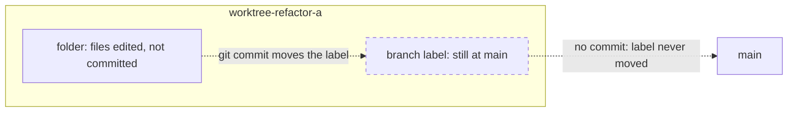

# Isolation Without a Commit Is Not a Backup

> You can tell "the agent's work is isolated" apart from "the agent's work is
> safe" — and they are not the same thing.

**Type:** Learn
**Prerequisites:** Phase 02 (Lessons 12 and 16), Phase 11
**Time:** ~30 minutes

---

## Learning Objectives

- Detect an empty agent branch whose folder still holds uncommitted work
- Explain why `git worktree remove` destroys work that `git reflog` cannot recover
- Add a commit instruction to an agent so its branch is never left empty
- Write the two-command check to run before merging any agent branch

---

## The Problem

Three agents ran in three worktrees. Each produced complete, correct work. Each
reported success in a clean, confident summary.

You go to merge. You list the branches:

```bash
git branch --all
#   main
# * worktree-refactor-a
#   worktree-refactor-b
#   worktree-refactor-c
```

Every worktree branch points at `main`. Every one is empty — no commits of its
own. The folders are full of edits. The branches have nothing to merge.

This is not hypothetical. It happened building this course. Three agents did
perfect work and left three folders nobody could merge, because none of them
committed. When those worktrees were eventually swept or removed, the edits went
with them.

The agents did not fail. They did exactly what they were asked — edit the files
and report. Nobody asked them to commit, so nobody's work was ever recorded.

---

## The Concept

A worktree is **a folder plus a branch label**. That is the whole machine.



Editing a file changes the **folder**. Only `git commit` moves the **label**. In
an untouched worktree the label sits exactly where the base was — usually `main`.
So an agent can edit every file for an hour and the repository still sees a
branch identical to `main`.

Isolation protects against **collision**. It does not protect against **loss**.
The worktree still obeys the oldest git rule in the course: uncommitted changes
live only in the folder they are in. Remove the folder, lose the changes.

### Why it is silent

Two things make this failure invisible until it is too late:

- **The agent's report is about files, not commits.** "I refactored the parser
  and ran the tests" is true whether or not anything was committed.
- **Nothing errors.** Git is perfectly happy to hold uncommitted work. There is
  no warning that a branch is empty, because an empty branch is a normal state.

### The check that would have caught it

From the main checkout, before merging anything:

```bash
git log --oneline main..worktree-refactor-a    # empty output = nothing to merge
git -C .claude/worktrees/refactor-a status --porcelain   # non-empty = real, uncommitted work
```

If the first is empty and the second is not, you have found the bug. That
combination — *empty branch, dirty folder* — is the signature.

### The fix is an instruction, not a tool

There is no flag that makes isolation also mean "committed." The fix is to put
the rule in front of the agent:

> **Commit before you finish.** `git add -A && git commit -m "..."`. At minimum a
> `wip` commit at the end of each step.

Once committed, the work is in the repository's object store — shared by every
worktree — and it survives the folder's removal. From that point the branch is a
normal branch you can rebase and merge (Lesson 109), and even a mistake is
recoverable through the reflog (Lesson 16).

> **The reframe:** isolation is not a backup — until the agent commits, its branch
> is still pointing at `main`, and the folder holds work git has never recorded.

---

## Build It

### 1. Make a worktree and dirty it without committing

```bash
mkdir -p ~/isolation-drill && cd ~/isolation-drill
git init
printf 'v1\n' > app.txt && git add app.txt && git commit -m "start"
git worktree add ../isolation-drill-agent -b worktree-agent
cd ../isolation-drill-agent
printf 'real work\n' >> app.txt
git status --porcelain
```

✅ You pass when `git status --porcelain` shows `app.txt` modified and the folder
holds a real edit.

### 2. Show the branch is empty

From the main folder:

```bash
cd ~/isolation-drill
git log --oneline main..worktree-agent
git diff main worktree-agent
```

✅ You pass when **both** commands print nothing — the branch has no commits and
no content difference, even though the folder is edited.

### 3. Confirm the edit is only on disk

```bash
git -C ../isolation-drill-agent status --porcelain
```

✅ You pass when this is non-empty while step 2 is empty. That disagreement is
the empty-branch bug.

### 4. Remove the worktree and watch the work vanish

```bash
git worktree remove --force ../isolation-drill-agent
ls ~/isolation-drill
```

✅ You pass when the folder is gone and the uncommitted edit with it — git cannot
merge, restore, or reflog anything that was never committed.

### 5. Do it again, with a commit

```bash
git worktree add ../isolation-drill-agent -b worktree-agent
cd ../isolation-drill-agent
printf 'real work\n' >> app.txt
git add -A && git commit -m "agent: real work"
cd ~/isolation-drill
git log --oneline main..worktree-agent     # now shows the commit
git worktree remove ../isolation-drill-agent
git log --oneline worktree-agent           # commit survives the folder
```

✅ You pass when the commit is visible **after** the worktree is removed — the
work moved from "a folder" to "the repository."

---

## Use It

| Command / concept | When you reach for it |
|---|---|
| `git log --oneline main..<branch>` | Checking a finished agent branch has commits to merge |
| `git -C <worktree> status --porcelain` | Seeing uncommitted work inside a worktree |
| `git add -A && git commit` | The instruction every agent needs before it reports done |
| WIP commit | Cheap insurance before anything risky |
| Empty branch + dirty folder | The signature of the empty-branch bug |
| `git worktree remove --force` | Deletes uncommitted work. Know that before you run it. |
| `git reflog` | Recovers committed work only. Never uncommitted work. |
| `main..branch` range | "What is on the branch that is not on main" — the merge preview |

---

## Exercises

1. Reproduce the empty-branch bug from scratch: a worktree, real edits, no
   commit, and a branch that still equals `main`.
   ✅ You pass when `git log --oneline main..<branch>` is empty while
   `git -C <worktree> status --porcelain` is not.

2. Take the same scenario and add a two-line instruction so a second run cannot
   finish without committing. Verify the branch is no longer empty at the end.
   ✅ You pass when a run that edits files leaves the branch with at least one
   commit, and `main..<branch>` is non-empty.

3. Write the one-line check you would run **before** merging any agent branch,
   and what its two outputs must disagree about.
   ✅ You pass when your check runs `main..<branch>` and `status --porcelain`,
   and "empty + dirty" is the failure you are looking for.

---

## Key Terms

| Term | What people say | What it actually means |
|---|---|---|
| isolation | "the work is safe" | Separate folders so edits do not collide. It says nothing about whether work is recorded. |
| empty branch | "the branch is there" | A branch label pointing where it started — usually `main` — with no commits of its own. |
| uncommitted work | "the agent's changes" | Edits that live only in one folder. Not in the object store. Not recoverable by git. |
| WIP commit | "a throwaway commit" | A commit that moves the label. Infinitely better than a folder about to be removed. |
| `main..branch` | "the diff" | Commits on `branch` that are not on `main`. Empty means nothing to merge. |
| worktree removal | "cleaning up" | Deleting a folder. Uncommitted work goes with it, silently. |
| reflog | "git's undo" | Recovers *committed* positions. It cannot see work that was never committed. |

---

## What this lesson skipped

**Automatic guardrails.** A hook or a script that refuses to finish a worktree
with uncommitted work is the durable fix. Building one is the Phase 16 module's
job, not this lesson's — this lesson teaches why the guardrail is needed.

**Recovering work that was never committed and whose folder is gone.** Git
cannot help. Only a filesystem undelete tool or the editor's local history can,
and neither is reliable. This is the reason the rule is "commit before you
finish," not "commit if you remember."

**Every cleanup rule for worktrees.** Which worktrees Claude Code sweeps, and how
uncommitted work and unpushed commits keep them on disk, is documented on the
worktrees page. Worth reading once you have felt this trap.

Checked against the Claude Code worktrees documentation in October 2026:
<https://code.claude.com/docs/en/worktrees>. Behaviour and messages drift; the
git rule does not.
