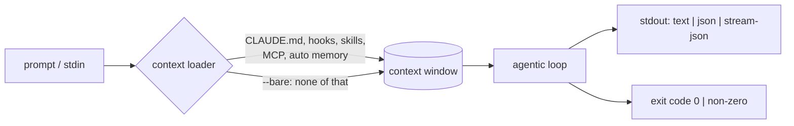

# Headless / Non-Interactive Mode

> You can turn a Claude Code session into one command that runs, prints, and
> exits — and you can say what it loaded and what it skipped.

**Type:** Learn
**Prerequisites:** Lesson 110, Isolation Without a Commit Is Not a Backup
**Time:** ~35 minutes

---

## Learning Objectives

- Run a one-shot task with `claude -p` and read its result
- Pipe input into a run and choose the output format your script needs
- Predict what a `-p` run loads from the working directory, and when that is a liability
- Make an unattended run that cannot hang waiting for a human
- Branch a script on the run's exit code

---

## The Problem

You put `claude -p "write the changelog for this release"` into a GitHub Action.
It worked on your laptop. On the runner it produced a different answer — or
exited non-zero — and nothing in the repository changed.

You did not break anything. The command did exactly what it does everywhere: it
loaded whatever the machine had. On your laptop that was your `CLAUDE.md`, your
hooks, your MCP servers, your personal skills. On the runner there were none of
those. Same command, same prompt, different context — and a result that is
different for a reason you cannot see from the log.

The pain is not "non-interactive mode is hard." It is that headless mode looks
like the CLI with the interface turned off. It is not. It is the whole context
loader, running with nobody to notice what it picked up.

---

## The Concept

Add `-p` (or `--print`) to any `claude` command. The run reads your prompt,
does one turn, prints the result, and exits. No interface, no waiting for you.



Everything left of the loop is the part people forget. An interactive session
and a `-p` run load from the same places: the working directory's
`.claude/`, `~/.claude/`, project `CLAUDE.md`, `.mcp.json`, `auto memory`,
installed plugins. `--bare` skips all of it, so the run is the same on every
machine.

Two doors exist because of how little is different:

- **Input.** The run reads stdin, so you pipe like any other command:
  `cat build-error.txt | claude -p 'explain the root cause'`.
- **Output.** `--output-format text` (default), `json`, or `stream-json`. With
  `json` the payload carries `result`, `session_id`, `total_cost_usd`. With
  `--json-schema` you get a validated `structured_output` field.

The exit code is the script's contract: `0` when the run succeeds, non-zero
when it fails. That is how a job knows to stop.

### The thing that makes unattended runs hang

A `-p` run still follows the permission system. If a tool call needs approval
and nothing can answer, the run waits. Two flags fix it:

- `--allowedTools "Read,Edit,Bash(git diff *)"` pre-approves specific tools.
- `--permission-prompts none` says nobody is available. Anything that would
  prompt is denied, Claude is told so, and the run continues instead of
  stalling. (This flag is version-gated — see the note below.)

There is no approval prompt in a `-p` run and no workspace trust dialog. That
means a `-p` session will run a project's hooks and connect its `.mcp.json`
servers *even in a folder you have never trusted*. That is the security edge of
headless mode; Lesson 114 picks it up.

> **The reframe:** headless mode does not make the agent smaller — it makes
> you absent. Everything a session would load still loads; the only thing gone
> is the person who would have caught it.

**A note on versions.** Claude Code ships weekly, so treat flags, not
versions, as the thing to learn. `--bare` and `--permission-prompts none` are
newer additions; if your binary rejects one, check the [headless
docs](https://code.claude.com/docs/en/headless) and
[CLI reference](https://code.claude.com/docs/en/cli-reference) for its current
spelling. As of this lesson, `--permission-prompts none` requires v2.1.259+,
and some bare-mode limits changed at v2.1.286.

---

## Build It

Run these in a real project folder. Each step ends in something you can point
at.

1. **One-shot question.** Ask about your codebase:

   ```bash
   claude -p "What does the auth module do?"
   ```

   The answer prints and the process exits.

2. **Pipe input in, redirect output out.** Write the answer to a file:

   ```bash
   cat build-error.txt | claude -p 'concisely explain the root cause of this build error' > output.txt
   ```

3. **Get structured output.** Ask for JSON and pull one field:

   ```bash
   claude -p "Summarize this project" --output-format json | jq -r '.result'
   ```

   You also get `session_id` and a client-side cost estimate in the same blob.

4. **Run the same prompt in bare mode.** Compare:

   ```bash
   claude --bare -p "Summarize README.md" --allowedTools "Read"
   ```

   Bare mode skips your `CLAUDE.md`, hooks, skills, plugins, MCP servers, and
   auto memory. It also does not use your subscription login — set
   `ANTHROPIC_API_KEY` first. If your project relies on a skill or a `CLAUDE.md`
   rule, this run won't have it. That difference *is* the lesson.

5. **Branch on the exit code.** Make the shell stop on failure:

   ```bash
   claude -p "run the test suite and fix any failures" --allowedTools "Bash,Read,Edit"
   echo "exit: $?"
   ```

6. **Run it unattended.** Simulate a scheduled job:

   ```bash
   claude -p "Update the dependency pins and run the tests" \
     --permission-mode auto --permission-prompts none
   ```

   It finishes instead of waiting for an approval nobody will give. With
   `--output-format stream-json`, denials appear as `permission_denied`
   messages and the final result lists them in `permission_denials`.

---

## Use It

| Command / concept | When you reach for it |
|---|---|
| `claude -p "…"` | One turn, no interface — scripts, CI, one-off questions |
| `--output-format json` | Your script needs fields, not prose (`result`, `session_id`, cost) |
| `--json-schema '{…}'` | You need a validated shape in `structured_output`, not free text |
| `--output-format stream-json` | You want events as they happen (tokens, tool calls, retries) |
| `--allowedTools "Read,Edit"` | Auto-approve specific tools instead of prompting |
| `--permission-mode auto \| dontAsk \| acceptEdits` | Set the baseline for a whole run, not one tool |
| `--permission-prompts none` | Nobody can answer — jobs must not hang |
| `--bare` | CI and scripts: same result on every machine, load only what you pass |
| `--settings <file-or-json>` | Inject settings for one run without touching a settings file |
| `--mcp-config <file>` | Give a bare run exactly the MCP servers it needs |
| `--append-system-prompt` | Add an instruction (e.g. "you are a typo linter") without replacing defaults |
| `--continue` / `--resume <id>` | Multi-step jobs that build on the previous turn |

---

## Exercises

1. **Make one run reproducible.**
   Write a one-line script that runs the same prompt with and without `--bare`
   in a repo that has a `CLAUDE.md` or a hook. Record both outputs.
   ✅ You pass when you can name the concrete difference the two runs produced
   and say which flag belongs in CI.

2. **Turn a command into a contract.**
   Wrap a `claude -p` call in a shell script that exits non-zero when the run
   fails, so a job stops instead of committing a lie.
   ✅ You pass when forcing the run to fail (bad input or a denied tool) makes
   your script exit with a non-zero status.

3. **Build a JSON pipeline.**
   Run a task with `--output-format json` (add `--json-schema` if you want a
   fixed shape) and parse exactly one field with `jq`.
   ✅ You pass when your script prints that one field to stdout and exits `0`.

4. **Make it survive nobody answering.**
   Run a command that would normally prompt, with `--permission-prompts none`,
   in a context where stdin is closed.
   ✅ You pass when the run ends on its own — no hang — and you can state, from
   the output, what it was denied.

---

## Key Terms

| Term | What people say | What it actually means |
|---|---|---|
| headless mode | "the CLI without the UI" | The same context loader and loop, with no person to approve or catch anything |
| `-p` / `--print` | "just a flag" | The switch that makes a run do one turn and exit, so it composes like a command |
| `--bare` | "a faster start" | A start that skips auto-discovery — the same result on every machine, and *none* of your setup |
| exit code | "did it work" | The script's contract. `0` success, non-zero failure; a job that ignores it ships garbage |
| stdout / stdin | "I/O" | The two doors that make a run a Unix command: pipe in, format out |
| `--allowedTools` | "permissions" | Pre-approval for a run. Not a security boundary — see Lesson 114 |
| `--permission-prompts none` | "don't ask" | Tell the run nobody is there, so it denies and continues instead of hanging |
| `stream-json` | "verbose JSON" | Newline-delimited events — tool calls, tokens, retries, denials — as they occur |

---

## What this lesson skipped

**The Agent SDK.** `claude -p --output-format json` is already "programmatic,"
but it is still a subprocess you scrape. Lesson 112 is the same loop as a
library with typed output and tool-approval callbacks.

**What a `-p` run may execute without asking.** A `-p` session connects a
project's MCP servers and runs its hooks with no trust dialog. That is a real
edge and it belongs with Lesson 114.

**Cost and session mechanics in depth.** `json` output gives you a client-side
estimate and a `session_id`; using them across a fleet is out of scope here.

**Provider auth.** Bare mode does not read your subscription login. Running on
Bedrock, Google Cloud, or Microsoft Foundry has its own setup; see the
[headless docs](https://code.claude.com/docs/en/headless).
