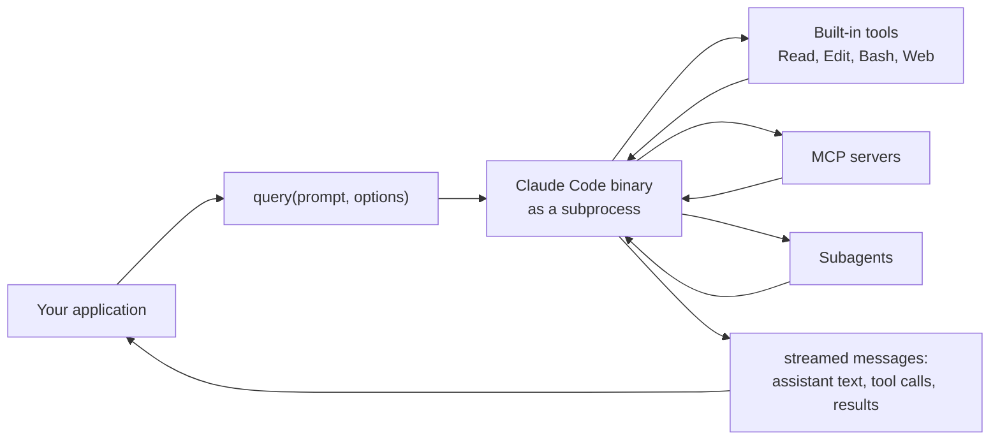

# The Claude Agent SDK

> You can put the same agent loop inside your own program — and say which of
> Claude Code's capabilities you get for free and which become yours to build.

**Type:** Learn
**Prerequisites:** Lesson 111, Headless / Non-Interactive Mode
**Time:** ~35 minutes

---

## Learning Objectives

- Say what the Agent SDK is, using the loop you already know as the anchor
- Recognise when a `claude -p` subprocess is enough and when you need the library
- Write and run a minimal SDK agent that completes one task
- Get validated structured output instead of parsing prose
- Decide tool approval in code, not by hand
- Name the things the terminal did for you that the SDK makes you own

---

## The Problem

You built a small product feature on `claude -p`. It shelled out, parsed the
text it got back, and displayed it. It worked for a month.

Then the model changed a sentence and your parser broke. There was no error —
just a blank panel in your UI because a regular expression missed. You wanted
the agent *inside* your program, and instead you had a stringly-typed pipe to a
terminal tool that happens to be a program.

The pain: the CLI is an interface for a person. Your application is an
interface for a program. Scraping the first to serve the second works until the
text it relies on moves.

---

## The Concept

The Agent SDK is Claude Code as a library. Same agent loop, same built-in
tools, same permissions, sessions, hooks, subagents, and MCP — driven from
Python or TypeScript instead of a prompt.



Read the middle box carefully. The SDK runs Claude Code's binary in a
subprocess. It is not a re-implementation of the loop in a language runtime; it
is a control surface over the same engine, which is why the capabilities below
match the tool you already use.

### What you get for free

| Capability | What it does | Where it comes from |
|---|---|---|
| Built-in tools | Read, write, edit files, run commands, search the web | The tools you met in Phase 04 |
| Permissions | Which tools run, which need approval | The permission system, now with a callback |
| Sessions | Keep context; resume or fork later | Session persistence you met in Phase 04 |
| Hooks | Run your code at lifecycle points | Phase 08, wired from your app |
| Subagents | Isolated, specialised helpers | Phase 06 |
| MCP | External tools and data | Phase 07 |
| Skills, commands, memory | Load from `.claude/` and `~/.claude/` | Phases 05 and 10 |
| Plugins | Package the above and load by path | Phase 09 |

### What becomes yours to build

The terminal did several jobs for you. In the SDK, they move into your code:

- **Approvals.** In the terminal, a prompt appears and a person answers. In the
  SDK, you supply a `canUseTool` callback — or a permission mode — and the
  decision is code.
- **Hosting.** The SDK starts a subprocess. Who supervises it, restarts it, and
  isolates tenants is your deployment problem.
- **Session storage.** Resuming needs somewhere to keep the transcript.
- **Auth.** Third-party products built on the SDK use an API key, not a
  claude.ai login. Anthropic does not permit offering claude.ai login or rate
  limits to your own users without prior approval.
- **Output shape.** If you need typed data, ask for it. The SDK supports
  structured outputs via a schema, and custom tools via an in-process MCP
  server, so you stop scraping.

### When the SDK is overkill

The SDK is one of two ways to run the loop from code, and often the plainest
one wins:

| You want to | Reach for |
|---|---|
| Run a task and read a result inside a script or CI job | `claude -p --output-format json` (Lesson 111) |
| A typed, in-process agent with callbacks and structured output | The Agent SDK (this lesson) |
| Call the Claude API directly and write the tool loop yourself | The Client SDK — different product, more control |
| Let Anthropic host the agent and its sandbox | Managed Agents — different product, less to run |

> **The reframe:** the Agent SDK does not give you a new agent — it hands you
> the loop and takes away the terminal, so everything the terminal quietly did
> for you (approvals, session storage, isolation, auth) becomes something you
> build.

**A note on versions.** The SDK is the fastest-moving surface in this course.
Package names, option shapes, and entry points change often. Learn the
*capabilities* from this lesson and take the exact signatures from the
[Agent SDK docs](https://code.claude.com/docs/en/agent-sdk/overview) and the
[quickstart](https://code.claude.com/docs/en/agent-sdk/quickstart) rather than
memorising them here.

---

## Build It

Install the SDK for your language, set an API key, and build the smallest agent
that does real work on a real file.

1. **Install and authenticate.**

   ```bash
   # TypeScript
   npm install @anthropic-ai/claude-agent-sdk
   # Python
   pip install claude-agent-sdk

   export ANTHROPIC_API_KEY="sk-ant-..."
   ```

2. **Ask for one task in one file.** The `query` function streams messages as
   the agent works. (Treat this shape as illustrative; confirm it against the
   current quickstart.)

   ```ts
   import { query } from "@anthropic-ai/claude-agent-sdk";

   for await (const message of query({
     prompt: "Find the bug in auth and fix it. Explain the fix in one line.",
     options: { allowedTools: ["Read", "Edit", "Bash"] },
   })) {
     console.log(message);
   }
   ```

   You should see assistant messages, a tool call, a tool result, and a final
   message — the loop you learned in Phase 04, streaming to your console.

3. **Get validated output.** Pass a schema and read `structured_output` instead
   of matching on text.

4. **Decide approval in code.** Give the session a `canUseTool` callback (or set
   a permission mode) so your program decides what runs — the terminal prompt,
   moved into your application.

5. **Add a tool of your own.** Define an in-process MCP server so the agent can
   call a function in your codebase. This is how you extend the loop without a
   separate server process.

6. **Keep the session.** Capture the session id and resume it on the next call,
   so a multi-step workflow survives past one process.

---

## Use It

| Thing | When you reach for it |
|---|---|
| `query(prompt, options)` | The entry point: one prompt, a stream of messages back |
| `options.allowedTools` | Pre-approve the tools the agent legitimately needs |
| `canUseTool` callback | You want to approve or deny each call in code |
| Structured output (schema) | Your caller needs typed data, not prose |
| In-process MCP server | You want the agent to call a function in your own process |
| Session id + resume/fork | A workflow spans more than one call |
| Subagents in the SDK | You want context isolation inside your own agent |
| `claude -p --output-format json` | You only need one result in a script — skip the SDK |
| The Client SDK | You want the raw API and will write the tool loop yourself |

---

## Exercises

1. **Convert a scrape to a contract.**
   Take one `claude -p` task you parse with a string operation. Reimplement it
   with the SDK and structured output.
   ✅ You pass when your program reads a typed field and never matches on the
   model's prose.

2. **Move the approval into code.**
   Add a `canUseTool` (or permission-mode) decision for one dangerous tool —
   say, anything that writes files.
   ✅ You pass when the agent's attempt at that action is decided by your code
   and you can point at the log line showing it.

3. **Reproduce the terminal's job.**
   Name three things the CLI did for you (a prompt, a saved session, an auth
   login) and, for each, write the one line of your design that now does it.
   ✅ You pass when each of the three has a named owner in your program, not
   "the SDK handles it."

4. **Choose the cheaper tool.**
   Take a task you automated with the SDK and reimplement it as
   `claude -p --output-format json`.
   ✅ You pass when you can state, in one sentence, which version you would
   ship and why — and it is allowed to be the subprocess.

---

## Key Terms

| Term | What people say | What it actually means |
|---|---|---|
| Agent SDK | "Claude Code in a library" | A library that drives the Claude Code binary as a subprocess, exposing the loop and its capabilities to your program |
| Client SDK | "the SDK" | A different product: raw access to the Claude API where *you* write the tool loop. Not this |
| Managed Agents | "the hosted SDK" | Anthropic runs the harness and the sandbox. Not this |
| `query()` | "the API call" | The entry point that streams one run's messages back to you |
| `canUseTool` | "permissions" | The callback that replaces the terminal prompt, so your code approves or denies |
| in-process MCP server | "a plugin" | Turning a function in your own process into a tool the agent can call |
| structured output | "JSON mode" | A schema-validated result field, so your caller stops parsing prose |
| subprocess architecture | "it just works" | The SDK launches the binary. Who supervises, isolates, and scales it is your deployment problem |

---

## What this lesson skipped

**Hosting at scale.** Session persistence across hosts, multi-tenant
isolation, restarts, and observability are a whole guide. See
[Hosting the Agent SDK](https://code.claude.com/docs/en/agent-sdk/hosting).
This lesson is orientation, not a deployment plan.

**The full option surface.** Models, effort, environment, limits, streaming
input vs single message, and per-feature options each have their own page. The
[configuration](https://code.claude.com/docs/en/agent-sdk/configuration) and
[streaming input](https://code.claude.com/docs/en/agent-sdk/streaming-vs-single-mode)
pages are the next stop.

**Auth beyond an API key.** Bedrock, Google Cloud, Microsoft Foundry, and
gateway routing are provider setup, out of scope here.

**Where the SDK sits in this course's mission.** The mission is parallel
*Claude Code* work, and the SDK is adjacent to it — useful to recognise, not
required to run a fleet. If you never build a product on it, Lesson 113's
surfaces are the better next step.
