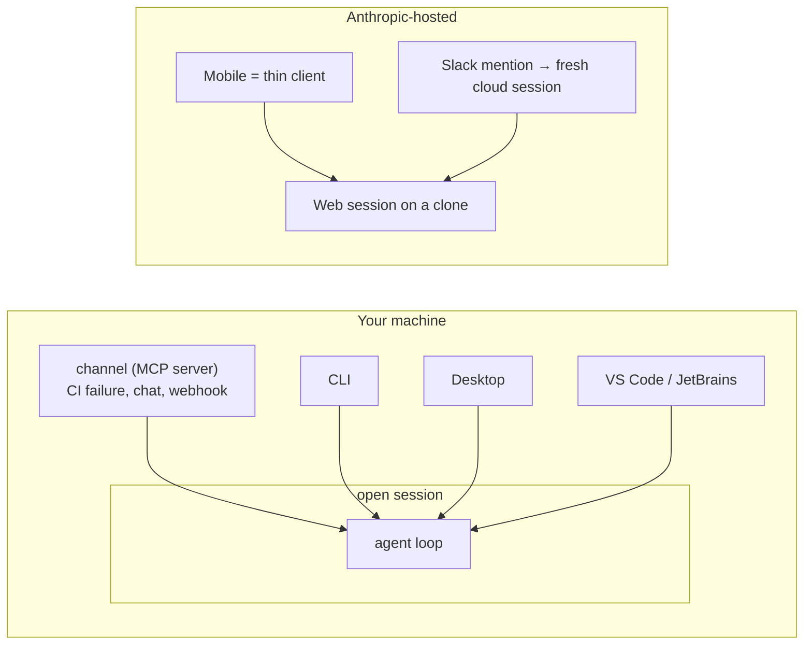

# Channels and Surfaces

> You can say where a run is happening, what context it can see, and how an
> event gets to it — and stop confusing a place to run with a way to wake it up.

**Type:** Learn
**Prerequisites:** Lesson 112, The Claude Agent SDK
**Time:** ~35 minutes

---

## Learning Objectives

- Name the surfaces Claude Code runs on and the one thing each is best for
- Predict which context travels between surfaces and which stays on the machine
- Explain what a channel is and how it differs from a cloud session or a schedule
- Run a channel and watch an outside event arrive in an open session
- Decide, for a given task, whether the surface or the wake-up is the choice that matters

---

## The Problem

You had a session open on your laptop with uncommitted changes and a clear
picture of the bug. A teammate mentioned `@Claude` in Slack and asked it to fix
the failing test.

It started a fresh session in the cloud, on a clone of the default branch. It
could not see your changes. It did not know what you were debugging. It opened
a pull request of its own against code you had already moved past.

Nothing was broken. You asked a sentence-shaped question and got a different
*surface* than the one you were working in. A Slack mention spawns a cloud task;
a channel pushes into the session already running on your machine. Same four
letters, two different mechanisms, and one of them has your files.

---

## The Concept

Two words, two jobs:

- A **surface** is *where the loop runs and how you watch it*. The engine is
  the same everywhere; what changes is the context it can see and the features
  it exposes.
- A **channel** is *how an outside event gets into a run that is already
  open*. It is an MCP server that pushes messages, not a place to run.



### The surfaces

| Surface | Best for | What makes it different |
|---|---|---|
| CLI | Terminal work, scripting, the Agent SDK, remote servers | The most complete surface; scripting and the SDK are CLI-only |
| Desktop | Visual diff review, parallel sessions, managed setup | A GUI over the same engine |
| VS Code / JetBrains | Staying in your editor | Inline diffs, selection sharing, a terminal session inside the IDE |
| Web | Long tasks with little steering; work that continues while you're offline | Runs in the cloud on a clone; keeps going after you disconnect |
| Mobile | Starting and monitoring tasks away from your desk | A thin client into cloud sessions, or into a local one via Remote Control |

The rule that bites: **configuration, project memory, and MCP servers are
shared across the *local* surfaces**, but a cloud session does not read your
device's files or your admin's MDM policy. The same project on two surfaces is
not the same context.

### The channels

A channel is an MCP server that pushes events into a running session. Install
it as a plugin, opt it in per session, and push:

```bash
claude --channels plugin:fakechat@claude-plugins-official
```

An inbound message shows in the terminal as a line like
`← fakechat · web: what's in my working directory?`, and the model receives it
as a `<channel source="…">` event. Channels can be two-way — Claude replies
through the same channel, which is how a chat bridge works.

Three properties define the shape:

- **Events arrive only while the session is open.** For always-on use you run
  the session in a background process or a persistent terminal.
- **Access is gated.** Every channel keeps a sender allowlist; only IDs you
  added can push. Being in `.mcp.json` is not enough — the server must also be
  named in `--channels`.
- **It is a research preview**, controlled by `channelsEnabled` and
  `allowedChannelPlugins` in managed settings (Lesson 115).

### Channels vs the other "reach me when I'm away" features

| Feature | Trigger | Where the loop runs | Use it when |
|---|---|---|---|
| Channel | An event pushed from chat, CI, or your server | Your open local session | You want the event acted on where your files already are |
| Slack `@Claude` | A mention in a team channel | A fresh cloud session on a clone | You want to start a task from team chat |
| Cloud / web session | You submit a task | Anthropic-hosted, on a clone | Async work you check on later |
| Remote Control | You drive it from your phone or browser | Your local session | You want to steer, not to answer |
| Scheduled task | A timer | CLI, Desktop, or cloud | Recurring work, no external event |

The trap is picking a wake-up to solve a context problem. If your task needs
uncommitted work or a local server, no cloud trigger will have it. Choose the
surface first; the event source second.

> **The reframe:** a surface decides where the loop lives and what it can see;
> a channel only decides what walks in the door. Reaching for the wrong
> wake-up cannot fix a run that is looking at the wrong files.

**A note on versions.** Channels are an explicit research preview: the
`--channels` flag and the protocol contract may change, and the flag is
intentionally hidden from `claude --help` while in preview. Check the
[channels docs](https://code.claude.com/docs/en/channels) and the
[platforms page](https://code.claude.com/docs/en/platforms) before relying on
any specific behaviour.

---

## Build It

1. **Run the same prompt on two surfaces and compare context.**
   In an interactive CLI session in a project with uncommitted changes, ask
   *"What files have I changed but not committed?"* Then submit a similar
   question to a cloud/web session on the same repository.
   ✅ You pass when you can state what the cloud session could and could not see,
   and name why.

2. **Check what travels between local surfaces.**
   Open the same project in the CLI and in the VS Code extension. Note the MCP
   servers and project memory each has.
   ✅ You pass when you can say which of the two had an MCP server the other
   lacked, or confirm they matched.

3. **Run a channel.**
   Install the `fakechat` demo plugin and start a session with it:
   `claude --channels plugin:fakechat@claude-plugins-official`. Open the local
   UI, send a message, approve the first reply if prompted.
   ✅ You pass when the message appears in your terminal as an inbound channel
   line and Claude's reply appears back in the UI.

4. **Prove the open-session limit.**
   Stop the channel session. Push another message.
   ✅ You pass when you can point at the absence of output and explain that a
   channel only delivers while the session is open.

5. **(If you administer an org) Find the gate.**
   Locate `channelsEnabled` and `allowedChannelPlugins` in managed settings
   (Lesson 115).
   ✅ You pass when you can say who can turn channels on and how one is
   restricted, without opening the docs.

---

## Use It

| Thing | When you reach for it |
|---|---|
| CLI | Scripting, the Agent SDK, or any terminal-native workflow |
| Desktop | Visual diff review and managing several sessions at once |
| VS Code / JetBrains | You want the agent inside the editor you already have open |
| Web / cloud session | A long, low-steering task that should survive you closing the lid |
| Mobile | Starting or monitoring work away from your desk |
| `claude --channels plugin:<name>@<marketplace>` | Push external events into an already-open local session |
| The channel sender allowlist | Every channel — only IDs you trust should reach the loop |
| Remote Control | Steering a running session from another device |
| Scheduled tasks | A timer, when there is no external event to react to |
| `channelsEnabled` / `allowedChannelPlugins` | Org-level control over which channels may register |

---

## Exercises

1. **Classify four requests by surface.**
   Write down: (a) an overnight migration on a branch, (b) a fix that needs a
   local Docker service, (c) a triage of a CI failure the moment it happens,
   (d) a question you want to ask from your phone about code on your laptop.
   Assign each a surface *and* a wake-up, then justify the surface.
   ✅ You pass when no item relies on a cloud trigger to reach local-only
   context such as uncommitted files or a running service.

2. **Break the assumption on purpose.**
   Start a task you believe "should" work from Slack or a cloud session and let
   it run against a repository where the needed changes are uncommitted.
   ✅ You pass when you can name the exact moment the missing context showed up
   and which surface would have had it.

3. **Make a channel fail closed.**
   Run a channel, then try to push from a sender that is not on the allowlist.
   ✅ You pass when the message is silently dropped and you can say where the
   gate lives.

4. **Choose the wake-up, not the habit.**
   For one recurring need, compare a scheduled task against a channel.
   ✅ You pass when you can say which one you chose and name the specific thing
   the other would do worse.

---

## Key Terms

| Term | What people say | What it actually means |
|---|---|---|
| surface | "the app" | Where the loop runs and how you watch it. The same engine, a different context and feature set |
| channel | "an integration" | An MCP server that pushes events into an *already-open* session. Not a place to run |
| cloud session | "Claude in the cloud" | A run on an Anthropic-hosted clone. It sees the repository, not your uncommitted work |
| Slack `@Claude` | "a channel" | The opposite: a mention *starts* a fresh cloud session, it does not feed an open one |
| Remote Control | "the same as a channel" | You drive a session from elsewhere; a channel pushes input into it |
| sender allowlist | "permissions" | The gate that decides which IDs may push into a channel; only IDs you add |
| shared across local surfaces | "synced" | Config, memory, and MCP travel between CLI, Desktop, and IDE — not to the cloud |
| research preview | "shipped" | Available, allowlisted, and explicitly subject to change |

---

## What this lesson skipped

**How to build a channel.** The protocol contract — capability declaration,
notification events, reply tools, permission relay — is the
[channels reference](https://code.claude.com/docs/en/channels-reference). This
lesson is about choosing the surface and the trigger, not authoring the server.

**Enterprise surfaces.** Self-hosted environments, gateways, and the full
admin picture are Lesson 115 and the
[administration docs](https://code.claude.com/docs/en/admin-setup).

**Remote Control and Dispatch in depth.** They are named here to keep them
distinct from channels; each has its own page.

**Cloud infrastructure.** Where a cloud session runs, how environments are
configured, and what isolation it has belong with
[cloud environments](https://code.claude.com/docs/en/cloud-environments), a
different course than this one's parallel-work focus.
