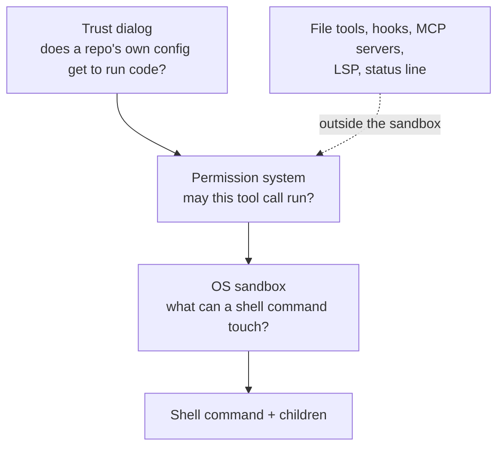

# Sandboxing and Security Model

> You can name which boundary stops which action — the trust dialog, the
> permission system, or the operating system — and say which one you actually
> turned on.

**Type:** Learn
**Prerequisites:** Lesson 113, Channels and Surfaces
**Time:** ~40 minutes

---

## Learning Objectives

- Separate the three boundaries and the action each one actually stops
- Turn on the sandboxed Bash tool and prove a command is inside it
- List what runs *outside* the sandbox, where a permission rule is the only control
- Close the unsandboxed-retry escape hatch and explain when you would
- Protect a credential from a sandboxed command

---

## The Problem

You turned on the sandbox to protect a client repository. You set it to
auto-allow so shell commands stop prompting. It felt airtight.

A build tool failed inside the sandbox — it couldn't reach a host. Claude
analysed the failure, retried the command **unsandboxed**, and the retry ran
with your full access. It worked, the build passed, and nothing in your day
told you the boundary had lifted. The sandbox was real; the escape hatch was
just as real, and it was on by default.

The pain is not that the sandbox is weak. It is that three different things
look like "security" — a trust dialog, a permission prompt, and an OS boundary
— and they stop three different classes of action. Turn on the wrong one and
you have a lock on a door you were not worried about.

---

## The Concept

Claude Code has three boundaries, from outermost to innermost. Each stops a
different thing.



| Boundary | Stops | Enforced by | Still there when nobody watches? |
|---|---|---|---|
| **Workspace trust** | A checked-out repo granting itself code execution | The tool's dialog at launch | Yes — it is a gate, not a prompt |
| **Permission system** | A tool call the model initiates | Rules + prompts, per call | Only if rules or a mode say so; a prompt needs a person |
| **OS sandbox** | Where a shell command can read, write, and connect | The operating system, while the command runs | Yes — that is why it can skip the prompt |

The third one is the new thing here. A permission prompt asks *a person*. The
sandbox asks *the kernel*, which is why a sandboxed command can be auto-approved:
there is a limit behind the approval that a person would not have to enforce.

### What the sandbox covers — and what it doesn't

The sandbox wraps **shell commands**: Bash, PowerShell, and Monitor commands,
plus the processes they start. It does **not** wrap:

- **Built-in file and web tools** — Read, Edit, Write, WebFetch, WebSearch.
  They follow permission rules. A `denyRead` entry does not stop the Read tool.
- **Command hooks, local MCP servers, plugin monitors, LSP servers, the status
  line command, and `apiKeyHelper`** — these run with your full access, outside
  the sandbox.

That list is the whole point of separating the boundaries. If your threat is a
shell command acting on hostile text, the sandbox helps. If your threat is a
hook, the sandbox is irrelevant and the permission/trust layer is the control.

### What the sandbox allows by default

| Access | Default |
|---|---|
| Writes | The working directory, a per-user temp dir, and added directories. [Protected paths](#protected-paths) stay denied |
| Reads | Most of the machine — **including `~/.ssh` and `~/.aws/credentials`** |
| Network | No direct route out; connections go through a proxy whose allowed-domain list starts empty |
| Environment variables | Inherited from Claude Code, including any secrets in it |

Reads being open by default is the part people get wrong. A sandboxed command
can read your credentials unless you deny them.

### Protected paths

Inside a writable directory, the sandbox still denies writes to the files that
configure Claude Code itself: `.claude/` settings, skills, agents, commands,
hooks, `.mcp.json`, shell startup files like `.bashrc`, `.gitconfig`, and the
internals of `.git` (including the shared `.git` of a linked worktree, except
for what `git commit` needs). The logic is circular and important: a command
that can edit the settings could grant itself permissions or add a hook that
runs outside the sandbox. There is no allow rule that lifts this — only turning
filesystem isolation off entirely.

### The escape hatch, and closing it

A command that fails inside the sandbox can be **retried unsandboxed** with the
`dangerouslyDisableSandbox` parameter. Who approves the retry depends on your
permission mode. The retried command runs with your full access.

To close it, set `"allowUnsandboxedCommands": false` — the `/sandbox`
Overrides tab calls this **Strict sandbox mode**. With the retry disabled,
Claude Code ignores the parameter and commands stay sandboxed unless they match
an `excludedCommands` entry.

### Platforms

The sandbox uses the OS: macOS Seatbelt; Linux and WSL2 use `bubblewrap` and
`socat`. **On native Windows, Claude Code runs commands unsandboxed.** To get a
sandbox on a Windows machine, run Claude Code inside a WSL2 distribution. If
you are following this course on Windows, that is the single fact to carry:
your shell commands are not sandboxed unless you are in WSL2.

### Credentials, and locking it down

`sandbox.credentials` declares files and environment variables to protect. A
`deny` entry blocks a read (or unsets a variable); a `mask` entry shows a
sentinel and lets the proxy substitute the real value on allowed hosts. There is
no built-in deny list — only what you list is protected. For deployments that
must not run unsandboxed, `sandbox.failIfUnavailable` makes Claude Code exit at
startup instead of silently running without the sandbox. An administrator can
lock these settings (Lesson 115).

> **The reframe:** the permission prompt asks a person and the sandbox asks the
> operating system — and only one of those is still there when nobody is
> watching.

**A note on versions.** The sandbox is actively evolving; flags, defaults, and
the strict-mode behaviour have changed across releases. Check the
[sandboxing docs](https://code.claude.com/docs/en/sandboxing) and the
[security page](https://code.claude.com/docs/en/security) before relying on a
specific default.

---

## Build It

Run these on a machine that can sandbox (macOS, Linux, or WSL2). If you are on
native Windows, note where the sandbox does not apply, because that observation
is itself the result.

1. **Turn it on and pick a mode.** Run `/sandbox` and open the **Mode** tab.
   Choose auto-allow or regular permissions. Or set it globally in
   `~/.claude/settings.json`:

   ```json
   { "sandbox": { "enabled": true } }
   ```

2. **Prove a command is inside the sandbox.** Ask Claude to run each probe
   (typing them at the `!` prompt yourself runs them *outside*):

   ```bash
   touch ~/sandbox-probe
   curl --noproxy '*' https://example.com
   ```

   The first fails (`Operation not permitted` on macOS, `Read-only file system`
   on Linux/WSL2); the second fails DNS resolution because there is no route
   around the proxy. On native Windows, both succeed — you were never
   sandboxed.

3. **Close the escape hatch.** Set strict sandbox mode:

   ```bash
   claude --settings '{"sandbox": {"enabled": true, "allowUnsandboxedCommands": false}}'
   ```

   Ask Claude to run a command that the sandbox blocks, then ask it to retry
   unsandboxed. It cannot.

4. **Find what lives outside the sandbox.** Ask Claude to read a file with the
   Read tool that a sandboxed shell command cannot reach, and compare the two
   results.
   ✅ You pass when you can point at one action that a sandboxed command was
   blocked from and the file tool was not.

5. **Protect a credential.** Add a deny entry and test it:

   ```json
   {
     "sandbox": {
       "enabled": true,
       "credentials": { "files": [{ "path": "~/.ssh", "mode": "deny" }] }
     }
   }
   ```

   Ask Claude to run `cat ~/.ssh/id_ed25519` in a sandboxed command.

6. **Make it a gate, not a hope.** Set `"failIfUnavailable": true` and start a
   session on a platform where the sandbox cannot run.
   ✅ You pass when the session refuses to start rather than running
   unsandboxed.

---

## Use It

| Thing | When you reach for it |
|---|---|
| `/sandbox` | Turn the sandbox on and choose auto-allow or regular permissions |
| `sandbox.enabled` | Enable it across all your projects in user settings |
| `sandbox.filesystem.allowWrite` / `denyRead` | Grant one path or protect one path |
| `sandbox.network.allowedDomains` | Let sandboxed commands reach specific hosts, nothing else |
| `sandbox.credentials` (`deny`/`mask`) | Protect a key file or environment variable |
| `allowUnsandboxedCommands: false` | Strict mode: forbid the retry that leaves the sandbox |
| `sandbox.failIfUnavailable: true` | A deployment where no sandbox means no run |
| `excludedCommands` | A trusted tool that cannot work inside the sandbox |
| `CLAUDE_CODE_SUBPROCESS_ENV_SCRUB` | Strip secrets from every subprocess, sandboxed or not |
| Permission rules | The control for tools and hooks, which the sandbox does not cover |

---

## Exercises

1. **Draw the three boundaries for one action.**
   Pick a real action — say, an agent editing `.bashrc`. For each of the three
   boundaries, write whether it applies, and what would stop the edit.
   ✅ You pass when at least one boundary is named that does *not* apply, and
   you can say which one does.

2. **Reproduce the escape.**
   With the sandbox on and auto-allow, trigger a command that fails inside it
   and observe the retry path.
   ✅ You pass when you have the log line for the retry and can state which
   permission mode would have prompted you first.

3. **Close it and prove it closed.**
   Turn on strict sandbox mode and repeat Exercise 2.
   ✅ You pass when the command stays blocked and `dangerouslyDisableSandbox`
   has no effect.

4. **Protect the thing you actually have.**
   List the two credential files on your machine that would matter most if a
   sandboxed command read them, then deny both and test one.
   ✅ You pass when the sandboxed read fails and an ordinary Read of your own
   project still works.

5. **State the honest gap.**
   Name one attack your current setup does not stop.
   ✅ You pass when the gap is specific — a hook, an MCP server, or a file tool
   — and you name the boundary that would cover it.

---

## Key Terms

| Term | What people say | What it actually means |
|---|---|---|
| sandbox | "the security model" | An OS-enforced limit on *shell commands only*. Necessary, not sufficient |
| permission prompt | "the security boundary" | A per-call approval, model-initiated. A convenience layer; it asks a person |
| trust dialog | "just a warning" | The gate that stops a checked-out repo running its own code. The actual outer boundary |
| `dangerouslyDisableSandbox` | "a fallback" | The parameter that retries a blocked command *unsandboxed*, with your full access |
| strict sandbox mode | "more sandbox" | `allowUnsandboxedCommands: false` — it removes the escape hatch |
| protected paths | "the allow list" | Config files a running command may not write even inside a writable directory |
| `failIfUnavailable` | "a setting" | When the sandbox can't start, exit instead of silently running unsandboxed |
| filesystem isolation | "the sandbox" | The half that limits read/write; the network half is separate and can stand alone |
| runs outside the sandbox | "safe" | File tools, hooks, MCP servers, LSP, status line, `apiKeyHelper` — governed elsewhere |

---

## What this lesson skipped

**Containers and VMs.** The sandbox limits shell commands on your machine. To
put *everything* — file tools, hooks, MCP, the process itself — behind one
boundary, use a container, VM, or the sandbox runtime. See
[sandbox environments](https://code.claude.com/docs/en/sandbox-environments).

**Network isolation internals.** Proxy variables, TLS termination, and the
`mask`/`injectHosts` mechanics for credential substitution are reference
material in the [sandboxing docs](https://code.claude.com/docs/en/sandboxing).

**Enterprise enforcement.** The managed keys that lock the sandbox so a
developer cannot loosen it are Lesson 115.

**Injection as an attack class.** The threat model for hostile text the model
reads is Lesson 53 (Phase 07); this lesson is about the boundaries that decide
what an action can do once the model decides to take it.
