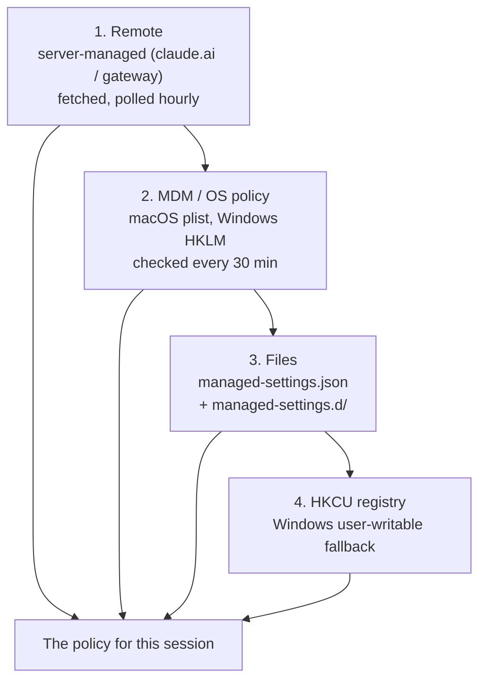

# Managing Settings at Scale

> You can put one policy on every machine and prove it applied — and say which
> source won when two of them disagree.

**Type:** Learn
**Prerequisites:** Lesson 114, Sandboxing and Security Model
**Time:** ~40 minutes

---

## Learning Objectives

- Name the four ways managed settings reach a machine and their rank
- Read `/status` and tell an unapplied policy from an overridden one
- Choose between `first-wins` and `merge`, and predict which source supplies a key
- Recognise the keys that fail closed and why that is deliberate
- Split a policy across files without creating a merge accident

---

## The Problem

You rolled out `managed-settings.json` to the fleet. A developer says the policy
is not applying. You open the file on their machine: it is there, valid JSON,
the right path. You redeploy it. Still nothing.

The file is not the problem. Either a *higher-ranked* source is present and
winning — an MDM profile, or server-managed settings from the admin console —
or the file is real but contains only control keys and no actual policy, so it
does not count as a source at all. Neither failure is visible by looking harder
at the file you deployed.

The pain: managed settings have **their own precedence**, different from the
four-file order you learned in Lesson 34. The fix is to read which source was
selected, not to deploy again.

---

## The Concept

Managed settings sit above every other layer: user, project, and local files
and even the `--settings` flag cannot override them, apart from a small set of
security-sensitive exceptions where a *stricter* lower value still counts.

But "above everything" is only half the story. Managed settings have four
delivery mechanisms that outrank *each other*.



The default behaviour is **`first-wins`**: Claude Code uses the highest-ranked
source that delivers at least one **policy key** and ignores the rest. A
*policy key* is any settings key other than the two control keys
(`managedSourcesBehavior`, `wslInheritsWindowsSettings`). A file containing
only control keys is not a source, and Claude Code moves down the list.

If you want every source to contribute, set
[`managedSourcesBehavior`](https://code.claude.com/docs/en/settings-reference)
to `"merge"` in the highest-ranked source you deploy. Under `"merge"`, lists
combine, locks take the strictest value, and most other keys take the value from
the highest-ranked source that sets them. The user-writable HKCU registry never
merges with another source.

### Where the files live

| OS | Directory | PowerShell / shell |
|---|---|---|
| Windows | `C:\Program Files\ClaudeCode\` | `managed-settings.json`, `managed-settings.d\`, `managed-mcp.json` |
| macOS | `/Library/Application Support/ClaudeCode/` | same file names |
| Linux / WSL | `/etc/claude-code/` | same file names |

The Windows HKCU fallback is a `Settings` value under
`HKCU\SOFTWARE\Policies\ClaudeCode`. The legacy path
`C:\ProgramData\ClaudeCode\managed-settings.json` is **not** read.

### Splitting the file across teams

Rather than one shared file everyone edits, put each team's part in
`managed-settings.d/`. Claude Code merges `managed-settings.json` first, then
every `*.json` in that directory in alphabetical order — so numeric prefixes
set the order:

```
managed-settings.json
managed-settings.d/
├── 10-telemetry.json
└── 20-security.json
```

When two files set the same key: single values are replaced by the later file,
lists are combined (duplicates removed), and nested blocks merge key by key.
Same rule as everywhere else in this course — **arrays merge, scalars are
replaced**.

### Fail closed, or fail open

Managed settings are more forgiving than your own files, in two opposite ways.

- **Invalid JSON refuses to start.** If a managed file, MDM plist, or HKLM
  value is present but cannot be parsed, Claude Code exits with an error naming
  the source rather than running with a partial policy.
- **Individual bad entries are repaired or dropped,** with a warning, instead
  of failing the whole file.
- **Some keys fail closed.** A restrictive single-value key that is present but
  invalid reads as its restrictive value until you fix it, so a broken
  restriction never silently becomes an open gate: `allowManagedPermissionRulesOnly`,
  `disableAutoMode`, and `skipDangerousModePermissionPrompt` all behave this way,
  and `allowedMcpServers` falls back to an empty allowlist that admits no
  user-added servers. A few keys fail open deliberately —
  `requiredMinimumVersion` is dropped rather than enforced when invalid.

This asymmetry is on purpose: a bad list should not silently *grant* access,
but a bad rollout should not brick every machine either.

### Keys only a managed source can set

A handful of keys have no effect in user, project, or local files — they are
read only from a managed source. These are the levers that make a rollout a
rollout, not a suggestion: things like `allowManagedPermissionRulesOnly`,
`managedMcpServers`, `availableModels`, and the sandbox locks from Lesson 114
(such as `sandbox.network.allowManagedDomainsOnly`). The
[settings reference](https://code.claude.com/docs/en/settings-reference) marks
each key's scope.

When a source names you in `/status`, it can also be *computed*: a
[`policyHelper`](https://code.claude.com/docs/en/settings-reference) is an
executable a managed source names, and Claude Code runs it at startup to produce
the `managedSettings` object.

> **The reframe:** a policy is two things — the file on the machine, and the
> rank that lets it win. Deploying harder only ever fixes the first.

**A note on versions.** The managed-settings surface adds keys and
combine-rules regularly — `managedSourcesBehavior`, per-source locking, and
several fail-closed keys are version-gated. Treat the *ranking* in this lesson
as the durable part and check the
[managed settings docs](https://code.claude.com/docs/en/managed-settings)
before depending on a specific key.

---

## Build It

You need administrator rights to write the system directory. If you do not have
them, do steps 1–2 with the `--settings` flag to rehearse and note where the
real mechanism differs.

1. **Deploy a minimal policy.** Create the file at your OS path — on Windows:

   ```json
   {
     "permissions": { "deny": ["Read(./.env)"] },
     "allowManagedPermissionRulesOnly": true
   }
   ```

   Save it as
   `C:\Program Files\ClaudeCode\managed-settings.json` (or the macOS/Linux
   path from the table above). Include at least one **policy** key, not just a
   control key.

2. **Confirm it applied.** Start Claude Code and run `/status`. The
   `Setting sources` line should show
   `Enterprise managed settings (file)`.
   ✅ You pass when that exact label appears.

3. **Break it on purpose — control keys only.** Replace the file with
   `{ "managedSourcesBehavior": "merge" }` and restart. Run `/status` again.
   The managed line should be **missing**, because a control-only file is not a
   policy source.

4. **See a skip.** If you can also add an MDM-style source (a second machine or
   a lab box), do. Otherwise reason it through from the ranking and check for a
   `Skipped sources` line in `/status` on a machine with two sources.
   ✅ You pass when you can say which source was selected and which was skipped.

5. **Split the policy.** Move one team's keys into
   `managed-settings.d/10-telemetry.json` and another's into
   `20-security.json`. Confirm the merged result via `/status` and by testing a
   behaviour each file sets.

6. **Watch a fail-closed key.** Set `allowedMcpServers` to something invalid
   and run `claude doctor`.
   ✅ You pass when the report names the key and the value it fell back to.

---

## Use It

| Thing | When you reach for it |
|---|---|
| `managed-settings.json` | The simplest rollout — one policy file in the OS directory |
| `managed-settings.d/*.json` | Several teams own parts of one policy; numeric prefixes set order |
| Server-managed settings | One place to change policy for a claude.ai org without touching machines |
| MDM / OS policy (plist, HKLM) | You already manage devices with Jamf, Intune, or Group Policy |
| `managedSourcesBehavior: "merge"` | You want every deployed source to contribute, not just the top one |
| `policyHelper` | The policy must be computed at startup, not stored |
| `allowManagedPermissionRulesOnly` | Only the org's permission rules may apply |
| `managedMcpServers` / `sandbox.*` locks | Deliver and lock servers or sandbox boundaries |
| `/status` | Find which managed source was selected, and which were skipped |
| `claude doctor` | Find the entries Claude Code dropped as invalid |

---

## Exercises

1. **Diagnose from the line, not the file.**
   A developer shows you a correct `managed-settings.json` and says the policy
   is not applying. Write the two things you check in `/status`, in order.
   ✅ You pass when your first check distinguishes "no managed source at all"
   from "a higher source won," and your second names the overriding source.

2. **Predict the winner.**
   A machine has an MDM plist, a `managed-settings.json`, and an HKCU value.
   Which supplies the policy under the default, and what changes under
   `"merge"`?
   ✅ You pass when you name the MDM plist for both, and add that HKCU stays out
   of the merge.

3. **Rehearse without admin rights.**
   Simulate a policy for one session using `--settings`, then explain why that
   is *not* managed settings.
   ✅ You pass when you can say which layer `--settings` occupies and which
   source would beat it.

4. **Avoid a merge accident.**
   Plan a policy split across three `managed-settings.d/` files where two files
   set the same list key. Predict the merged list.
   ✅ You pass when your prediction matches the combined, de-duplicated list and
   you name the file order that produced it.

5. **Prove enforcement.**
   Deploy `allowManagedPermissionRulesOnly: true` and try to add an allow rule
   in a project settings file.
   ✅ You pass when the project's allow rule has no effect and you can say which
   layer dropped it.

---

## Key Terms

| Term | What people say | What it actually means |
|---|---|---|
| managed settings | "admin settings.json" | A policy that outranks user, project, local, and `--settings`. Its *own* sources also outrank each other |
| policy key | "any setting" | Any key other than the two control keys. A file with none is not a source |
| `first-wins` | "the default" | The top-ranked source with a policy key supplies the policy; the rest are skipped and named |
| `merge` | "combine them" | An opt-in where every admin source contributes, combined by kind of key |
| fail closed | "a bug" | A restrictive key that is present but invalid reads as its restrictive value, on purpose |
| refuses to start | "it broke" | What happens when a managed source is present but not parseable — a deliberate hard stop |
| `/status` line | "a status readout" | The field that tells you *which* source won and which were skipped |
| `policyHelper` | "a script" | An executable that computes the managed settings at startup |
| scoped key | "a normal setting" | A key read only from a managed source; putting it in your own file does nothing |

---

## What this lesson skipped

**Server-managed settings and gateways.** The claude.ai console path and the
self-hosted gateway deliver the same keys through different infrastructure. See
[server-managed settings](https://code.claude.com/docs/en/server-managed-settings)
and [gateways](https://code.claude.com/docs/en/gateways).

**MDM tooling.** Deployment templates for Jamf, Intune, and Group Policy live
in the [MDM examples repository](https://github.com/anthropics/claude-code/tree/main/examples/mdm);
this lesson covered the ranking, not the packaging.

**The full key list.** There are hundreds of keys with per-source scopes. Read
[all settings](https://code.claude.com/docs/en/settings-reference) when you need
a specific one.

**Compliance configurations.** HIPAA and zero-data-retention setups have their
own documents; they are organisation policy, not the mechanism this lesson
teaches.
