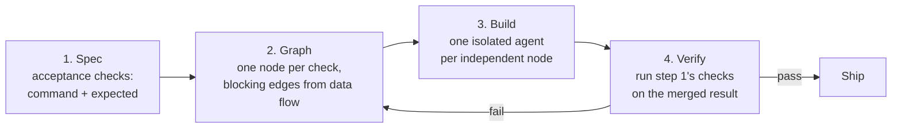
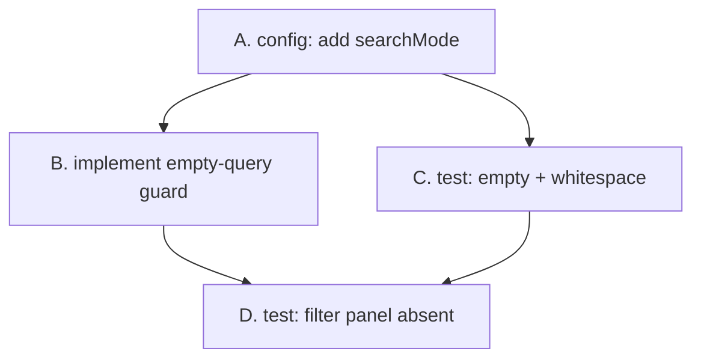
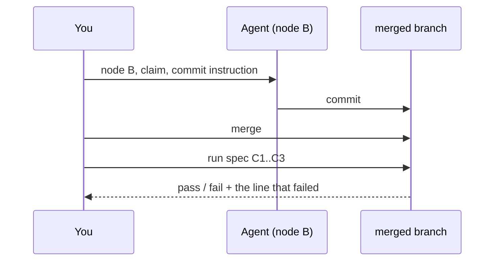

# Spec → Graph → Build → Verify

> You can turn a paragraph of intent into a spec of runnable checks, arrange
> those checks as a task graph, build the independent nodes with isolated agents,
> and prove the result — because the verify step is step one, run again.

**Type:** Build
**Prerequisites:** Lesson 115, Managing Settings at Scale; Lessons 98–105, Graph
Engineering; Lesson 110, Isolation Without a Commit Is Not a Backup
**Time:** ~45 minutes

---

## Learning Objectives

- Write a spec as acceptance checks — each one a command and an expected result —
  before any agent starts
- Turn those checks into a task graph and mark the blocking edges from data flow,
  not from folder layout
- Hand each independent node to one isolated agent, with a claim and a commit
  instruction
- Run the checks from step one against the **merged** result and say exactly what
  a pass proves and what it doesn't

---

## The Problem

You asked for better search. You got better search, plus a filter panel, plus a
rename nobody requested, plus a bug where an empty query returns every row. It
ran. It reviewed clean. It merged. Three weeks later someone asks why typing a
single space dumps the whole table, and there is no line anywhere that says it
shouldn't.

"Iterate on search" is not a task. Every agent that touched it had a different
definition of finished, and all of them were defensible.

Now parallelize that. You split "search work" into three nodes by folder — one
agent per directory — and run them at once. They never touch the same file, so
isolation holds, so nothing collides. The merged branch still fails, because the
thing they shared was a decision: the shape of the options object, the cache key,
the order of the query clauses. Folders are not the graph. The dependencies are.

Two failures, one cause. The request described an outcome with no way to check
it, so "done" was an opinion — and opinions don't compose across agents.

---

## The Concept

Four phases. One loop, and the loop is the point.



### 1. Spec — a list of commands, not a paragraph

A spec entry has a command and an expected result. Nothing else counts.

| # | Check | Command | Expected |
|---|---|---|---|
| C1 | empty query returns nothing | `npm test -- search.empty` | 1 passing |
| C2 | whitespace-only query returns nothing | `npm test -- search.whitespace` | 1 passing |
| C3 | filter panel is not part of this change | `git diff --name-only` | no file under `filters/` |

If you cannot write the command, you do not have a spec. You have a wish, and a
wish is what an agent fills in with its own judgement.

### 2. Graph — the spec, re-ordered

Each check becomes a node. An edge runs from node A to node B when B **needs
something A produces**. That is what a blocking edge is (Lesson 100) — not "B
sounds like it comes later."



The **frontier** is the set of nodes with no unfinished predecessor — the only
things genuinely parallelizable *right now* (Lesson 99). Here that is A alone.
After A, B and C can run at once. D waits for both.

The edges come from shared data: a type, a config key, an interface, a fixture.
If you drew an edge because two files live in the same folder, you drew the wrong
graph — and the parallel run will prove it to you in the merge.

### 3. Build — one agent, one node, one commit

Each node gets an isolated agent in its own worktree (Lesson 74), a **claim** on
that node so no second agent picks it up (Lesson 101), and one standing
instruction:

> Commit your work before you report. An isolated worktree with no commit is not
> a backup — it is a branch pointing at `main` (Lesson 110).

Agents may run in parallel only for nodes on the same frontier. Nodes joined by
an edge run in order, because the edge is a promise B makes about A.

### 4. Verify — the same list, on the whole

Run step one's checks against the merged branch, from a clean checkout, by
someone who did not build it — you, or a verifier agent that has not seen the
diffs. Each node passing on its own branch proves nothing about the combination
(Lesson 95). Verification is a property of the merged whole.



> **The reframe:** the spec is not the text you hand to an agent — it is the set
> of commands you will run at the end, and the graph is those commands arranged
> so that nothing waits longer than it has to.

### What verify can and cannot tell you

A pass proves the behaviours you thought to check. It says nothing about the ones
you didn't. So write the blind spots down in the spec itself, as a section named
"Not covered." "Maybe the model wrote something clever elsewhere" is not a
failure of the method; claiming the method covered it is.

---

## Build It

Do this on your capstone's next real change, small enough to finish in one sitting.

### 1. Write the checks before the code

Put them in `SPEC.md` as a table. Include one check that is **false right now**,
so the spec fails before any work starts.

```bash
# one command runs the whole spec
npm test -- search
```

✅ You pass when the whole spec runs as one command and fails on the current
commit — you can point at the failing check.

### 2. Turn checks into nodes and draw the edges

One node per check. For each pair, ask: *does B need anything A produces?* Write
the answer down; a guessed edge costs a serialized node, a missing edge costs a
merge you cannot explain.

✅ You pass when every node has its predecessors named or explicitly marked
"none", and you can mark the frontier.

### 3. Kill the false frontier before you spawn

For each pair of frontier nodes, ask whether they share a resource: a config key,
an interface, a fixture, a version string, a generated file. Sharing means one of
them comes first, or one of them owns the resource.

✅ You pass when no two nodes you are about to run at once touch the same file
**or** the same decision, and you can name the check you ran to decide that.

### 4. Spawn one agent per frontier node

Give each agent: its node, its inputs, its claim, its worktree, and the commit
instruction. Nothing else. An agent that "might as well also" fix something
adjacent is a node you did not model.

✅ You pass when each agent's branch has at least one commit and
`git branch --contains <sha>` names its branch.

### 5. Merge, then verify the whole

Merge the branches (Lesson 109). Then run the spec from step one against the
merged result, from a clean checkout.

```bash
git worktree list      # every isolated copy, and which branch it holds
git log --oneline --graph --all
npm test -- search
```

✅ You pass when the spec passes on the merged branch, and `git status` is clean
afterwards — a suite that only passes while files are dirty is not a pass.

### 6. Record the gap between spec and result

Write down, in `NOTES.md`, one behaviour the final artifact has that no check
covers, and one check that had to be added after a failure. That list is the
spec's real coverage report.

✅ You pass when `NOTES.md` names both, and you can say which of the two you would
add to the spec first.

---

## Use It

| Concept | When you reach for it |
|---|---|
| Acceptance check | Any request you can't turn into a command yet — that is the work |
| `SPEC.md` as a table | Before the first agent starts, and again after the merge |
| Blocking edge | Whenever two nodes share a decision, not just a file |
| Frontier | The only correct answer to "what can run right now?" |
| Claim | Before spawning, so two agents never do one job |
| Worktree | Any node you want isolated from your working copy |
| Commit instruction | In every agent's prompt. Untracked work is not saved work |
| Verifier on the merged branch | The last step, every time. Part-branches green means nothing |
| "Not covered" section | Whenever the spec is the basis of a claim you'll make out loud |

---

## Exercises

1. Take your capstone's next change and write `SPEC.md` as checks only — no
   prose, no goals, no description. Every row must have a command and an expected
   result, and at least one row must fail today.
   ✅ You pass when one command runs the whole file and the failure it reports is
   the one you predicted, not a different one.

2. Draw the graph for that spec, then find one edge you got from folder layout
   rather than data flow. Remove it or justify it.
   ✅ You pass when you can name which nodes changed status — parallel to serial,
   or the reverse — and what would have broken if you'd kept the wrong edge.

3. Run two frontier nodes in parallel with two agents, merge them, and verify on
   the merged branch.
   ✅ You pass when both branches contain a commit, the merge is clean, and the
   spec passes on the merged result rather than only on the individual branches.

4. Deliberately break one check on the merged branch, confirm the spec catches it,
   then fix it.
   ✅ You pass when you can show the check failing and then passing on the same
   commit history, and you know which node's work was affected.

---

## Key Terms

| Term | What people say | What it actually means |
|---|---|---|
| spec | "the requirements" | A list of checks, each a command with an expected result. Prose is not a spec. |
| acceptance check | "a test" | One command whose exit tells you whether one behaviour holds. The unit a spec is made of. |
| task graph | "the plan" | Nodes (checks to satisfy) joined by edges (what needs what). A plan without edges is a list. |
| blocking edge | "A comes before B" | B genuinely needs an output of A. Remove it and B cannot be checked. |
| frontier | "what's parallel" | Nodes with no unfinished predecessor. Everything else is waiting, by design. |
| claim | "assigning the ticket" | A written marker that one agent owns one node, so two don't do one job. |
| verify | "running the tests" | Re-running step one's checks against the **merged** result, not per branch. |
| false frontier | "parallel but slow" | Two nodes that share a decision, drawn as independent. Isolated files, colliding meaning. |
| "Not covered" | "known issues" | The behaviours your spec doesn't check. Naming them is part of the spec, not an apology. |

---

## What this lesson skipped

**Mechanism choice.** *How* to spawn — subagent, teammate, workflow, `/batch` —
is Lesson 84's decision framework, not this lesson's. This lesson assumes the
graph is right and one agent per node is the right shape.

**Conflict mechanics.** When two branches touch the same line, the resolution is
Phase 02, Lesson 15, and the strategy is Lesson 109. Here we treat a conflict as
a signal that an edge was missing, which is true roughly as often as it is wrong.

**Verification loops for unattended runs.** Lesson 95 builds the loop that
retries and escalates without you. This lesson's verify step assumes a human
decides what a failure means.

**Cost.** Fan-out costs money per node (Phase 03, Lesson 11). The graph says what
*can* run at once; it doesn't say what is worth running at once. That judgement
is Lesson 85.
