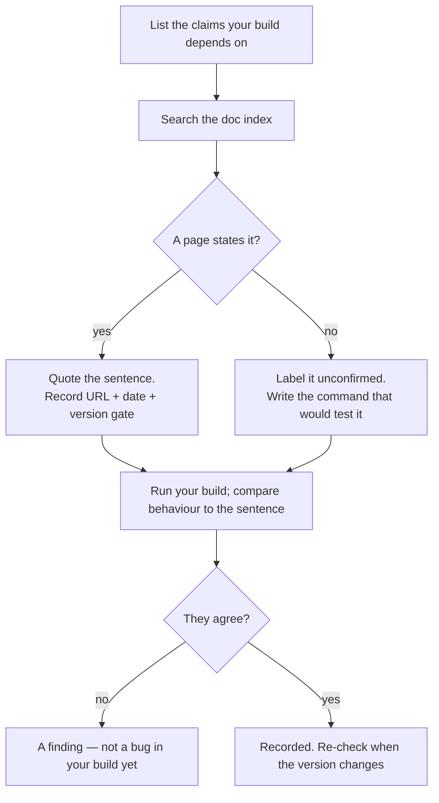

# Review Against the Docs

> You can point at a dated URL for every capability your build depends on, label
> the ones you only ever saw once, and say which claims a future release would
> invalidate.

**Type:** Learn
**Prerequisites:** Lesson 116, Spec → Graph → Build → Verify; Lesson 20, Model
Aliases and Routing
**Time:** ~30 minutes

---

## Learning Objectives

- List every external claim your build makes — flags, commands, settings keys,
  event names, frontmatter fields, env vars
- Look each one up in the doc index and record four things: URL, date, version,
  and state
- Sort claims into documented, version-gated, unconfirmed, and contradicted —
  and treat "unconfirmed" as a real label, not a failure
- Tell a source from a summary, and cite the source

---

## The Problem

This repo's history contains two confident false claims, and both came from the
same move: an agent asserting a capability without opening the page.

One said a syntax accepted a `[ref]` address. It isn't in the docs. It was stated
as fact; it was a remembered guess. The other said workers survive closing a
session tab — they don't; the transport is a per-session socket and a dead session
receives nothing. That one reached the learner before it was caught, and the
learner repeated it to someone else.

Neither failure was dramatic. That is what makes the shape dangerous. A wrong
claim doesn't crash — it just becomes something you build on, and then something
you teach, and then something you defend in a code review because it has worked
so far.

Your capstone is that risk at scale. It depends on maybe forty small external
facts, and you learned most of them from a summary: a blog post, a changelog
snippet, an agent's explanation, or one session where it happened to work. The
review step is where you find out which ones you can still point at.

---

## The Concept

A claim about the harness is in exactly one of four states. The docs decide which.

| State | What it means | What you do |
|---|---|---|
| **Documented** | You have the page, and you can quote the sentence | Cite URL + the date you checked |
| **Version-gated** | Documented, but only from some version | Cite URL + date + *your* version |
| **Unconfirmed** | You observed it; no page says it | Say "unconfirmed" out loud, and write how you'd test it |
| **Contradicted** | A page says otherwise | This is the valuable one. Your build is wrong, or your version is older than the page |



### The index is the map, the page is the source

`https://code.claude.com/docs/llms.txt` is a machine-readable index of every doc
page — titles and URLs, no content. It answers "does a page about this exist?"
in one fetch, which is the question you actually have most of the time.

The page it points to is the source. A blog post *about* the page is a summary,
and summaries carry a version you can't see. The changelog
(`https://code.claude.com/docs/en/changelog.md`) is where a change becomes dated.

### One page per claim, and the claim is narrow

"A hook can run a command" is documented and stable. "`SessionStart` receives a
`source` field with these three values" is documented **and** version-gated **and**
surface-tier — the kind of sentence that is true this release and quietly different
the next.

Review works because the claims are narrow. A wide claim ("hooks exist") is
almost always documented, which makes it useless for finding the one narrow thing
you got wrong.

### Aliases, never versions

Lesson 20's rule is a review rule too. `sonnet` is a capability; a dated model ID
is a version. Write the alias in your notes; if you must record a version,
record it as a version, next to the date, in a place you will look again.

Verified against the pages linked above on **2026-10-15**. URLs and version gates
age; the habit does not.

> **The reframe:** a review against the docs is not "does my code match my notes"
> — it is "which of the sentences my build depends on can I still point at, and
> which am I simply remembering."

### What this review is not

It is not a security review, not a style review, and not a test of whether the
feature is a good idea. It answers one question: **is what I rely on still true,
and can I show it?** Everything else has its own phase.

---

## Build It

Do this on your capstone, after Lesson 116's verifier passes. The verifier proves
the behaviour you asked for; this proves the facts you asked for it *with*.

### 1. Harvest the claims

Grep your build for every external name. Each hit is a claim.

```bash
# settings keys, hooks, MCP entries, plugin components
grep -rn "hooks\|settings\|mcpServers\|frontmatter" .claude .mcp.json 2>/dev/null | head -50
```

Then add the ones that don't appear in a file: flags you typed from memory, the
name of an event, the spelling of a field.

✅ You pass when you have a list, not a feeling — and it is longer than you
expected.

### 2. Look each one up in the index

Fetch `https://code.claude.com/docs/llms.txt`. For each claim, find the page or
record that no page matched. Two columns, filled honestly.

✅ You pass when every claim has either a URL or an explicit "no page found".

### 3. Record the four fields

Build the table in a file, not in your head — `REVIEW.md` next to your build:

| Claim | Where I got it | URL | Checked | State | My version |
|---|---|---|---|---|---|
| session workers survive a closed tab | conversation | — | 2026-10-15 | contradicted | — |
| `SessionStart` fires at session start | docs | `…/en/hooks.md` | 2026-10-15 | documented | — |

```bash
claude --version
```

✅ You pass when every row has a state, and the state is one of the four words —
no "probably" and no blank.

### 4. Run the build and compare behaviour to the sentence

This is the step people skip. The doc says X; your build does Y; one of them is
authority. If a claim is contradicted, decide whether it is your bug or your
version — the changelog will usually say.

✅ You pass when at least one claim was checked against real output rather than
against your memory of how it behaved.

### 5. Write the leftovers down

For every unconfirmed claim, write the command that would settle it. That sentence
is the difference between "unconfirmed" and "I don't know and I don't care."

✅ You pass when each unconfirmed row ends with a runnable test, and you have run
at least one of them.

---

## Use It

| Thing | When you reach for it |
|---|---|
| `llms.txt` index | First move for any "does this exist?" question |
| The page, not the summary | Whenever you are about to write the claim into a doc or a config |
| Changelog | When your behaviour and the page disagree — it dates the change |
| Glossary | When you and a teammate mean different things by one word |
| `claude --version` | Next to every version-gated claim, every time |
| "Unconfirmed" | For anything you observed but can't cite. Say it out loud |
| Alias over ID | In every note you expect to read again |
| The date you checked | Beside every URL. A citation without a date is a memory |
| The narrow claim | When a review finds nothing — your claims are too big to be wrong |

---

## Exercises

1. List ten external claims your capstone relies on, and resolve each one against
   the doc index.
   ✅ You pass when every claim carries a state and a URL, and at least one is not
   "documented" — a list of ten green rows usually means you picked ten easy
   claims.

2. Find one claim you have repeated to another person that the docs do not
   support.
   ✅ You pass when you can quote the sentence you said, say what the docs say, and
   name who you'd have to correct. If you find none, look at claims about
   *concurrency* — that is where the last two in this repo hid.

3. Take one version-gated claim and find the changelog entry that introduced or
   changed it.
   ✅ You pass when you can give the version and the date, and say whether your
   installed version is before or after it.

4. Replace every hardcoded model version in your build with an alias.
   ✅ You pass when `grep` for a dated model ID returns nothing, and the build still
   runs.

---

## Key Terms

| Term | What people say | What it actually means |
|---|---|---|
| documented | "it's in the docs" | You can quote the sentence on a page you linked, and you checked today. |
| version-gated | "it works on my machine" | Documented, but only from some version. Useless without your version beside it. |
| unconfirmed | "I've seen it work" | Observed, uncited. A legitimate state — as long as it's labelled and has a test attached. |
| contradicted | "the docs are wrong" | The page disagrees with you. The page is usually right; check your version before arguing. |
| source vs summary | "I read an article" | A doc page is the source. Anything that quotes a version you can't see is a summary. |
| the index | "the docs site" | `llms.txt` — titles and URLs only. Answers "does a page exist" without a search. |
| dated claim | "I linked it" | URL + date + version. Any two of the three is a memory. |
| narrow claim | "hooks work" | A claim small enough to be wrong. Wide claims are always true and never useful. |

---

## What this lesson skipped

**Filing a docs bug.** If a page is wrong, the changelog and the docs issue
tracker are where it goes. Out of scope here — this lesson is about not building
on it first.

**Deprecation policy.** How long a deprecated flag keeps working is a product
decision that changes; the changelog dates each deprecation when it happens.

**Semantic version ranges in plugins.** `^1.2` and what a plugin update does to a
pin is Phase 09's plugin-dependencies page, not this lesson.

**The Agent SDK's version story.** A different surface with a different cadence
(Lesson 112). Come back when you ship an SDK-based runner.
