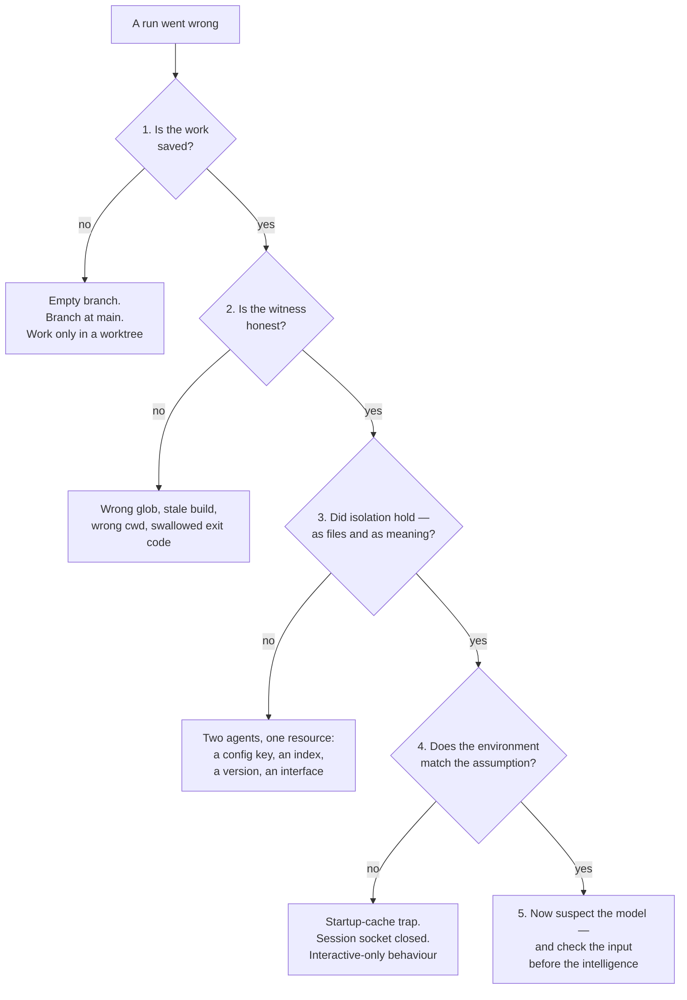

# What Breaks in Production

> You can name the five ways an unattended parallel run fails, check them in
> cheapest-cause-first order, and stop reaching for "the model was wrong" until
> everything cheaper has been ruled out.

**Type:** Learn
**Prerequisites:** Lesson 117, Review Against the Docs; Lesson 104, Failure
Propagation; Lesson 110, Isolation Without a Commit Is Not a Backup
**Time:** ~35 minutes

---

## Learning Objectives

- Name the five failure classes an unattended run fails into, and which one is
  the model
- Run a triage in cheapest-cause-first order and stop before blaming an agent
- Force four of these failures on purpose and record the observable signal each
  one leaves
- Write a preflight that turns two of them from failures into something that
  can't happen

---

## The Problem

A parallel run finished. Four agents reported success. Three of the four branches
pointed at `main`.

Nothing was lost only because the worktrees hadn't been cleaned up yet — the work
was still sitting in working trees that no branch referenced. The agents had done
everything except the one thing that makes work real: commit. Isolation is not a
backup (Lesson 110), and cleanup does not ask whether you were finished (Lesson 75).

Same repo, different week. A run came back with a red suite, so the agents took
the blame — the fanciest-looking change must be the culprit. The actual cause was
a wrong glob in `package.json`: the test command pointed one directory wide. Every
agent's work was fine. The *witness* was lying, and nobody checked the witness
because blaming an agent is more satisfying than reading a config line.

Two failures with the same lesson underneath: the model was not the broken part
either time. It almost never is.

---

## The Concept

Unattended runs fail in five classes. Exactly one of them is "the model
misbehaved," and it is the last one you check — because it is the most expensive
to check and the least likely to be true.



### 1. The transaction boundary — work that was never saved

A change in a working tree is not saved. It is *present*. `git status` will show
it until a `clean`, a reset, or a worktree cleanup removes it without ceremony.

The tell is a branch that exists and points at `main`, or a `git log` with fewer
commits than agents you spawned. The cheapest check in the whole lesson:

```bash
git branch --contains <sha>     # names the branch holding this commit, or nothing
git worktree list               # every isolated copy, and the branch it holds
```

If an agent's transcript says "committed" and the sha is on no branch, the answer
is almost never "it lied." It is "the commit went into a worktree whose branch you
never merged, and the branch still says `main`."

### 2. The witness — the thing reporting on the work

Your verifier is a system, and systems lie in ordinary ways: a glob that matches
one directory wide, a build artifact from before the change, a command run from
the wrong cwd, a pipeline where a failure exits 0 because something swallowed the
code. The red suite that "proved" the agents failed was this class.

The rule: **check the witness before the work.** Run the suite on the *last known
good* commit. If it is red there too, the agents are exonerated in one command.

### 3. Isolation — files are separated, meaning is not

Two worktrees cannot touch each other's files. They can absolutely both bump the
same version string, both add an entry to the same index array, both rename the
same exported function, or both assume opposite shapes for the same interface.
Each branch is green; the merge is red.

Worktrees solve the file problem. The graph's blocking edges solve the meaning
problem (Lessons 100, 101, 104) — and only if the edges came from data flow. Two
nodes that "look independent" because they live in different folders are the
false frontier from Lesson 116, and their failure arrives after the merge, when
it is most expensive to unpick.

### 4. The environment — where the harness and reality disagree

Two documented shapes, both invisible until they bite:

- **The startup-cache trap.** The harness establishes things about its working
  directory once, at launch. Create a git repository *after* the session starts
  and worktree tools refuse with "not in a git repository" while `git rev-parse`
  cheerfully prints a path. The fix is to restart in an existing repo — the
  session cannot learn about a repo that appeared beneath it (Lesson 108).
- **A session-scoped transport.** Cross-session messaging belongs to a session;
  a closed session receives nothing. A worker that "should have been told" was
  told, to a socket nobody was reading. This repo asserted the opposite once and
  was wrong. The default is: the session is the lifetime.

Anything a step assumes about its environment — a branch that exists, a file
another node wrote, a TTY, a credential in the shell — is this class, and it fails
as "nothing happened," which is the quietest failure there is.

### 5. The model — last, and not alone

By the time you get here you have ruled out four cheaper causes, and the remaining
possibility is still two things: the model, and **what the model was given**. A
confident wrong answer from a well-fed agent is rare. A confident wrong answer
from an agent handed a stale CLAUDE.md, a truncated file read, or a task with no
acceptance check is routine — and that is a harness problem wearing the model's
face.

### The order is the lesson

Cheapest first, and most-likely first, which here happen to agree. "Is it saved?"
costs one command. "Is the witness honest?" costs one run. Suspicion of the model
costs a transcript read and probably a re-run. Doing them out of order is how a
five-minute problem becomes a day of re-running agents that were right.

### Retries hide the first failure

An unattended loop that retries will produce a green run after a red one, and the
green one is not a pass. It is a pass **plus an unexplained earlier failure**. Until
you can name what changed between the two, you have a flaky system, not a fixed
one — and Lesson 95's verification loops are where that gets designed properly.

> **The reframe:** in production the model is the last suspect, not the first —
> what breaks is the seam between two systems, and no seam belongs to either side.

---

## Build It

You cannot debug a failure mode you have never seen. Force four of them.

### 1. Seed the empty branch

In a scratch repo, spawn or write a change in a worktree, then remove it without
merging. Then run the two commands above.

✅ You pass when you can show a worktree whose work is reachable from no branch,
and you know which command would have caught it *before* the cleanup.

### 2. Break the witness

Make the suite pass on code you know is broken. Change a test glob, or edit a
source file without rebuilding, or put a `|| true` in a pipeline.

```bash
# run the suite on the last known good commit
git stash list
git log --oneline -3
```

✅ You pass when the suite reports green on broken code, and you can point at the
single line that made it lie.

### 3. Seed a semantic collision

Give two parallel nodes a shared resource — the same config key, the same index
array, the same exported name. Let both pass on their own branch. Merge.

✅ You pass when the merged branch fails while both branches pass, and you can name
the resource they shared in one sentence.

### 4. Leave the environment stale

Start a session in a plain directory, create a repository inside it, and try a
worktree operation. Record the exact message.

✅ You pass when you have the message, and can say which single action — taken
*before* the session started — would have avoided it.

### 5. Write the runbook

Turn the five classes into a triage sheet: symptom, first check, the command,
what a pass looks like. Two rows must be a **preflight** — things you run before
spawning, so the failure cannot occur at all.

✅ You pass when every row has a runnable command, and at least two rows are
preflight rather than triage.

### 6. Have someone else use it

Hand the runbook to a person (or a fresh agent session) who did not write it, seed
one failure at random, and watch.

✅ You pass when they resolve it without asking you a question, and you can name
the row that did the work.

---

## Use It

| Thing | When you reach for it |
|---|---|
| `git branch --contains <sha>` | First command after any "the agent says it finished" |
| `git worktree list` | Before cleanup. Every isolated copy, every branch |
| Known-good commit | Run the witness there before blaming anyone |
| `git log --oneline --graph --all` | When the shape of history doesn't match the number of agents |
| Blocking edges | The fix for a semantic collision — after the fact, add the edge you skipped |
| Startup-cache trap | Any "not in a git repository" that contradicts `git rev-parse` |
| Session-scoped transport | Any message a closed session "should have received" |
| Unchanged re-run | Treat as unresolved until you can name what differed |
| Preflight | Two rows of the runbook that stop failures happening instead of explaining them |

---

## Exercises

1. Take a parallel run of yours — any size — and run the four triage checks in
   order against its last red result. Write down which class it was.
   ✅ You pass when you can name the class, the command that revealed it, and the
   command that *would not* have revealed it.

2. Reproduce the empty-branch failure in a scratch repo, then write the one-line
   preflight that makes it impossible.
   ✅ You pass when the failure is reproducible on demand and the preflight is a
   command, not a rule you remember.

3. Break your verifier so it passes on broken code, then fix it, keeping the evidence
   of both states.
   ✅ You pass when you can show the same commit passing and failing under two
   different verifier configurations, and you can say which one you trust.

4. Re-run a previously-failed unattended job. If it now passes, write down what
   changed — or state plainly that you cannot, and treat the pass as unresolved.
   ✅ You pass when the outcome is one of "named the change" or "flagged as
   unexplained," and not "it works now."

---

## Key Terms

| Term | What people say | What it actually means |
|---|---|---|
| empty branch | "the agent didn't do anything" | A branch that exists and points at `main` while the work sits uncommitted in a worktree. |
| the witness | "the test suite" | Whatever reports on the work. Check it on known-good code first — it lies in mundane ways. |
| transaction boundary | "it's saved" | A working tree is not a commit. Until it's committed, cleanup can and will remove it. |
| semantic collision | "they were in different folders" | Two nodes that share a resource (key, index, name, interface) while sharing no file. Green apart, red merged. |
| startup-cache trap | "it says not a git repository" | The harness probed the working directory once, at launch. A repo created later is invisible to it. |
| session-scoped transport | "the worker should have got the message" | Cross-session messaging lives and dies with the session. A closed session receives nothing. |
| retry masking | "it's green now" | A pass after a failure with no explanation for the difference. Unresolved, not fixed. |
| preflight | "running the tests first" | A check that runs before the work starts, turning a failure class into something that cannot happen. |

---

## What this lesson skipped

**Cost and rate limits.** A fan-out that dies at call forty is a capacity problem,
not a correctness one — Lesson 11 for the shape, Lesson 81 for the runtime caps.

**Security.** Sandbox escapes and prompt injection are their own failure class and
their own lesson (Lesson 114); this lesson assumes the permission boundary held.

**Fleet and organizational failure.** Settings drift across machines, plugin
policy, central telemetry — Lesson 115. Everything here happens on one machine,
inside one run.

**Designing the verification loop itself.** Retries, escalation, and what
"unresolved" does to a run is Lesson 95. This lesson is what to check when that
loop has already given you an answer you don't trust.
