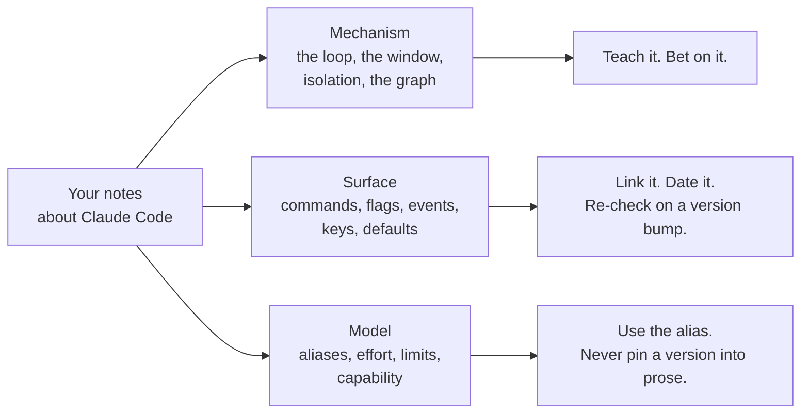

# Keeping Up — Claude Code Ships Weekly

> You can sort your own notes into the part that won't change and the part that
> will, put a date and a URL on the second kind, and let a version bump tell you
> what to re-read instead of a feed.

**Type:** Learn
**Prerequisites:** Lesson 118, What Breaks in Production; Lesson 20, Model
Aliases and Routing; Lesson 56, All 32 Events
**Time:** ~30 minutes

---

## Learning Objectives

- Sort a claim about Claude Code into surface, mechanism, or model — by how fast
  it decays
- Keep a claims ledger with a URL, a date, and a version on every entry that can
  drift
- Build a `SessionStart` hook that prints the version at the top of every session
- Re-check the surface tier on a trigger, not on a habit of reading everything

---

## The Problem

This course once stated a `[ref]` addressing syntax as documented fact. It isn't
in the docs. Nobody was harmed — the sentence was just wrong, and it would have
failed for whichever reader tried it first. The agent had used the syntax before,
remembered it, and said it.

The same shape costs more elsewhere. Write a model ID into a config because it
worked in March, and by autumn `sonnet` points somewhere else while your file
still names the old thing — valid, current, and no longer what you chose. Nothing
errors. Your setup just quietly stopped being the setup you think you have.

Two failure surfaces, one cause: **notes with no date on them.** You cannot tell
a sentence that is still true from one that was true when you wrote it, so you
either re-read everything or trust everything. Both are expensive.

---

## The Concept

Every claim you hold about Claude Code sits in one of three tiers. They decay at
wildly different rates, and that difference is the whole method.



| Tier | Examples | Decay | What you do with it |
|---|---|---|---|
| **Mechanism** | The agentic loop, the context window, compaction, isolation, nodes and edges | Effectively never | Teach it, build on it. These are why the course is 119 lessons and not a changelog |
| **Surface** | Slash commands, CLI flags, hook event names, settings keys, defaults, file locations | Weeks | Link the page, write the date, re-check on a version change |
| **Model** | Model aliases, effort levels, context limits, capability per task | Every release | Use the alias; if you must name a version, name it as a version |

The tiers exist so that a release changes your *checklist* and not your
*understanding*. When a flag moves, you have one page to re-read. When the loop is
still the loop, the twentieth lesson you wrote about it is still true.

### One index, one log, one definition

- **The index** — `https://code.claude.com/docs/llms.txt`. Titles and URLs for
  every page. Answers "does a page exist" without a search engine.
- **The log** — `https://code.claude.com/docs/en/changelog.md`. Where a change
  becomes dated and attributed to a version.
- **The definitions** — `https://code.claude.com/docs/en/glossary.md`. One word,
  one meaning, so your notes and the docs agree on what a term is.

### The ledger

Surface claims go in a file — `DRIFT.md` — with four columns. Not in your head,
where they cannot be recounted.

| Claim | Source | Checked | Version |
|---|---|---|---|
| `SessionStart` fires when a session starts | `…/en/hooks.md` | 2026-10-15 | — |
| the settings key for a hook matcher is spelled this way | `…/en/hooks.md` | 2026-10-15 | — |

The column that matters is **Version**. A row with a version and no version bump
since is a fact. A row whose version is older than yours is a question.

### The trigger, not the feed

Reading every release note is a job, and it is not your job. Instead:

- re-check the **surface** rows whose component you actually use — your hooks, your
  plugin, your settings keys — when the version changes;
- read the changelog filtered by those components, not end to end;
- re-check **unconfirmed** rows from Lesson 117 whenever the version changes at all,
  because they were never on solid ground to begin with.

A ledger turns "keep up with Claude Code" from an ambient anxiety into a diff with
two sides.

Verified against the pages linked above on **2026-10-15**. Page URLs, flags and
version gates age; the three-tier split does not.

> **The reframe:** keeping up is not reading every release note — it is knowing
> which of your sentences are about the harness and which are about a version,
> and only the second kind ever needs re-checking.

---

## Build It

### 1. Sort ten of your own claims

Take the claims you harvested in Lesson 117. Label each one mechanism, surface, or
model.

✅ You pass when the mechanism rows outnumber the surface rows, and you can say why
that ratio is the reason this course exists.

### 2. Start the ledger

Create `DRIFT.md` with the four columns. One row per surface claim.

✅ You pass when every surface row has a URL **and** a date, and no row says
"somewhere in the docs."

### 3. Print the version at the top of every session

A `SessionStart` hook that runs a command and injects its output turns the trigger
into something you cannot miss.

```json
{
  "hooks": {
    "SessionStart": [
      {
        "hooks": [
          { "type": "command", "command": "echo \"claude $(claude --version) — surface claims due for re-check\"" }
        ]
      }
    ]
  }
}
```

Confirm the event name, the matcher, and the settings key against
`https://code.claude.com/docs/en/hooks.md` before you trust that block — hook
config is surface tier, which is this lesson's entire point. Lesson 57 has the
script shape; Lesson 34 has the settings file that wins.

✅ You pass when a new session prints your line, and you can say which settings
file you put it in and why that one won.

### 4. Find the version bump

```bash
claude --version
```

Check it against the changelog. Find one entry — any entry — that touches
something in your ledger.

✅ You pass when you can name the component, the version, and the ledger row it
invalidates or confirms.

### 5. Alias the models

Replace any dated model ID in your config or notes with the alias.

✅ You pass when `grep` for a dated ID in your build returns nothing, and the build
still runs.

### 6. Set the re-check trigger

Write, in `DRIFT.md`, the one thing that starts a re-check: a version change, a
failed preflight, or the changelog mentioning a component you use. Not a calendar
reminder to "read the notes."

✅ You pass when the trigger is a condition you can evaluate in one command, not an
intention.

---

## Use It

| Thing | When you reach for it |
|---|---|
| `llms.txt` index | "Does a page about this exist?" — the first move, always |
| Changelog | When behaviour and the page disagree, or a version just changed |
| Glossary | When two people are using one word three ways |
| `claude --version` | Beside every surface claim, in the ledger and at session start |
| Mechanism tier | Anything you are about to teach someone else |
| Surface tier | Anything you are about to type into a config |
| Model tier | Anything with a name that could route somewhere else next month |
| Alias over ID | Every note, every config, every lesson |
| The version column | The single column that tells you which rows are now questions |
| Re-check trigger | When a version changes — not when you remember |

---

## Exercises

1. Write a short how-to for a teammate that involves one Claude Code command. Make
   it survive the next release.
   ✅ You pass when a reader with a newer version can recover the correct command
   from your link alone, without asking you.

2. Take a claim that lives only in your head — a flag, an event name, a field — and
   resolve it against the docs today.
   ✅ You pass when it has a state (from Lesson 117) and a row in `DRIFT.md`, or you
   have removed it from your build.

3. Add the `SessionStart` version line, then update Claude Code and start a session.
   ✅ You pass when the printed version changes and your ledger's surface rows are
   now visibly older than the session you are sitting in.

4. Find one lesson in this course, or one note of your own, that is now wrong. Fix
   it in place and date the fix.
   ✅ You pass when the corrected text carries the date and the page you checked,
   so the next reader knows how old it is.

---

## Key Terms

| Term | What people say | What it actually means |
|---|---|---|
| mechanism | "the concepts" | Part of the harness that doesn't decay: the loop, the window, isolation, the graph. Bet on these. |
| surface | "the syntax" | Commands, flags, events, keys, defaults. True this release; re-check on a version bump. |
| model tier | "which model" | Aliases, effort, limits, capability. Route by alias; a version in prose is a claim with an expiry date. |
| claims ledger | "my notes" | `DRIFT.md`: claim, source, date checked, version. The version column is what makes it usable. |
| version gate | "it needs a newer version" | A behaviour that only exists from some version on. Useless without your version beside it. |
| alias | "the model name" | `sonnet`, `opus` — a route, not a version. What you write when you want it to keep working. |
| trigger | "staying up to date" | A condition you can test in one command that starts a re-check. Not a resolution to read more. |
| drift | "the docs changed" | Your note silently stopped being true. Nothing errored, which is what makes it expensive. |

---

## What this lesson skipped

**Deprecation windows.** How long a deprecated flag keeps working is a product
decision; the changelog dates each one when it happens. Read it there rather than
trusting a number in this lesson.

**Plugin dependency ranges.** `^1.2`, and what an update does to a pin, is a
Phase 09 concern — the plugin dependencies page.

**The Agent SDK's cadence.** A separate surface with its own versioning
(Lesson 112). Come back to it when you ship an SDK-based runner.

**Enterprise release channels.** Managed settings can hold a fleet on a version
(Lesson 115). One machine does not need a rollout plan; a team does.
